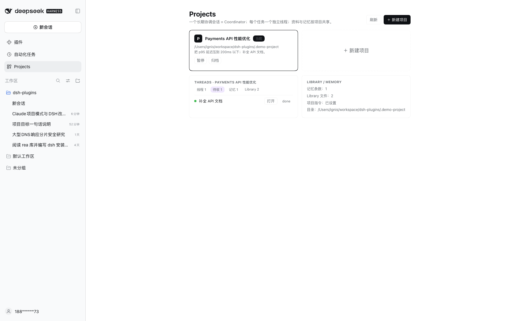

# DSH Projects

Claude Projects-style **multi-project coordinator + threads + library + project memory** for [DeepSeek Harness](https://github.com/deepseek-ai/deepseek-harness) (DSH).

一个长期协调会话（Coordinator）负责和你对话、把任务派给独立线程；每个线程有自己的 Session 与 **git worktree/branch**，完成后向协调者汇报。项目级记忆与资料库（Library）在所有线程间共享。



## Features

- **Multi-project** — registry, create/switch/pause/archive/delete, per-project memory/library/threads.
- **Coordinator** — long-lived per-project session; policy prompt teaches it to dispatch threads, review status, resolve, and maintain memory.
- **Threads** — top-level sessions created through `ctx.sessionController`; spawn/list/send/stop/resolve/report/propose tools.
- **Isolation** — every thread runs in its own `git worktree` + branch (`thread/<id>-<slug>`); `project_thread_diff` shows its changes.
- **Project memory** — `MEMORY.md` index + typed facts, injected into the system prompt; `memory_write/search/list/read`; per-project scopes.
- **Library** — folders, upload (snapshot), move, read/list; host tools + workbench UI.
- **Lifecycle** — attention counts (waiting/review/failed), 7-day auto-resolve, watcher on `turn/end`.
- **Live state** — `GET /dsh-projects/events` SSE + client workbench.

## Requirements

- DSH `0.2.1-rc.2` (Web profile composition)
- Node.js >= 22.19
- pnpm 11
- git (optional; enables per-thread worktrees)

## Install

```sh
git clone https://github.com/ChengliangCao/dsh-projects
cd dsh-projects

# point these at your local DSH runtime if not auto-detected
export DSH_BIN="/Applications/DeepSeek Harness.app/Contents/Resources/runtime/cli/bin/dsh"
export NODE_BIN="$(command -v node)"
export PNPM_BIN="$(command -v pnpm)"

./scripts/install.sh
```

Installer creates a DSH profile (default `projects`) from the web template, a sample project at `~/.dsh/projects-ui/hello-project`, packs and installs the bundle.

Start:

```sh
"$DSH_BIN" --profile projects --no-open --port 61990
```

Open the printed token URL. Then:

1. Sidebar → **Projects** → create/switch projects; project directories must already exist (absolute path).
2. Enter the project conversation and ask the Coordinator to spawn a thread, e.g. *"开一个线程：只读分析 src/queries.sql，产出 findings.md，完成后汇报"*.
3. Use **Threads** for status/review/resolve; **Library** for documents; **Projects** for project home.

## Repository layout

```
bundle/                 DSH bundle (host plugins + web client)
  lib/projects.js       multi-project registry, HTTP/SSE routes
  lib/project-tools.js  coordinator/thread/library tools, coordinator route
  lib/memory.js         project memory injection + memory tools
  lib/client.js         Projects / Threads / Library UI, custom sidebar
  cordis.patch.yml      bundle patch (installer replaces __PROJECTS_HOME__)
scripts/install.sh      clean-profile installer
scripts/pack.sh         source release tarball
examples/hello-project  sample project created by installer
docs/                   design, decision records, release plan
prototype/              clickable UI prototype + screenshots
```

## Known limitations

- Conversation inline thread cards (`View thread` / `Sent to a thread`) are **not implemented**; thread cards are not rendered inside chat.
- Native right-sidebar tabs (Threads/Library/Scheduled) are **not available**: the client exposes no tab-registration API; the same tabs live in the in-page workbench.
- Project conversation sessions still appear in DSH's native session storage; the custom sidebar hides them from **Recents**, but other consumers may still see them.
- Navigation between sessions uses `localStorage["dsh.sessions.current"]` + full reload (no internal router API).
- Scheduled project tasks and token usage/limits are placeholders.
- Worktree merge/cleanup UI is manual (`git worktree list/remove`).
- Single-user, loopback web profile only; no mobile layout.

## License

Apache-2.0. Copyright Ignis. See `LICENSE` and `NOTICE`.
