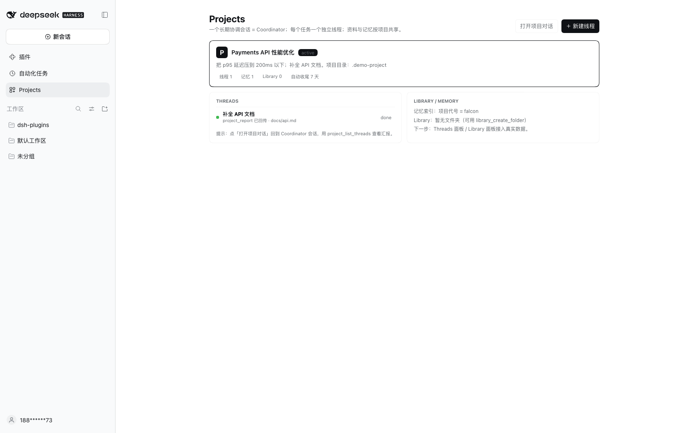

# DSH Projects · Preview 0.1（可体验版）

> 状态：**正在运行**（2026-10-23）｜独立 profile：`projects`（web 模板）｜不影响你的 desktop GUI / 当前 61863 会话
> 访问地址（一次性 token，打开后写入 cookie）：

**http://127.0.0.1:61990/?token=1HtHbA8WVD413YZ61D6VQUOeF94sohoviU8AIb49pRA**

如果 token 失效（服务重启会变），告诉我重启并给新链接。

---

## 1. 这是什么（以及不是什么）

这是「先做出来给你体验」的 **Preview 0.1**：用最小可运行 bundle 验证 **Coordinator + Threads + 项目记忆** 的核心闭环，UI 沿用 DSH 原生界面（**还没有** Projects 首页 / Threads 侧栏 / Library 文件夹面板——那些是下一轮按你反馈再做）。

已实现：

| 能力 | 说明 |
|---|---|
| **Project = 固定 demo 项目** | `/Users/ignis/workspace/dsh-plugins/.demo-project`（Payments API 示例，含 README/docs/src） |
| **Coordinator 工具** | `project_spawn_thread` / `project_list_threads` / `project_send_thread` / `project_stop_thread` / `project_resolve_thread` / `project_report` |
| **Thread = 顶层 Session** | 用 `ctx.sessionController.create + prompt` 创建；有自己的上下文与工作目录；出现在侧栏会话列表（`.demo-project` 工作区） |
| **线程汇报回协调者** | 线程完成后调用 `project_report`，写入 `.demo-project/.dsh/threads.json` 并把汇报投给协调者会话 |
| **项目记忆** | `memory_write` / `memory_search` / `memory_list` / `memory_read`；`MEMORY.md` 索引自动注入系统提示（跨会话/跨线程共享） |
| **按 git repo 派生 scope** | demo 项目内已有 `.git`；同 repo 的会话共享记忆 |

已知限制（Preview 正常现象，不是 bug）：

1. **没有 Projects 页面/Threads 面板/Library 文件夹 UI**：线程就是普通会话，出现在左侧 Workspace 分组里；状态用 `project_list_threads` 查看。
2. **单项目固定**：记忆与线程注册表都绑定 `.demo-project`；暂不支持在 UI 里切换项目。
3. **线程提问必须在线程里回答**：这是 Claude 同款边界；协调者转发「go ahead」不会替线程回答。
4. **状态不是实时投影**：threads.json 在 spawn/send/stop/resolve/report 时更新，界面不会自动刷新列表。
5. **模型不一定主动调工具**：可以明确说「调用 project_spawn_thread …」「调用 memory_write …」。

---

## 2. 建议体验流程

打开链接 → 点「继续」→ 直接在输入框发消息。

### ① 记忆（跨会话）
```
调用 memory_write：name='项目代号', description='项目代号是 falcon', type='project', content='项目代号是 falcon'
```
然后 **新建一个会话**，问：
```
项目代号是什么？用 injected 的项目记忆索引回答，不要调用工具
```
→ 应回答 **falcon**（`MEMORY.md` 已注入系统提示）。

### ② 派线程 + 线程内提问
```
调用 project_spawn_thread：title='补全 API 文档'，brief='阅读 .demo-project/docs/api.md，补全接口说明；不确定的接口约定先问我；完成后调用 project_report 汇报'
```
- 返回 `thread-...`，左侧出现新会话（工作区 `.demo-project`）；
- 打开该线程：**当前已有一条测试线程正在等你回答**「接口约定以什么为准？」——直接在线程里回答，它会继续并调用 `project_report`；
- 回到协调者会话问「线程状态？」→ `project_list_threads` 显示 `done` + `lastReport`。

### ③ 管理线程
```
调用 project_list_threads
调用 project_send_thread：id='thread-...'，message='按 Stripe 风格起草，标注为提案'
调用 project_stop_thread：id='thread-...'
调用 project_resolve_thread：id='thread-...'，reason='完成'
```

### 当前 demo 里已有的测试数据

- 协调者会话：`session-aafd3528-...`（你在浏览器里打开的那个）
- 线程：`thread-bb1ab84c-daf9-4220-9a1c-ed3559fd26b1`（**正在等你回答接口约定问题**）
- 项目记忆：`项目代号 = falcon`
- 线程注册表：`.demo-project/.dsh/threads.json`

---

## 3. 技术结构（这一版）

```
profile:      ~/.dsh/profiles/projects/         # 从 web 模板创建，独立于 desktop
bundle:       spike/app-bundle/                 # 安装为 link 依赖
  ├── lib/memory.js                  # 记忆注入 + memory_* 工具
  ├── lib/memory-store.js            # 核心（索引/预算/scope/原子写/锁）
  ├── lib/project-tools.js           # coordinator/thread 工具 + threads.json
  └── cordis.patch.yml               # 插入 app-memory / app-project-tools 两行
demo project: .demo-project/                    # git 仓库 + README/docs/src
memory:       .demo-project/.memory/scopes/<hash>/MEMORY.md
threads:      .demo-project/.dsh/threads.json
server:       dsh --profile projects --no-open --port 61990
```

停止/重启：
```sh
# 停止：告诉我，或找到该后台任务 kill
# 重启（token 会变化，需要新链接）
"/Applications/DeepSeek Harness.app/Contents/Resources/runtime/cli/bin/dsh" \
  --profile projects --no-open --port 61990
```

你的 **desktop profile / 61863 当前 GUI 完全没被改动**；体验完毕可删 `~/.dsh/profiles/projects` 与 `.demo-project`（测试数据），或保留继续迭代。

---

## 4. 下一轮（按你反馈决定优先级）

1. **Projects 首页 + Threads 侧栏面板**（真实 UI，替换现在的「线程=普通会话」）；
2. **Library 文件夹 UI**（上传/新建文件夹/移动/拖拽 + 线程只读）；
3. **多项目**：Project domain + 切换 + 每个项目独立记忆/线程/资料；
4. **实时状态投影**：Threads 面板自动刷新（running/waiting/done）；
5. **Coordinator preset**：把路由/汇报纪律固化到 preset，而不是靠用户提示词。

体验后告诉我：哪些地方最不顺手、最想要先补哪一块，我按反馈继续。

---

## 5. M1 追加工具（2026-10-23 晚，服务器已重启）

新版 bundle 额外提供：

| 工具 | 作用 |
|---|---|
| `project_info` | 读取项目标题/目标/项目指令 |
| `project_set_instructions` | 更新项目指令；**下一轮请求起**注入所有会话/线程的系统提示 |
| `library_list` | 列 Library 根目录或指定文件夹（folders/files） |
| `library_create_folder` | 新建文件夹（支持 parent） |
| `library_add_file` | 把项目内文件**快照拷贝**进 Library（可指定 folder/name） |
| `library_move` | 在 Library 内移动文件到另一个文件夹 |
| `library_read` | 读取 Library 文本文件（≤20KB） |

另修复：`project_report` 相同 summary 不再重复投递给协调者（去重）。

可以这样试：

```
调用 project_info
调用 project_set_instructions：instructions='所有线程先给方案；不要直接改代码；完成后 project_report 汇报。'
调用 library_create_folder：name='合同原件'
调用 library_add_file：from='docs/api.md'，folder='合同原件'
调用 library_list：folder='合同原件'
调用 library_move：name='api.md'，fromFolder='合同原件'，toFolder=''
调用 library_list
```

注意：Library 目前只有 Host 工具与磁盘目录（`.demo-project/library/`），**还没有可视化 Library 面板**；Projects 首页 / Threads 面板在 M2。

> 2026-10-23 晚（已修复）：Projects 客户端 UI 已显示。原因是本地 `link:` 包不被 Client module loader 发现；改为 `pnpm pack` + tarball 安装后生效。当前 Projects 页面数据是 **demo 快照**（THREADS/MEMORY 行），下一步接 `.dsh/threads.json` 与 `library/` 真实数据。


