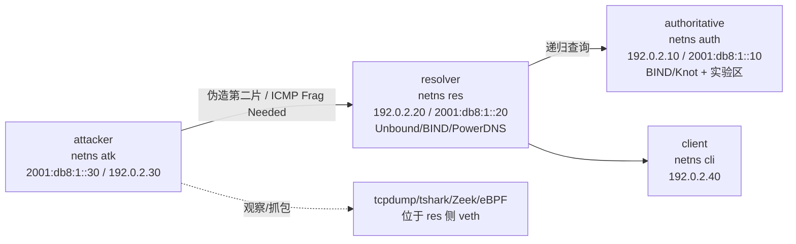

# DNS 大响应与 IP 分片处理弱点：防御性研究的文献综述、实验方法与发表可行性评估

> **交付对象**：提出"DNS 大响应需要分片时，分片处理是否暴露弱点"这一构想的研究者
> **核心问题**：① 这个点能否形成可发表成果？② 现今研究是否已经"越过"这些障碍（工具/方法能否复用、旧命题是否已被做掉）？
> **完成时间**：2026-10-22（Asia/Shanghai）｜**检索截止**：2026-10-22
> **证据等级**：`[已核]` = 通过 RFC 原文 / Crossref / OpenAlex / Semantic Scholar / NVD / USENIX 官方页 / 论文 PDF 核实；`[待核实]` = 仅见摘要/题录/二手引用。所有关键事实附 DOI/URL，见文末参考文献。
> **安全边界**：本报告是防御性研究综述与方法设计。实验方案一律限定在**隔离环境**（Linux VM / network namespace、RFC 5737 与 RFC 3849 文档地址、无默认路由、egress DROP）；不提供、也不应实施任何针对真实解析器、权威服务器或第三方网络的攻击步骤。若研究过程中发现真实产品漏洞，应走厂商/CERT 的协调披露流程。

---

## 0. 结论摘要（先看这一页）

### 0.1 一句话结论

**"DNS 大响应需要分片时可能暴露分片处理弱点"作为一个'发现'已经不可发表**——它是 1987 年以来被反复研究的经典脆弱性，2013 年已有系统性的分片 DNS 缓存投毒工作，2020–2021 年推进到 DNS forwarder 与 DNS-over-TCP，2025 年已有 USENIX Security 论文把"大响应第二片操纵 RRSIG"用于真实攻击，同年 PowerDNS Recursor 还出了对应 CVE。**但把它收窄为"测量 / 检测 / 缓解评估 / 可复现工件"中的一类增量工作，是明确可以发表的**；2024–2026 年后量子（PQ）DNSSEC 导致的响应尺寸膨胀，恰好为这个老问题提供了新的、真实的研究窗口。

### 0.2 分档判断（Q1：能否发表）

| 贡献类型 | 现实档位 | 判断与关键门槛 |
|---|---|---|
| (a) 新的"分片+DNS"攻击 | **不建议**（顶会极低 / 二线低） | 2013 投毒、2020 forwarder、2021 DoTCP、2025 RUC 与 CVE-2025-59024 已占位；且与你的防御目标冲突，伦理与披露成本高 |
| (b) 测量研究（现代解析器/中间盒/双栈/PQ） | **中—高**：PAM / TMA / IFIP Networking / ANRW 稳；IMC 需规模与新维度 | 需要跨实现、跨网络、IPv4+IPv6、可复现；只测 6 台本地解析器只能到 workshop/短文 |
| (c) 检测方法（DNS 语义感知 + eBPF/IDS） | **中—高**：DSN / CNS / ANRW / 中文期刊 | 必须跨过 **POPS（USENIX Sec 2025）** 与 **Iavich et al.（Future Internet 2025/26）** 两道门槛；卖点应是"DNS 语义 + 对抗性规避 + 误报/性能评估" |
| (d) 缓解评估（RFC 8900→RFC 9715 的量化权衡） | **中**：TMA / PAM / ANRW / 中文期刊 | 不能写成 RFC 摘抄或配置手册，要给出"防御收益 vs 正常解析代价"的决策矩阵 |
| (e) 可复现测试床/工件 | **高（最现实的最小可发表版本）**：ANRW / TMA / DSN artifact / 中文系统类期刊 | 需要真实被复用证据、文档、CI；可与 (b)(c) 打包成 artifact |

### 0.3 Q2：现今研究是否已经"越过"这些障碍？

要分两层回答：

1. **技术障碍已经被越过，而且可复用性很高。** 诱导大 DNS 响应不需要攻击工具：EDNS(0) 缓冲区协商 + 大 RRset/多 TXT + DNSSEC 大签名（今天的后量子签名更大）即可；精确制造分片只需在 Linux network namespace 里调小 veth MTU；安全建模伪造分片用 Scapy + 隔离 netns 即可完成。测量可复用 RIPE Atlas / DNS-OARC DITL / OpenINTEL；检测可复用 Zeek / Suricata / eBPF 生态。**换句话说，"不会做实验"不再是障碍。**
2. **新颖性障碍没有自动被越过，反而被 2021–2026 的工作抬高了。** 旧命题被 RFC 8900（BCP 230，2020）、PAM 2021、ICDCS/ANRW 2021、USENIX Sec 2020/2025、RFC 9715（2025）与真实 CVE 反复覆盖。**今天的"越过"只能发生在新的维度上**：后量子 DNSSEC 大响应、IPv6/双栈中间盒、RFC 9715 发布后的遵从度、DNS 语义感知的运行时检测、可复现测试床。

### 0.4 五条必须知道的 2025–2026 新事实（它们改变了赛题）

1. **RFC 9715（2025-01，Informational）** "IP Fragmentation Avoidance in DNS over UDP" 已发布：建议 UDP 响应方限制尺寸（推荐上限 1400 字节）、丢弃分片 DNS 响应、必要时 TCP 回退 `[4]`。注意它**不是 BCP**，"再提一个'应避免分片'"没有发表价值。
2. **USENIX Security 2025 的 RUC 论文**（"Your Shield is My Sword"）在真实攻击链中使用了**"操纵大 DNS 响应第二片中的 RRSIG"**：攻击者只需预测 16 位 IPID（而非 32 位的端口+TXID 组合），并可用伪造 ICMP Fragmentation Needed 压低权威服务器 MTU `[33]`。这正是你最担心的"第二片"路径的攻击侧先例。
3. **USENIX Security 2025 的 POPS** 明确宣称能检出 Suricata/Snort 漏掉的 **fragmentation attacks**，并用 DNS TC 标志做缓解 `[34]`。检测方向的直接竞品已经存在。
4. **CVE-2025-59024**：PowerDNS Recursor "Crafted delegations or IP fragments can poison cached delegations"（CVSS 3.1 = 6.5，CWE-345；受影响 ≤5.1.7/5.2.5/5.3.0，修复 5.1.8/5.2.6/5.3.1）`[40]`。**2025 年真实产品仍在因 IP 分片被攻破**，问题没有"被解决"。
5. **后量子 DNSSEC（2024–2026）让大响应重新变成常态**：QBF（QNAME 级分片）、ARRF（请求驱动的记录分片）、混合签名 + UDP 分片的 IMC 2026 测试床，以及 ICC 2024 的"分片误关联（mis-association）威胁"防护工作 `[46][47][48][49][50]`。**这是 2024–2026 最确定的新窗口，也是本报告最推荐的主线。**

### 0.5 三条推荐路径（详见 §5）

- **P1（主线，6–9 个月）：后量子 DNSSEC 大响应 × 双栈/中间盒测量。** 以"PQ 签名让大响应从例外变常态"为 motivation，量化现代解析器在"分片 vs 截断 vs DoTCP 回退"之间的路径选择、成功率和时延代价。最小可发表版：TMA/PAM/ANRW/IFIP Networking 短文；升级：IMC。
- **P2（工程向，4–6 个月）：DNS 语义感知的分片检测器 + 开源工件。** 在递归解析器侧用 eBPF/XDP 关联 IP 分片状态与 DNS 事务语义（第二片/尾片、RRSIG 结构、TC 回退），做对抗性规避评估与误报/吞吐开销；对标 POPS、Iavich、FragEva6、Suricata/Zeek。最小可发表版：ANRW 短文 + artifact；升级：DSN。
- **P3（中文快速通道，2–3 个月）：中文综述/测量短文。** 面向通信学报/计算机研究与发展/网络与信息安全学报/信息安全学报（等级以 CCF 中文目录为准，本报告不写分区/影响因子）。

### 0.6 本报告的结构

§1 问题重述与技术背景 → §2 文献综述（截至 2026-10）→ §3 新颖性/空白分析与选题 → §4 受控实验方法论（诱导大响应、安全伪造分片、检测评估）→ §5 发表策略与 12 周计划 → §6 结论 → 附录（关键事实速查、证据等级、参考文献）。团队的分主题详细笔记见 `notes/lit-classic.md`、`notes/lit-recent.md`、`notes/lab-methods.md`、`notes/novelty-venues.md`。

---

## 1. 问题重述与技术背景

### 1.1 把原始构想精确化

你的原始表述"分片不可靠，因此大 DNS 响应可能需要研究分片处理弱点"包含三个不同、可分别检验的命题：

| 命题 | 内容 | 可检验性 | 现状 |
|---|---|---|---|
| **P-1（机制）** | DNS 响应超过路径 MTU 时会被 IP 分片；分片在真实网络中会丢、会乱序、会被中间盒丢弃或错误重组 | 高（测量） | 已被 PAM 2021、TNSM 2024、TMA 2026 等大量测量 |
| **P-2（安全）** | 分片后的 DNS 响应可被攻击者利用（第二片注入、IPID 预测、重叠分片、分片缓存耗尽）实现缓存投毒/DoS/IDS 规避 | 高（攻击模型） | 2013 起被系统研究，2025 年仍有新攻击与 CVE |
| **P-3（防御）** | 可以设计检测/缓解机制，并量化其收益与代价 | 中—高（系统工程+测量） | 有 POPS/DNS-Sensor/Iavich 等，但"DNS 语义感知 + 规避评估 + 数据面性能"仍有空间 |

**关键：P-1、P-2 已经不能单独作为论文贡献，P-3 才是可发表空间。** 你的目标（检测与缓解）实际上已经把你放在了最可行的 (c)(d)(e) 三类；需要做的是把命题从"分片是否危险"改写为"在什么新条件下危险、如何检测、缓解代价多少"。

### 1.2 DNS 大响应从哪来

DNS 最初把 UDP 响应限制在 512 字节，超出则置 TC 位让客户端改用 TCP `[1]`。EDNS(0) 允许客户端声明更大的 UDP 接收缓冲区（常见 1232、1400、4096 字节）`[2]`，使大响应可以直接走 UDP，也使其在超过路径 MTU 时被 IP 分片。今天导致大响应的主要因素：

- **多记录 RRset**：多 A/AAAA、多 NS、多 MX、长 TXT（单个 character-string ≤255 字节，但可多条）等；
- **DNSSEC**：DNSKEY/RRSIG/NSEC/NSEC3 使 NXDOMAIN 与 DNSKEY 响应轻松超过 1500 字节；RUC 论文实测大量 DNSSEC 签名区的 DNSKEY RRSIG 偏移已超过最小 MTU `[33]`；
- **后量子签名（PQ）**：NIST PQC 签名（如 ML-DSA/Falcon/SPHINCS+）比 ECDSA-256 大一个数量级，几乎所有方案都超出 1232 字节 UDP 负载限制，这是 2024–2026 的活跃工程问题 `[46][47][48][51]`；
- **配置/协议原因**：长 CNAME 链、referral、`minimal-responses` 未开启、权威服务器忽略客户端 EDNS 缓冲区而返回大响应 `[4]`；
- **攻击者诱导**：伪造 ICMP Fragmentation Needed 让权威服务器以为路径 MTU 很小，从而把响应切成更小的片 `[22][23][33][39]`。

**尺寸证据**：PAM 2021 测得 .nl 权威服务器 99.99% 的响应小于 1232 字节，Google Public DNS 报告 99.7% 的流量小于 1232 字节；截断比例约 2.93%–7.15% `[24]`。TNSM 2024 用 2527 个 RIPE Atlas 探针、1400 万+ 次测量发现：10 个公共解析器中有 3 个仍通告非常大的 EDNS(0) 缓冲区（潜在导致分片），且面对权威大响应时解析器常常**不回退 TCP** `[30]`。IMC 2026 的 "Taming DNS Responses" 进一步把"响应尺寸"本身作为测量对象 `[32]`。

> **对实验的启示**：想稳定触发分片，最可控的做法不是指望公网，而是在实验室同时控制三件事：① 权威区产生 >MTU 的响应；② 路径/接口 MTU 足够小；③ 客户端 EDNS 缓冲区足够大（否则会先 TC→TCP）。详见 §4。

### 1.3 分片如何发生，以及为什么"不可靠"

**IPv4/IPv6 机制差异**：IPv4 由路由器或源主机按 MTU 分片（DF 位控制）；IPv6 只允许源主机分片，路由器遇到过大包回 ICMPv6 Packet Too Big `[8]`。IPv6 的分片信息在 Fragment 扩展头中，首片含 UDP 头，后续片没有；IPv6 最小 MTU 为 1280 字节。分片的公共字段是 Identification（IPv4 16 位；IPv6 32 位）、Fragment Offset、MF/More 位；同一数据报的所有分片共享 ID，重组靠五元组 + ID `[5][8][19]`。

**"不可靠"的来源**（RFC 8900 / BCP 230 有系统总结 `[3]`）：
- 中间盒丢分片、NAT 状态不一致、负载均衡按分片散列导致分片走不同路径；
- PMTUD 黑洞（ICMP 被过滤）导致大包被静默丢弃；
- 分片 ID 可预测/碰撞导致的错误关联（mis-association），高数据率下 IPv4 16 位 ID 会复用 `[5][6]`；
- 攻击者可以伪造"需要分片"的 ICMP 让发送方切小片，或直接注入后续片 `[22][23][33][39]`。

**测量证据**：PAM 2021 的主动测量发现 IPv4 下约 **4.4% 的查询在网络上发生分片** `[24]`；TMA 2026 对 2007–2025 年一条 transit link 的纵向测量发现 IPv4 分片并未消失（占流量字节/包数的 0.03%–1.48%），**UDP/DNS 是分片最多的服务，占全部 UDP/DNS IPv4 流量字节的 18.62%**，并且超过 44% 在 120 秒内复用 IPID 的主机不符合 RFC 6864（存在误关联风险）`[31]`。这两个数字表明：**"分片很罕见所以不重要"是不成立的**，尤其对 DNS 而言。

### 1.4 威胁模型分类

| 维度 | 选项 | 说明/代表工作 |
|---|---|---|
| 攻击者位置 | on-path（可观察/修改） | 可截断、改写分片；IDS 规避类研究 `[17][55]` |
| | off-path（盲攻击） | 需预测 IPID（2¹⁶）而非端口+TXID（2³²）；伪造第二片 `[18][21][33]` |
| | 恶意权威/委托域 | 通过长 CNAME/大记录强制分片，或控制域名构造大响应 `[21][33]` |
| 目标 | 解析器缓存完整性 | 分片投毒、分片误关联 `[18][20][21][33][48]` |
| | 可用性 | 分片重组拥塞/缓存耗尽 DoS `[35][39][43]` |
| | 检测/过滤设备 | 分片重叠/分片头绕过 IDS/IPS `[17][55]` |
| 利用原语 | 第二片伪造（second-fragment injection） | 首片含 UDP/DNS 头，尾片携带伪造 RR；只需匹配 IPID `[18][21][33]` |
| | 重叠分片/分片顺序操纵 | 不同 OS/中间盒重组策略差异，导致解析不一致 `[17][19]` |
| | 分片缓存/重组表耗尽 | FragmentSmack（CVE-2018-5391）、FRAGJAM `[39]` |
| | PMTUD 操纵 | 伪造 ICMP Frag Needed 压低 MTU，强制分片 `[22][23][33][39]` |
| 缓解假设 | 端口/TXID 随机化、0x20、Cookies | 对第二片注入不构成主要障碍（尾片没有 UDP/DNS 头）`[18][21]` |
| | DNSSEC | 可防缓存投毒，但不防分片 DoS/降级/排障缓存复用型攻击 `[4][33]` |
| | 强制 TCP / EDNS 小缓冲 / 分片过滤 | 有效但存在部署代价与"TCP 也能被分片"的反例 `[25][26][4]` |

> **实验设计的核心含义**：在隔离实验里，你需要能分别构造"on-path 改写"和"off-path 第二片注入"两类场景，并且**必须固定 IPID 生成策略、MTU 与 EDNS 缓冲区**这三组变量，否则结论无法外推（见 §4.6 实验矩阵）。

---

## 2. 文献综述（截至 2026-10）

> 本节按"问题谱系"而不是按年份罗列。每小节先给结论，再给关键工作。完整条目（含每条摘要、与构想的 delta、证据等级）见 `notes/lit-recent.md`（41 篇 + 标准 + 中文线索）与 `notes/lit-classic.md`。

### 2.1 分片脆弱性谱系（1987–2012）：从性能问题到安全问题

- **1987，Kent & Mogul, "Fragmentation Considered Harmful"**：最早系统论证分片对性能与健壮性的危害，是此后所有"避免分片"建议的源头 `[16]`。
- **1995–2001，标准层的分片攻击防御**：RFC 1858（tiny fragment 攻击）与 RFC 3128（TCP 首片过短以绕过过滤）确立了"用分片做 IDS/防火墙规避"的经典范式 `[10][11]`。
- **1997–1998，teardrop / ping of death / IDS 规避**：重叠分片导致重组崩溃或解析不一致；Ptacek & Newsham 1998 系统展示了分片/重叠/小片如何绕过当时的 IDS——这是今天"用分片绕过检测"研究的鼻祖 `[17]`。
- **2011–2014，分片攻击的安全化**：Gilad & Herzberg 的 "Fragmentation Considered Vulnerable"（盲拦截/丢弃分片）`[19]`、Shulman & Waidner 的 "Fragmentation Considered Leaking: Port Inference for DNS Poisoning"（用分片侧信道推断 DNS 端口）`[20]`，把分片从"可靠性问题"变成"可利用的攻击面"。

**小结**：到 2012 年，"分片可以被用来做 IDS 规避、端口推断、资源耗尽"已经是共识；2013 年之后的研究只是把目标换成了 DNS。

### 2.2 DNS 分片攻击主线（2013–2020）

- **Herzberg & Shulman, "Fragmentation Considered Poisonous, or: One-domain-to-rule-them-all.org"（IEEE CNS 2013）** `[18]`：最具标志性的工作。核心论点：**off-path 攻击者可以利用 UDP 大响应引起的 IP 分片，绕开事务 ID/源端口/查询名随机化等挑战-应答防御，向解析器注入伪造记录**。攻击前提是解析器接受分片的 DNS 响应、攻击者能预测或暴力匹配 IPID；防御建议包括正确部署 DNSSEC、避免分片、增加分片熵。**这是你原始构想最直接的"前人工作"：它已经把"大响应 → 分片 → 缓存投毒"讲清楚了。**
- **Hlavacek 2013（RIPE 67）"IP fragmentation attack on DNS"** `[22]`：工程界版本，展示伪造 ICMP Frag Needed 诱导权威服务器产生小分片、再注入后续片的思路；RFC 9715 把它列为参考文献 `[4]`。
- **Brandt et al., CCS 2018, "Domain Validation++ For MitM-Resilient PKI"** `[23]`：把 PMTUD 操纵用于 CA 域名验证场景；RFC 9715 引用它说明"off-path 可干预 PMTUD 使权威产生分片" `[4]`。
- **Zheng et al., USENIX Security 2020, "Poison Over Troubled Forwarders"** `[21]`：把分片投毒扩展到 **DNS forwarder**（家用路由器/企业转发器）。攻击者用长 CNAME 链等强制 forwarder 的上游响应分片，再注入伪造第二片；论文系统比较了 BFrag（forwarder+resolver）、SFrag（用 ICMP 诱导分片后直接向解析器注入第二片，包括针对 DNSSEC 响应的变体）与 SOoB（越界 bailiwick）等路径，并讨论了 0x20 扩展编码、按响应缓存、随机 IPID 等缓解。**补充（经 PDF 内容流恢复核实）**：论文把强制分片明确分为 **PMTU 操纵**与 **DNSSEC-based defragmentation** 两条路径（前者对 forwarder 无效），并点明**第二片不含 DNS/UDP 头与 question section，因此端口/TXID 随机化对它无效**。2021 年 ANRW 论文进一步测量 Alexa Top-100K，发现 393 个域名的权威服务器可被强制对 **TCP 段**做源分片，而 UDP 下不能 `[26]`。**这说明"第二片注入"不是新想法，2018–2020 年已被系统化。**
- **标准与运营侧的回应**：DNS Flag Day 2020 推动 1232 字节 EDNS 缓冲区与"避免分片"的部署实践 `[15]`；RFC 8900（BCP 230）在 2020 年把"IP 分片不可靠"上升为 IETF 共识 `[3]`。

**小结**：2013–2020 年，"大响应 + 分片 + 第二片"这条路在**攻击侧**已被走到 forwarder 与 DNSSEC 变体；你的构想若以"发现分片可被用于注入"为创新点，会被直接判定为重复。

### 2.3 TCP 与 PMTUD：缓解路径本身的风险（2021–2024）

一个常见的直觉是"大响应就强制 TCP，TCP 不分片所以安全"。文献已经推翻了这一直觉：

- **Dai, Shulman, Waidner, ICDCS 2021 poster "Fragmentation Attacks on DNS over TCP"** `[25]`：首次证明 IP 分片攻击同样适用于 DoTCP；对 10 万 Alexa 域名服务器测量发现 454 个域名易受分片攻击，其中 366 个**只在 TCP 下**易受攻击（TCP 可被诱导分片到 <292 字节，比 UDP 的 ≥548 字节更危险）。
- **同组 ANRW 2021 "DNS-over-TCP considered vulnerable"** `[26]`：系统性论证 TCP 不是分片攻击的避风港。
- **PMTUD/ICMP 操纵**：RFC 9715 的安全考虑明确写道，off-path 攻击者可干预 PMTUD 让权威服务器产生分片 `[4]`；2026 年的 FRAGJAM 把伪造 ICMP Frag Needed 做成了对真实 UDP 服务（VPN/视频会议/RADIUS）可复现的 DoS 攻击链 `[39]`。
- **测量侧**：Kosek et al. CCR 2022 测量了响应尺寸增长时代 DNS-over-TCP 的使用与性能 `[27]`；Fukuda et al. NOMS 2022 用主被动结合刻画 DNS 响应尺寸分布 `[28]`。

**小结**："强制 TCP/PMTUD"不是免费的午餐；任何以"缓解措施有效性"为卖点的研究，都必须把这条反例纳入实验设计。

### 2.4 2025–2026：攻击面继续前移

- **RUC / "Your Shield is My Sword"（Zhang et al., USENIX Security 2025）** `[33]`：利用 DNSSEC 排障机制（不强制验证的查询）向解析器缓存注入未验证数据，导致持续性 DNSSEC 验证失败（一次注入可造成 >24 小时解析中断）。**与分片的关系**：论文的 off-path 变体明确使用"DNS 响应分片"，包括两个具体手法——① 操纵大 DNSKEY 响应第二片中的 RRSIG（只需改 RRSIG 尾部的一个 bit）；② 触发大 NXDOMAIN 响应并删除第二片中的 OPT 记录。攻击者只需预测 16 位 IPID；论文正文还引用了"5.1% 的 Tranco 顶级域名权威服务器使用全局递增 IPID"的测量，并指出可通过伪造 ICMP Frag Needed 压低权威服务器 MTU 来强制分片。**评价：这是"大响应第二片"在 2025 年的最强先例，但它的落点是"排障缓存复用的持续性 DoS"，没有研究分片处理本身的检测与缓解，也没有 IPv6 场景。** 这为防御侧留下了缝隙。
- **POPS（Afek, Berger, Bremler-Barr, USENIX Security 2025）** `[34]`：面向 IPS 的 DNS 缓存投毒检测+缓解系统。三条规则中，**Rℓ2 直接针对分片攻击**：检测 offset=0 且 MF=1 的首片，把非首片丢弃；缓解模块用 TC 标志触发 TCP 回退，声称对历史统计型投毒"零误报/漏报"，且能检出 Suricata/Snort 漏掉的 fragmentation attacks。**评价：这是检测方向最直接的竞品。** 其差异化缝隙在于：DNS 语义感知（第二片/尾片 × RRSIG 结构 × TC 回退）、对抗性规避评估、IPv6、后量子大响应、数据面性能。
- **CVE-2025-59024（PowerDNS Recursor，2025-10 披露，NVD 2026-02 发布）** `[40]`：攻击者利用 UDP IP 分片污染缓存的委托信息（CVSS 3.1 6.5，CWE-345；受影响 ≤5.1.7/5.2.5/5.3.0，修复 5.1.8/5.2.6/5.3.1）。同一份 advisory 还包含 CVE-2025-59023（High，伪造委托）。**这是"问题仍未解决"的最强现实证据，也是你做防御研究的最好 motivation 之一。**
- **FRAGJAM（Pan & Rossow, CISPA, 2026）** `[39]`：利用 Linux 的 per-netns IP 重组缓冲区上限，以及"伪造 ICMP Frag Needed 使服务端以人为缩小的 MTU 分片"两个原语，对 VPN、视频会议、RADIUS 等真实 UDP 服务实施 DoS（模拟中影响 Zoom、ExpressVPN），并做了协调披露。**评价：2026 年最新的"伪造分片"实践证据。你的工作必须引用它，且不能声称"首次伪造分片/首次利用 PMTUD"。**
- **其他 2026 竞争叙事**：S&P 2026 "One Char to Rule Them All"（DNS 静默漏洞）`[44]`、NDSS 2026 "CUCKOO DOMAIN"（bailiwick 检查缺陷）`[45]`、CCS 2025 RebirthDay（生日悖论缓存投毒复活）`[38]`、S&P 2024 TuDoor（畸形 DNS 响应预处理漏洞）`[37]`、CCS 2024 KeyTrap（DNSSEC 算法复杂度 DoS）`[36]`、S&P 2024 DNSBomb（大响应脉冲 DoS）`[35]`。它们各自占住了"分片之外"的解析器安全叙事，提醒你：**不要把论文写成"再找一个解析器 bug"。**

### 2.5 2021–2026 的测量研究：基线已经很高

| 工作 | 年份/venue | 数据规模/方法 | 与本课题相关的主要结论 |
|---|---|---|---|
| Moura et al., PAM 2021 `[24]` | 2021 | .nl 权威服务器 + RIPE Atlas 主动测量 | 截断 2.93%–7.15%；99.99% .nl 响应 <1232B；服务器侧分片很少，但**约 4.4% 查询在网络上被分片** |
| Dai et al., ICDCS 2021 poster `[25]` | 2021 | 10 万 Alexa 域名服务器 | DoTCP 分片攻击可行；TCP 比 UDP 可被切得更小 |
| Kosek et al., CCR 2022 `[27]` | 2022 | 1210 万次 DNS 请求，2500 探针 | DoTCP 普遍比 DoUDP 慢；回退行为与响应尺寸相关 |
| Fukuda et al., NOMS 2022 `[28]` | 2022 | 主被动结合 | 响应尺寸分布刻画 |
| Dikshit et al., IFIP Networking 2023 `[29]` / TNSM 2024 `[30]` | 2023/2024 | 1400 万+ 测量，2527 个 RIPE Atlas 探针，10 个公共解析器，IPv4/IPv6 | **3/10 解析器仍通告超大 EDNS buffer；解析器常不回退 TCP**；多数解析器 DoTCP/DoUDP 韧性相近 |
| Aubard et al., TMA 2026 `[31]` | 2026 | 2007–2025 一条 transit link 纵向流量 | IPv4 分片未消失；**UDP/DNS 是最多分片的服务（占 UDP/DNS IPv4 流量字节 18.62%）**；>44% 主机 IPID 复用不符合 RFC 6864 |
| Li et al., IMC 2026 "Taming DNS Responses" `[32]` | 2026 | 响应尺寸及影响的测量 | 响应载荷持续增长，"响应尺寸"本身成为风险中心 |

**小结**：测量侧的门槛已经很高——想发 IMC/PAM/TMA，必须有**新维度**（IPv6、PQ、RFC 9715 前后对比、中间盒）或**新规模**。单纯重复"大响应会分片"只能到 workshop/短文。

### 2.6 后量子 DNSSEC：2024–2026 重新点燃"大响应→分片"

这是本报告认为**最重要**的新窗口：

- **QBF（Rawat & Jhanwar, SPACE 2024）** `[46]`：常规网络中 >1232 字节的 DNS(SEC) 消息要么被 IP 分片、要么需 TCP 重传；而 IP 分片不可靠、相当比例服务器不支持 TCP。QBF 在 **DNS 层**用标准记录把大后量子 DNS(SEC) 消息分片/重组，仅 1 个 RTT，并证明 Falcon-512/Dilithium-2/SPHINCS+ 下解析 A 查询的性能与现网 ECDSA-P256/RSA-2048 相当。
- **ARRF（Goertzen & Stebila, LNCS 2023）** `[47]`：另一条"请求驱动的资源记录分片"路线，用于在 UDP 上承载后量子 DNSSEC 大响应。
- **Raavi, Wuthier, Chang, ICC 2024** `[48]`：明确指出"先前研究提出的分片 DNSSEC 消息使 DNSSEC 暴露于 **Fragmentation Mis-Association（分片误关联）威胁**"，并给出防护。**这是"后量子大响应分片的安全防御"最接近你构想的已发表工作**，必须逐段读，找它没做的部分（例如 IPv6、PMTUD、运行时检测）。
- **McGowan, Liu, Ruj, WWW 2025 Companion** `[49]`：发现 ARRF 存在**内存耗尽漏洞**并给出低开销修复。说明"分片方案自身可被 DoS"已不是新发现，但该文是协议修补，不做检测器。
- **Heikamp et al., IMC 2026 poster** `[50]`：为商用 DNS 软件实现"混合签名（经典+PQC）+ UDP 分片"并搭建真实测试床，**开源软件与测试床**。这是 2026 年"后量子大响应必须分片"进入真实部署评估的标志。
- **系统综述**：Iavich, Lopata, Bagalishvili, Mathematics 2026 `[51]` 按 PRISMA 综述 2020–2025 年 27 篇工作，指出所有 NIST PQC 签名都超出 1232 字节 UDP 限制、现有提案无一同时解决传输约束/密码敏捷/DoS 韧性/运营部署/标准化五维问题。**写 related work 必引。**
- **反向证据**：Rawat & Jhanwar, ASIACCS 2025 `[52]` 的"无签名后量子 DNSSEC"路线若成熟，会削弱"PQ 必然导致大响应"的论据；严谨的论文应提及。

**小结（选题含义）**：后量子是 2024–2026 唯一"确定会继续变大"的响应尺寸驱动力。围绕它的**测量**（分片发生率/回退代价/双栈差异）与**运行时检测**仍有空间，但竞争激烈、抢发风险高，建议尽快用 arXiv 预印本占位。

### 2.7 检测与缓解现状

**缓解（标准与工程）**：

- RFC 8900 / BCP 230（2020）：系统论证分片脆弱性，建议避免依赖分片 `[3]`。
- DNS Flag Day 2020：推动 EDNS 缓冲区 1232 字节与"避免分片"部署 `[15]`。
- **RFC 9715（2025-01，Informational）** `[4]`：给出 R1–R11 建议，关键包括：UDP 响应方不使用 IPv6 分片（R1）、配置 DF/PMTUD 防止发送分片（R2）、响应尺寸取 min(客户端缓冲区, 接口 MTU, 网络 MTU, **推荐上限 1400 字节**)（R3）；UDP 请求方限制缓冲区（R5）、**丢弃分片的 DNS/UDP 响应（R6）**、最终尝试替代传输（R7）；DNS 运营方减少 NS/A/AAAA 数量、开启 minimal-responses、优先小签名算法（R8–R11）。安全考虑中明确：分片 DNS 的熵很低（端口与 DNS ID 各 16 位，且都在首片），因此"避免分片"兼具韧性与真实性收益 `[4]`。
- 其他缓解：DNS Cookies `[14]`、源端口/TXID 随机化、0x20 编码（对第二片帮助有限）、分片过滤（RFC 1858/3128 `[10][11]`）、TCP 回退、DNSSEC。
- **实现现实**：RFC 9715 是 Informational 而非 BCP，且 R6"丢弃分片响应"会误伤合法的大响应（PAM 2021 的 4.4% 分片率、TMA 2026 的 DNS 分片占比说明这不是小数目）。**"丢弃分片的收益与代价"本身就是一个可量化的研究问题。**

**检测（现状）**：

- **POPS（USENIX Sec 2025）** `[34]`：IPS 模块，规则化检测统计投毒 + 分片；用 TC 标志缓解；与 Suricata/Snort 对比更快、更少包，且能检出后两者漏掉的分片攻击。
- **DNS-Sensor（Sensors 2025）** `[54]`：分布式传感器持续扫描缓存并与权威数据比对，检测缓存投毒（把 fragmentation 列为诱因）。
- **Iavich et al., Future Internet 2025/26** `[53]`：确定性、规则化、可解释的**通用** IP 分片异常检测框架（offset 对齐、TTL 一致性、payload 规律性；合成数据集 + CIC-IDS-2017；受控集准确率 99.23%）。**但不 DNS-aware。**
- **FragEva6（LCN 2024）** `[55]`：IPv6 分片头绕过安全设备的系统评估（17 款 OS + 4 款安全系统），说明"分片即规避"在 IPv6 侧仍是现实。
- **IPv6 IP-ID 测量（LNCS 2025）** `[56]`：IPv6 分片依赖 32 位 Fragment ID，真实网络 IP-ID 行为是伪造分片建模的关键变量。
- **IDS 基线的缺口**：POPS 论文明确指出 Suricata/Snort 会漏掉 fragmentation attacks；这既是"检测仍有空间"的证据，也意味着**做检测论文必须以它们为基线并解释为什么它们不够**。

### 2.8 标准演进时间线

| 时间 | 标准/事件 | 与 DNS 分片的关系 |
|---|---|---|
| 1987 | RFC 1035 `[1]` | UDP 512 字节限制、TC 位 |
| 1995/2001 | RFC 1858 / RFC 3128 `[10][11]` | tiny fragment/首片过短的过滤规避与防御 |
| 2013 | RFC 6891 EDNS(0) `[2]` | 允许大 UDP 响应 → 分片成为可能 |
| 2013 | RFC 6864 `[6]` | IPv4 ID 字段规范（防误关联） |
| 2016 | RFC 7739 `[5]` | 可预测分片 ID 的安全影响 |
| 2016 | RFC 7766 `[7]` | DNS over TCP 实现要求 |
| 2017 | RFC 8200 `[8]` | IPv6 分片机制（仅源分片） |
| 2019 | draft-fujiwara-dnsop-fragment-attack（未成 RFC） | "Measures against cache poisoning using IP fragmentation" |
| 2020 | **RFC 8900 / BCP 230** `[3]` | "IP Fragmentation Considered Fragile" |
| 2020 | **DNS Flag Day 2020** `[15]` | 1232 字节缓冲区、避免分片 |
| 2023 | RFC 9210（DNS 传输建议）等 | 传输选择背景 |
| 2025 | **RFC 9715**（Informational）`[4]` | "IP Fragmentation Avoidance in DNS over UDP"：R1–R11 |
| 2025–2026 | 后量子 DNSSEC 分片方案（QBF/ARRF/混合签名）`[46][47][49][50]` | 大响应从"例外"变成"设计常态" |

> **写作提示**：related work 里把 RFC 8900 与 RFC 9715 的区别写清楚（BCP vs Informational、2020 vs 2025、1400 vs 1232、R6 丢弃分片），审稿人会认为你真的读懂了标准。补充两个可直接引用的细节：**1232 = IPv6 最小 MTU 1280 − 48 字节（IPv6 头 40 + UDP 头 8）**；RFC 9715 §7.5 建议解析器防火墙**丢弃 IPv4 FO≠0 或 MF=1 的分片，以及带 IPv6 Fragment 头的包**（若地址非 DNS 专用，则只丢弃含 UDP 头端口的首片）。DNS Flag Day 2020 侧的原文要求包括"MUST NOT 超过 EDNS 缓冲区""TC=1 时必须用 TCP 重发"。

### 2.9 中文文献

**结论：中文界在"DNS 分片检测/缓解"上接近空白，但空白本身不等于可发表。**

- 李沁心、武文浩、王兆华、李振宇，《域名系统递归解析服务安全技术综述：风险、防护和测量》，计算机研究与发展（DOI 10.7544/issn1000-1239.202440158）：把递归解析安全分为缓存投毒、DNS 劫持、直接攻击、借递归攻击他人、软件漏洞五类，并总结测量方法 `[57]`。**这是中文综述最合适的对标/引用，但它不是分片专论。** 卷期年份以期刊官网为准，本报告标 `[待核实]`。
- 杨天乐、谌颖、王海涛，《通过缓存一致性检查方法和灾难解析系统优化来抵御 DNS 缓存中毒》，《新一代信息技术》2023, 6(16)：用缓存一致性检查（3C）+ 本地顶级域权威镜像检测缓存投毒，文中明确把 "DNS Forwarder 分片整理攻击"列为新威胁 `[58]`（已核 PDF 首页）。
- 其余检索（CNKI/万方题录、专利）多为通用分片/攻击检测，未见以"DNS 大响应 IP 分片弱点检测/缓解"为主题的中文授权专利；中文检索覆盖有限，**建议在校内 CNKI/万方与 CNIPA 系统补检**（详见 `notes/lit-recent.md` §4）。

### 2.10 检索覆盖与局限

- 已用：OpenAlex Works API（重建摘要）、Semantic Scholar Graph API（引文追踪，Herzberg 2013 被引 131 次）、Crossref（DOI 精确核）、USENIX 官方论文页、IETF datatracker、arXiv abs、ePrint、NVD、PowerDNS advisory、CCF 目录页。
- 未能用：DBLP API（被 Anubis 反爬拦截，HTTP 202）；CNKI/万方/CNIPA（无权限/需登录）；IEEE Xplore/ACM DL 全文（多数只有元数据/摘要）。
- 因此：`[仅元数据]`/`[待核实]` 标注集中在 IEEE/ACM 全文细节；**投稿前请对关键引文做一次全文核对**（尤其是 RUC 第二片细节、Dai 2021 数据、Raavi 2024 的防御设计）。

---

## 3. 新颖性、空白与可发表选题（核心）

### 3.1 直接回答：什么能发、什么不能发

| 贡献类型 | 现实档位 | 为什么 | 最小可发表版本 |
|---|---|---|---|
| (a) 新的"分片+DNS"攻击 | **不可行/不建议** | 2013 投毒、2020 forwarder、2021 DoTCP、2025 RUC 与 CVE-2025-59024 已占位；与你的防御目标冲突；需大规模真实测量与厂商确认 | — |
| (b) 测量研究（解析器/中间盒/双栈/PQ/RFC 9715 遵从度） | **中—高** | 基线高（PAM 2021/TNSM 2024/TMA 2026/IMC 2026），但 PQ、IPv6、中间盒、RFC 9715 后行为仍是新维度 | TMA/PAM/ANRW/IFIP Networking 短文；IMC 需扩规模 |
| (c) 检测方法（DNS 语义感知 + eBPF/IDS） | **中—高** | POPS（2025）与 Iavich（2025/26）已占"检测"的一般形态；但"DNS 语义 + 规避对抗 + 误报/性能"仍有空间 | ANRW 短文 + 开源原型；升级 DSN/RAID |
| (d) 缓解评估（RFC 8900→9715 的权衡） | **中** | 标准给了建议但没人量化"防御收益 vs 合法大响应误伤"；需决策矩阵而非配置手册 | TMA/PAM/ANRW |
| (e) 可复现测试床/工件 | **高（最现实的最小可发表）** | 专用 DNS 分片安全测试床未见公开；与 (b)(c) 打包可加分 | ANRW/TMA/DSN artifact；中文系统类期刊 |

**结论**：你的"防御视角（检测与缓解）"恰好落在最可行的 (b)(c)(d)(e) 区间。**不要去补一个新的攻击故事**；把论文写成"在 2025–2026 的新条件下，如何测量/检测/缓解一个仍然真实存在的风险"。

### 3.1.1 为什么 2025 年顶会还在发这个方向，而这里却说"原样 idea 不可发"？

这两件事不矛盾，因为**顶会 2025 的两篇论文，贡献都不是"发现分片弱点"**：

| 2025 顶会论文 | 真正的新颖点 | 分片在论文中的角色 | 它没有做什么（你的机会） |
|---|---|---|---|
| **RUC / Your Shield is My Sword**（USENIX Sec 2025, `[33]`） | **新的攻击面**：DNSSEC 排障机制（不强制验证的查询）的缓存复用；全网测量 + 厂商修补 | 只是**使能原语之一**：用"大响应第二片操纵 RRSIG / 删 OPT"实现注入；论文标题与核心贡献都不是"分片" | 不做分片级检测/缓解，不做 IPv6/PMTUD 场景，不做防御系统 |
| **POPS**（USENIX Sec 2025, `[34]`） | **新的检测/缓解系统**：IPS 集成、三条规则、TC 缓解、相对 Suricata/Snort 的性能与覆盖率、2002–2025 历史攻击回测 | 只是**被覆盖的攻击类别之一**：摘要说能检出 fragmentation attacks，但论文主体是投毒检测系统 | 不做 DNS 语义级分片状态机、不做对抗性规避评估、不做 IPv6/PQ 大响应、不做数据面性能 |

顶会评审问的核心问题始终是："**相对已知工作，你新增了什么？**"——不是"这个 topic 老不老"。
- 老话题 + 新对象/新方法/新证据/新影响 = 可以发（2025 两篇就是例子）；
- 老话题 + 旧结论（"分片确实会导致投毒/DoS"）= 拒稿。

所以更准确的说法是：**"发现分片+DNS 弱点"不值得作为贡献主张；但围绕它的新条件、新检测、新测量仍然活跃**。2025 年顶会论文的存在恰恰证明了后半句——同时也把门槛抬高了：RUC 已把"第二片 RRSIG"演示过，POPS 已把"检测 fragmentation attacks"作为卖点，你不能再重复这两件事。

### 3.2 原样构想会被审稿人追问的六个问题

1. **"这和 Herzberg & Shulman 2013 有什么不同？"**——他们已把"大响应→分片→off-path 缓存投毒"讲清楚 `[18]`；你必须回答新增的是新对象（PQ/IPv6/中间盒）、新方法（eBPF/规避评估）、还是新证据（大规模/纵向）。
2. **"这和 PAM 2021 / TNSM 2024 的测量有什么不同？"**——大 DNS 消息在真实网络中的分片/截断/超时行为已被量化 `[24][30]`；新增维度必须是 PQ、IPv6、中间盒或 RFC 9715 前后对比。
3. **"2025 年 RFC 9715 之后还值得测吗？"**——值得，但必须把"标准已给建议、落地效果与代价未知"作为动机；R6"丢弃分片响应"的合法流量代价（4.4%–18.62% 的分片占比 `[24][31]`）就是现成切口。
4. **"POPS 已经能检 fragmentation attacks 了，你的增量在哪？"**——POPS 是规则化统计投毒检测 + TC 缓解 `[34]`；你要证明 DNS 语义/对抗规避/数据面性能上不可替代。
5. **"证据规模多大？伦理怎么处理？"**——单机 netns 只能支撑短文/workshop；顶会需要跨实现、跨网络、双栈；主动扫描必须获许可并做协调披露。
6. **"FRAGJAM、RUC、IMC 2026 都做过了，你凭什么说新？"**——必须逐条列出 delta（见 §3.6 与 §3.7）。

### 3.3 空白矩阵（1987 → 2026）

| 时间 | 代表工作（已核） | 已解决 | 遗留空白 |
|---|---|---|---|
| 1987 | Kent & Mogul, "Fragmentation Considered Harmful" `[16]` | 分片对性能/健壮性的系统性危害 | 安全语义、端点过滤、IPv6 |
| 1998 | Ptacek & Newsham, IDS 规避 `[17]` | 分片/重叠绕过 IDS | 现代高速检测（eBPF）与 DNS 语义关联 |
| 2013 | Herzberg & Shulman `[18]`；Gilad & Herzberg `[19]` | 分片 DNS 投毒/端口推断的理论攻击面 | IPv6、现代解析器/中间盒、大规模测量 |
| 2020 | RFC 8900/BCP 230 `[3]`；USENIX Sec 2020 forwarder `[21]` | "分片不可靠"的共识；forwarder 攻击 | 建议的量化落地效果未知；检测器 |
| 2021 | PAM 2021 `[24]`；ICDCS/ANRW 2021 DoTCP `[25][26]` | 大消息网络行为；TCP 分片攻击 | IPv6、PQ、RFC 9715 前后对比 |
| 2024 | DNSBomb `[35]`；QBF `[46]`；TNSM 2024 `[30]`；Raavi ICC 2024 `[48]`；FragEva6 `[55]` | 大响应 DoS；PQ 分片协议方案；测量；PQ 分片威胁防护；IPv6 规避 | PQ 实际部署下的分片行为、DNS 专用 IPv6 测量、运行时分片检测/工件 |
| 2025 | RFC 9715 `[4]`；RUC `[33]`；POPS `[34]`；WWW 2025 ARRF 安全 `[49]`；CVE-2025-59024 `[40]` | 标准建议；第二片 RRSIG 攻击；检测+TC 缓解；PQ 分片方案漏洞；真实 CVE | RFC 9715 遵从度、检测误报/规避评估、可复现工件 |
| 2026 | IMC 2026 PQ poster `[50]`；IMC 2026 "Taming DNS Responses" `[32]`；TMA 2026 `[31]`；FRAGJAM `[39]`；CCF 目录更新 `[60]` | PQ 真实评估（poster）；大响应测量；IPv4 分片纵向基线；ICMP/重组拥塞 DoS | **DNS 语义级检测、IPv6、双栈大规模测量、工件复用（2026 仍空）** |

### 3.4 八个空白项与可行性

| 空白项 | 现有证据 | 可做性 | 主要风险 |
|---|---|---|---|
| DNS 语义感知的分片检测（第二片/尾片 × RRSIG × TC × 重组状态机） | POPS 非 DNS 语义级；Iavich 非 DNS-aware；FragEva6 非检测器 `[34][53][55]` | **中—高** | 需要内核/数据面经验 + 误报评估 |
| IPv6 DNS 分片测量 | PAM/TNSM/TMA 以 IPv4 为主；FragEva6 不测 DNS `[24][30][31][55]` | 高（复用测试床） | 审稿人质疑现实重要性 |
| RFC 9715 落地效能 | 标准 2025 才发布；无公开遵从度测量 `[4]` | 高 | 被测量组抢发；扫描伦理 |
| PQ DNSSEC 大响应/分片 | 协议方案 + poster + 威胁建模，无系统测量/运行时检测 `[46][47][48][49][50]` | 高（2024–2026 窗口） | **抢发风险最高** |
| 中间盒/NAT44/NAT66 行为 | TNSM 2024 有限规模 `[30]` | 高 | 版本与环境差异 |
| 缓解收益 vs 合法大响应误伤 | RFC 建议无量化对照 `[3][4]` | 高 | 易写成配置手册 |
| 可复现测试床/工件 | 未见专用公开测试床 | 高 | 需要真实复用证据 |
| 检测误报/性能评估 | 基本空白 | 中—高 | 需要真实或半真实流量与标注 |

### 3.5 六个可收窄选题（卡片式）

> 所有实验均在隔离环境（Linux VM/netns、RFC 5737/3849 文档地址、无默认路由、egress DROP）。资源为粗略估计。

**T1（推荐主线）PQ DNSSEC 大响应 × 双栈/中间盒测量**
- 暂定题目：*When PQ Signatures Meet the Wire: Measuring Resolver Fragmentation and TCP Fallback under Post-Quantum DNSSEC (IPv4 vs IPv6)*
- 创新点：首个在 PQ 签名导致的大响应下，量化现代解析器"分片 vs 截断 vs DoTCP 回退"路径选择及其时延代价的双栈测量。
- Delta：QBF/ARRF 是协议方案 `[46][47]`；WWW 2025 是安全考量 `[49]`；IMC 2026 poster 是 hybrid signature 的 poster 级评估 `[50]`；均未覆盖 IPv6 + 中间盒 + RFC 9715 后行为。
- 最小实验：本地 Knot/BIND 签发 PQ 大记录（或大 DNSKEY/RRSIG）→ 5–6 款解析器（Unbound/BIND/Knot Resolver/PowerDNS Recursor/dnsdist，版本锁定）→ nftables 构造 NAT44/NAT66/分片策略 → 测分片率、重组成功率、TC/DoTCP 回退率、端到端时延、重传。
- 目标：TMA/PAM/ANRW（最小版）；IMC（扩规模后）。风险：抢发高，尽早 arXiv 占位。

**T2 RFC 9715 落地效能测量**
- 暂定题目：*Avoiding the Avoidable: Measuring RFC 9715 Compliance in Open Resolvers and Authoritative Servers*
- 创新点：RFC 9715（2025-01）发布后首个对开放解析器/权威服务器"避免分片"建议遵从度的测量。
- Delta：TNSM 2024 数据早于 RFC 9715；PAM 2021 早于标准；无"EDNS 缓冲区分布 + TC 正确性 + DoTCP 回退"三联指标。
- 目标：IMC/PAM/TMA；备选 ANRW。风险：门槛低、易被抢发。

**T3 IPv6 DNS 大响应与中间盒失败模式**
- 暂定题目：*IPv6 Fragmentation Is Not IPv4: Measuring DNS Large-Response Handling Across IPv6 Middleboxes*
- 创新点：系统刻画 IPv6 分片（扩展头、仅首片含 UDP 头、无 IP 校验和、NAT66 状态）在 DNS 大响应下的现代中间盒失败模式分类。
- Delta：FragEva6 只做 IPv6 分片对 IDS 的规避、不涉及 DNS `[55]`；PAM/TNSM/TMA 以 IPv4 为主。
- 目标：TMA/PAM/ANRW/IFIP Networking；中文期刊。风险：现实重要性可能被质疑。

**T4 DNS 语义感知分片检测器 + 规避对抗 + eBPF 开销**
- 暂定题目：*Fragile by Design: eBPF-Based Detection of Malicious DNS Fragmentation at the Recursive Resolver*
- 创新点：在解析器侧用 XDP/eBPF 把 IP 分片状态机与 DNS 事务语义关联（第二片/尾片、RRSIG 结构、TC 回退），给出 TPR/FPR 与吞吐开销，并对抗性规避做评估。
- Delta：POPS 是规则化统计投毒检测 + TC 缓解 `[34]`；Iavich 是通用规则化分片检测（非 DNS-aware）`[53]`；FragEva6 是 IPv6 规避测试 `[55]`；DNS-Sensor 是缓存一致性 `[54]`。
- 最小实验：netns + 真实解析器 + 合成正常/异常流量 + eBPF 原型 + Zeek/Suricata/frag3 基线；指标 TPR/FPR/延迟/CPU。
- 目标：ANRW（最小版）、DSN/RAID（升级）、中文期刊。风险：中；需要内核经验。

**T5 缓解量化评估（RFC 8900→RFC 9715 的权衡）**
- 暂定题目：*Defense in Depth or Defense in Cost? Quantifying DNS Fragmentation Mitigations from RFC 8900 to RFC 9715*
- 创新点：把"减小 EDNS 缓冲区 / TC+TCP / 分片过滤 / DF+PMTUD / RFC 9715 R6 丢弃 / 解析器策略"放进同一实验矩阵，量化防御收益 vs 正常解析代价（含合法大响应误伤）。
- Delta：标准给建议但无量化对照 `[3][4]`；已有论文多为攻击侧。
- 目标：TMA/PAM/ANRW；中文期刊。风险：可能被写成配置手册，必须突出决策矩阵。

**T6 可复现测试床 + 开源工件**
- 暂定题目：*DNSFragLab: A Reproducible Testbed for DNS Fragmentation Security Research*
- 创新点：一键部署的隔离测试床（netns/容器）+ 合法的大响应/分片生成器 + 检测评估 harness，让"分片+DNS"实验可复现。
- Delta：现有论文工件公开性 `[待核实]`；未见面向 DNS 分片安全的公开测试床与基准。
- 目标：ANRW/TMA/DSN artifact；中文（软件学报/计算机研究与发展，等级以官网为准）。风险：低（先发优势），但需真实复用证据。

### 3.6 最接近的八篇工作（投稿前必须逐篇读并明确 delta）

| # | 工作 | 为什么最接近 | 你必须给出的增量 |
|---|---|---|---|
| 1 | **POPS**（USENIX Sec 2025）`[34]` | 直接做 DNS 投毒检测+缓解，摘要点名 fragmentation attacks | DNS 语义/规避/IPv6/PQ/数据面性能中至少两项 |
| 2 | **RUC / Your Shield is My Sword**（USENIX Sec 2025）`[33]` | 公开使用"大响应第二片操纵 RRSIG" | 不重复攻击发现；做其未做的分片级检测/测量 |
| 3 | **Dai et al. ICDCS/ANRW 2021** `[25][26]` | 把分片攻击扩到 DoTCP，动摇"TCP=安全" | 缓解/测量必须纳入 TCP 反例 |
| 4 | **Raavi et al. ICC 2024** `[48]` | PQ DNSSEC 分片 mis-association 威胁 + 防护 | 做它未做的运行时检测/IPv6/PMTUD |
| 5 | **Iavich et al. Future Internet 2025/26** `[53]` | 通用、确定性、可解释的分片异常检测 | 证明 DNS 语义级增量与更严误报评估 |
| 6 | **FRAGJAM**（CISPA 2026）`[39]` | 伪造 ICMP Frag Needed + 重组拥塞 DoS 的真实可行性 | 不声称"首次"；限定 DNS 解析器/响应语义 |
| 7 | **PAM 2021 / TNSM 2024 / TMA 2026** `[24][30][31]` | 大响应/分片/回退的测量基线 | 新维度（PQ/IPv6/中间盒/RFC 9715 后） |
| 8 | **IMC 2026 "Taming DNS Responses" + PQ hybrid poster** `[32][50]` | 2026 最新大响应测量与 PQ 真实评估 | 明确与 poster/测量论文的数据与结论差异 |

### 3.6.1 2026 三篇代表工作的"新"拆解（避免误判"顶会发了 = 老命题可发"）

| 工作 | 研究问题 | 数据/方法 | 具体新意（相对已有工作） | 它没做什么（你的空间） |
|---|---|---|---|---|
| **FRAGJAM**（Pan & Rossow, CISPA 2026, `[39]`） | IP 重组拥塞型 DoS 在**真实 UDP 服务**上是否可行？ | 分析 Linux per-netns 重组缓冲上限；服务端用伪造 ICMP Frag Needed 让服务商以人为小 MTU 分片；客户端用伪造分片洪泛 Linux NAT 网关；对 VPN/视频会议/RADIUS 模拟评估（Zoom/ExpressVPN），协调披露 + 缓解建议 | ① 从"内核 CVE/理论可行"推进到"真实服务端到端可复现"；② 服务端+客户端两个方向的组合原语；③ 系统测量真实服务商在伪造 ICMP 下的分片行为；④ 披露与缓解建议 | DNS 协议语义、DNS 解析器专用检测、缓存投毒（它做 DoS 不做投毒）；不提供"分片+DNS"的检测/测量 |
| **Taming DNS Responses**（Li et al., ACM IMC 2026, `[32]`） | 真实 DNS 响应尺寸行为如何？现有静态/上游放大防御有何局限？ | 约 **100 万开放解析器**、**一年期**测量；刻画解析器 UDP 响应尺寸限制（聚类到少数常见值）；观察公共解析器配置变化的生态传播；区域差异 → 放大风险不均；提出 **ARS（Adaptive Response Scaling）** 动态控制，降低放大 >70% 且保持功能 | ① 百万级、一年期的响应尺寸全局测量（规模/时长）；② 把"解析器配置"作为生态传播现象测量；③ 区域差异导致放大风险不均；④ 揭示静态/上游防御局限；⑤ 提出并量化 ARS 机制 | 不测实际 IP 分片/重组/第二片注入；不做 DNS 分片检测；聚焦"响应尺寸/放大风险"而非"分片处理" |
| **IPv4 分片纵向测量**（Aubard et al., TMA 2026, `[31]`） | IPv4 分片 2007–2025 如何演变？哪些主机会产生可误关联的分片流量？ | MAWI（WIDE AS2500 transit link）每年 100 条随机 trace（2007–2025），自建 fragment-series 构造/分析工具；RQ1 特征演变（总览/尺寸/上层协议/源主机多样性），RQ2 RFC 6864 合规与误关联分析 | ① **19 年纵向**（2007–2025）transit link 基线；② 系统 fragment-series 构造/过滤方法；③ 量化 **UDP/DNS 为最主要分片服务（占 UDP/DNS IPv4 字节 18.62%）**；④ **>44%** 在 120s 内复用 IPID 的主机不符合 RFC 6864；⑤ 主机多样性/集中度（年均 5,539 台） | 不做 DNS 协议语义/解析器行为/攻击检测；IPv6 仅作讨论；不涉及 PQ；不能直接用于分片检测 |

**共同点**：三篇的"新"都落在**新数据（规模/时间跨度）、新对象（真实服务/百万解析器/19 年流量）、新机制（ARS/双向量 DoS 原语）、新证据（披露/区域差异/合规率）**上，而不是"再次发现分片有风险"。这解释了为什么"领域活跃"与"原样 idea 不可发"可以同时成立：**活跃的是具体增量，不是旧结论。**

### 3.7 抢发风险与差异化策略

| 方向 | 抢发风险 | 已占位工作 | 差异化策略 |
|---|---|---|---|
| PQ DNSSEC 大响应测量 | **高** | QBF/ARRF/Raavi/IMC 2026 poster `[46][47][48][50]` | 锁定"IPv6 + 中间盒 + RFC 9715 后行为"三角；尽早 arXiv |
| DNS 语义分片检测 | 中—高 | POPS、Iavich、FragEva6、Suricata/Snort `[34][53][55]` | DNS 语义状态机 + 对抗规避 + eBPF 开销 + 开源工件 |
| RFC 9715 遵从度 | 中—高 | 标准刚出，测量组可能已动手 `[4]` | 样本设计差异化（IPv6 分层/AS 级/中间盒） |
| IPv6 DNS 分片 | 低—中 | FragEva6（非 DNS）`[55]` | 用 PQ/EDNS 增长趋势论证重要性 |
| 测试床/工件 | 低 | 未见专用公开测试床 | 先发优势 + 真实复用证据 |

---

## 4. 受控实验方法论：如何诱导大响应、如何安全建模伪造分片

> 本节回答你的两个操作性问题。所有命令与配置均为**隔离实验环境**的示意；未在作者本机实测（本机为 macOS，未安装 docker/netns 相关栈），需在 Linux VM 内按版本核实后使用。安全边界见 §4.0 与 §4.8。

### 4.0 设计原则

1. **隔离**：所有实验在 Linux VM 内的 network namespace（或容器/虚拟网络）中进行；地址只用 RFC 5737（192.0.2.0/24、198.51.100.0/24、203.0.113.0/24）与 RFC 3849（2001:db8::/32）文档地址。
2. **无泄漏**：实验 netns 不配置默认路由；每类 netns 加 egress DROP 兜底；实验前用 `ip route`、`ip -6 route` 检查，实验后销毁 netns。
3. **可复现**：固定解析器/权威服务器版本；脚本化拓扑；抓包与配置入库；记录内核版本与 sysctl（尤其 `net.ipv4.ipfrag_*`、`net.ipv6.ip6frag_*`）。
4. **防御性**：只研究"如何检测/缓解"，不针对真实解析器或第三方网络；发现真实产品漏洞走协调披露。

### 4.1 总体拓扑（隔离）



- **auth**：权威服务器 + 实验区，产生大响应。
- **res**：递归解析器（Unbound/BIND/PowerDNS Recursor/dnsmasq 之一），作为"受害者"。
- **atk**：攻击者模拟器（Scapy 发包、伪造 ICMP、第二片注入）。
- **cli**：普通客户端（`dig`/`kdig`），用于测量解析时延与 TC 回退。
- 链路用 veth pair，**在 auth 出方向或 res 入方向调小 MTU** 以强制分片。

### 4.2 诱导大 DNS 响应（权威侧实验区）

**目标**：让响应大小 > 路径 MTU，且 ≤ 客户端 EDNS 缓冲区（否则先 TC→TCP，见 §4.3）。推荐组合：

| 手段 | 做法 | 可靠性 | 备注 |
|---|---|---|---|
| 多 TXT 字符串 | 一条 TXT 记录内多个 ≤255 字节的 character-string；或多条 TXT RR | 高 | 最简单、可控；注意区文件引号转义 |
| 多 A/AAAA/NS/MX 记录 | 一个 RRset 放多条记录 | 高 | 注意 `minimal-responses` 会裁剪 |
| DNSSEC | 签名区（RRSIG/DNSKEY/NSEC3） | 高 | DNSKEY/NXDOMAIN 很容易 >1500B `[33]` |
| 后量子签名 | PQ DNSKEY/RRSIG（如 ML-DSA/Falcon） | 高但需实现 | 2024–2026 最真实的大响应动机 `[46][47][50]` |
| 长 CNAME 链/referral | 链式 CNAME、长 NS 列表 | 中 | 可被缓存/裁剪影响 |
| ANY 查询 | 传统上返回多记录 | 低 | RFC 8482 允许最小化 ANY 响应 `[13]`，**不可依赖** |
| EDNS padding | 填充选项 | 低 | 主要用于隐私，不应假设服务器填充响应 |

**BIND9 实验区示例（示意，需按版本核实）**：

```bind
; named.conf（仅隔离环境）
options {
    listen-on { 192.0.2.10; };
    listen-on-v6 { 2001:db8:1::10; };
    recursion no;
    minimal-responses no;      ; 关闭裁剪，保留 additional/authority（默认值随版本不同，务必核实）
    edns-udp-size 4096;
    max-udp-size 4096;
    allow-query { any; };
};
zone "example.test" {
    type master;
    file "/etc/bind/db.example.test";
};
```

```bind
; db.example.test
$TTL 300
@   IN SOA ns.example.test. hostmaster.example.test. (1 3600 600 86400 300)
    IN NS  ns.example.test.
ns  IN A   192.0.2.10
; 一条 TXT 内多个 <=255 字节字符串（总响应可远超 MTU）
big TXT "AAAAAAAA...(255B)" "BBBBBBBB...(255B)" "CCCCCCCC...(255B)" "DDDD...(255B)"
; 或多条 TXT
big2 TXT "1111...(255B)"
big2 TXT "2222...(255B)"
big2 TXT "3333...(255B)"
```

**验证响应大小**：

```bash
dig @192.0.2.10 big.example.test TXT +bufsize=4096 +ignore | grep -E "MSG SIZE|flags"
dig @192.0.2.10 big.example.test TXT +bufsize=4096 +tcp | grep -E "MSG SIZE|flags"
```

- `MSG SIZE` 给响应字节数；目标：**MTU < 响应大小 ≤ EDNS bufsize**。
- `+ignore` 让 dig 忽略 TC 位（便于观察"本应回退 TCP"的路径）；`+tcp` 做 TCP 对照。
- 如果响应超过 bufsize，权威会置 TC；这正是"TCP 回退窗口"的上界。

**Knot/NSD/PowerDNS/CoreDNS** 同理；关键是确认"不启用最小响应裁剪 + 允许足够大的 EDNS 响应"。Knot 的 `minimal-responses` 等价项、PowerDNS 的 `minimal-ttl`/`max-udp-size`、CoreDNS 的 `bufsize` 插件行为各不相同，**写论文前用官方文档核实并记录版本**。

### 4.3 强制分片与 MTU/PMTUD 控制

**核心窗口**：设客户端 EDNS 缓冲区为 `B`（如 4096），路径 MTU 为 `M`（如 600/1280/1500），响应大小为 `S`。
- 若 `S > B`：权威置 TC，客户端走 TCP → **不是分片场景**；
- 若 `M < S ≤ B`：UDP 响应被 IP 分片 → **目标场景**；
- 若 `S ≤ M`：不分片 → 对照组。

**netns + veth 示例（仅在隔离 Linux VM 内执行）**：

```bash
# 创建 netns 与 veth（示意：auth <-> res）
ip netns add auth
ip netns add res
ip -n auth link add va type veth peer name vr netns res
ip -n auth addr add 192.0.2.10/24 dev va
ip -n res  addr add 192.0.2.20/24 dev vr
# 强制分片：把 auth 出方向 MTU 调到 600（IPv4）
ip -n auth link set va mtu 600 up
ip -n res  link set vr up
# IPv6 同理：地址 2001:db8:1::10/64 / 2001:db8:1::20/64，最小 MTU 1280
# 确认无默认路由（只有直连子网路由）
ip -n auth route; ip -n res route
# 兜底 egress DROP（示意；按实验网段调整，避免误伤测试流量）
ip netns exec auth iptables -A OUTPUT ! -d 192.0.2.0/24 -j DROP
ip netns exec auth ip6tables -A OUTPUT ! -d 2001:db8::/32 -j DROP
```

**要点**：
- `MTU` 是发送侧接口属性；把 auth 的 veth MTU 调小，auth 发出的 IP 包会在此处被分片。
- IPv6 只有源主机分片；路由器不分片（回 ICMPv6 Packet Too Big）。实验室里把 auth 侧 MTU 设 1280 即可让 >1280 的响应在源端分片。
- **不要依赖公网 PMTUD**：实验里直接设 MTU 更可控；若要模拟"off-path 攻击者伪造 ICMP Frag Needed 压低权威 MTU"，在 atk netns 里伪造 type 3 code 4（IPv4）或 ICMPv6 PTB，并确保只发给实验 auth 的地址。这是 RUC/FRAGJAM 用过的原语 `[33][39]`，**仅在隔离环境验证**。
- 记录 `net.ipv4.ipfrag_time`、`ipfrag_high_thresh`、`ipfrag_low_thresh`（以及 IPv6 对应项）；分片缓存容量/超时是"第二片注入窗口"的关键参数（RUC 论文提到解析器分片缓存通常可存约 64 个分片、每个约 30 秒 `[33]`，具体随内核/版本变化）。

**TCP 回退对照**：用 `dig +tcp` 与 `dig +bufsize=512` 分别做对照，验证"TC→TCP"路径；同时注意 DoTCP 也可能被分片（`[25][26]`），需要在 TCP MSS/MTU 上做单独实验。

**实验中最重要的一个不等式（决定你能不能触发分片）**：设 DNS 响应负载（不含 UDP 头）为 `R`，客户端 EDNS 缓冲区为 `E`，权威服务器允许的最大 UDP 响应为 `S`，路径 MTU 为 `M`，IP+UDP 头开销 IPv4 = 28、IPv6 = 48。则：
- 当 `R > M − 28`（IPv4）或 `R > M − 48`（IPv6）**且** `R ≤ min(E, S)` 时：响应走 UDP 并被 IP 分片 → **目标场景**；
- 当 `R > min(E, S)` 时：权威置 TC，客户端改走 TCP → **不是分片场景**（这是新手最常见的失败原因：把服务器 `max-udp-size` 留在默认 1232，却把 veth MTU 设 1500，永远触发不了 IPv4 分片）。
- 因此实验矩阵应同时测 `EDNS=1232` 与 `1400` 两组（1232 是 DNS Flag Day 2020 的推荐值与大厂默认值，1400 是 RFC 9715 的 RECOMMENDED 上限 `[4][15]`），并记录服务器端 `max-udp-size`/`udp-max-payload`/`udp-truncation-threshold` 的实际值。

**三个实现层面的坑（来自实验方法调研，务必先排掉）**：
1. **Linux UDP 可能置 DF 而不分片**：Linux 对 UDP 默认可能启用 PMTUD（DF），此时调小 veth MTU 只会导致 ICMP"需要分片"或丢包，而不是分片。需要在实验发送端设置 `sysctl -w net.ipv4.ip_no_pmtu_disc=1`（IPv4）或通过 `IP_MTU_DISCOVER=DONT` 的 socket 选项显式允许分片；不同内核/发行版行为不同，需先做基线测试。
2. **IPv6 路由器禁止分片**：IPv6 只有源主机能分片，且分片信息在 Fragment 扩展头；要模拟第二片注入，需用 Scapy 的 `fragment6()` 或手工构造 Fragment 头，**不能**依赖"设小 MTU 让中间路由器分片"。
3. **veth offload 会让抓包"看不到分片"**：GSO/GRO/TSO 可能让 `tcpdump` 在 veth 上看到"超大帧"而非真实分片。实验前执行 `ethtool -K <veth> gso off gro off tso off`，并用 `tcpdump -vv` 确认 offset/MF 字段真实出现。

**六个最小实验单元（建议先做这一组，3–5 人日）**：

| 单元 | 目的 | 关键配置 | 产出 |
|---|---|---|---|
| U1 | 基线：大响应但不分片 | auth/res MTU 1500；EDNS 4096；R < M−28 | 响应尺寸分布、TC 比例 |
| U2 | IPv4 分片与重组 | auth veth MTU 700；`R>M−28`；`R≤min(E,S)` | 分片率、重组成功率、时延 |
| U3 | 第二片伪造注入 | on-path 读 IPID + 手工构造尾片；先 on-path 后 off-path | 注入成功率 vs IPID 猜测次数 |
| U4 | 重叠/顺序策略差分 | 不同 OS（Linux/Windows VM）与解析器的重组策略 | 策略差异表 |
| U5 | 检测 TPR/FPR | Zeek/Suricata frag3/eBPF 原型 + 正常分片流量 | TPR/FPR/开销 |
| U6 | 缓解消融 | EDNS 1232 vs 1400；TC+TCP；RFC 9715 R6 丢弃；PMTUD 加固 | 收益 vs 合法解析代价曲线 |

### 4.4 安全建模伪造分片（Scapy 骨架）

> 目的：在隔离环境复现"第二片注入""重叠分片""分片缓存占用"等机制，用于**检测/缓解评估**。不要对真实目标使用。

**Scapy 角色**：
- `fragment(pkt, fragsize=...)`：把合法 IP 包切成片，用于观察"正常分片"行为；
- 手工构造 `IP(id=..., flags="MF", frag=0)/Raw(payload[:L])` 与 `IP(id=..., flags=0, frag=(L//8))/Raw(payload[L:])`：用于**定向伪造第二片**（因为第二片不含 UDP/DNS 头，攻击者只需匹配 IPID/五元组）；
- `send()`/`sendp()`：需 root；只在实验 netns 中发。
- `sniff()`/`tcpdump`：观察分片到达与重组。

**第二片注入的字段关系（核心）**：

```
首片：IP(src=auth, dst=res, id=IPID, flags=MF, frag=0) / UDP(sport=53, dport=P) / DNS(...)[:L]
第二片：IP(src=auth, dst=res, id=IPID, flags=0, frag=L/8) / Raw(伪造的 DNS 负载后缀)
```

- `L` 必须是 8 的倍数（Fragment Offset 以 8 字节为单位）。
- 攻击者只需让第二片的 `(src, dst, id, proto)` 与首片一致；**不需要知道 UDP 端口与 TXID**（它们在首片里，由合法服务器提供）。
- 实验中的两种模型：**on-path**（抓包读到 IPID，直接构造第二片）与 **off-path**（预测/暴力 2¹⁶ IPID，需在实验网段内、受控速率下进行；用真实解析器时先确认其 IPID 生成策略）。
- 重叠分片：让第二片的 offset/长度与合法首片尾部重叠，比较不同 OS/解析器/IDS 的重组策略（Linux/BSD/Windows 策略不同 `[17][19]`）。

**Scapy 伪代码（仅隔离环境）**：

```python
from scapy.all import IP, UDP, DNS, DNSQR, DNSRR, Raw, send, fragment
import struct

AUTH, RES = "192.0.2.10", "192.0.2.20"
IPID = 0x1234
# 1) 构造合法 DNS 负载（示意）
dns = DNS(id=0xBEEF, qr=1, qd=DNSQR(qname="big.example.test", qtype="TXT"),
          an=DNSRR(rrname="big.example.test", type="TXT", ttl=300, rdata="A"*255))
dns_bytes = bytes(dns)
# 2) 组 UDP 头（校验和可置 0：IPv4 UDP 校验和 0 表示未计算；IPv6 需正确校验和）
udp = struct.pack("!HHHH", 53, 40000, 8 + len(dns_bytes), 0) + dns_bytes
# 3) 构造合法首片（L 为 8 的倍数，且小于 MTU-IP头）
L = 544
first = IP(src=AUTH, dst=RES, id=IPID, flags="MF") / Raw(udp[:L])
# 4) 构造伪造第二片（offset = L/8；伪造 DNS 负载后缀）
forged_tail = b"\x00" * 64   # 用真实伪造内容替换；这里仅示意
second = IP(src=AUTH, dst=RES, id=IPID, flags=0, frag=L // 8) / Raw(forged_tail)
# 5) 在 atk netns 内发送（需 root）；仅隔离实验
# send(first, verbose=0); send(second, verbose=0)
```

> 更简单的方式：先用真实权威服务器产生合法首片（抓包），再用 `bytes()`/`Raw(load=...)` 取出首片 IP 负载，按真实偏移构造第二片。这样能保证 UDP 长度/偏移完全一致。**具体校验和/分片字段需按你的内核与解析器行为调试；本代码仅为字段关系示意，未在本机实测。**

**隔离与防泄漏检查清单**：

- [ ] `ip netns list` 只包含实验 netns；每个 netns 仅直连实验子网路由，无默认路由；
- [ ] 每类 netns 有 egress DROP（IPv4 + IPv6 分别）；
- [ ] 主机 `sysctl net.ipv4.ip_forward=0`（或按实验需要显式开启并记录）；
- [ ] `tcpdump -i any -n 'udp port 53'` 在实验 veth 上抓包，确认没有流量离开实验网段；
- [ ] 实验结束 `ip netns delete` 并核对无残留进程/路由；
- [ ] 所有实验地址属于 RFC 5737/3849；不出现真实域名解析（用 `/etc/hosts` 或本地权威区）。

### 4.5 观测、检测与基线

**观测**：

```bash
# 抓分片与 DNS
tcpdump -i <veth> -n -vv -e 'udp port 53'
# 只看分片
tcpdump -i <veth> -n 'ip[6:2] & 0x1fff != 0 or ip[6] & 0x20 != 0'
# tshark 过滤（示例）
tshark -r lab.pcap -Y 'ip.frag_offset > 0 || ip.flags.mf == 1'
```

**检测器设计（T4 方向）**：
- **状态机**：以 `(src, dst, id, proto)` 为键维护分片窗口；记录首片（offset=0）与后续片；若"只有尾片没有首片""尾片偏移/长度异常""首片后极短时间出现来自不同接口的尾片"→ 可疑。
- **DNS 语义**：解析首片中的 DNS 问题/事务 ID；把尾片内容与 DNS 资源记录结构对齐（如 RRSIG 尾部落点 `[33]`）；若尾片改写签名/OPT/DS 等敏感字段 → 高分。
- **基线**：Suricata `frag3` 引擎（`/etc/suricata/` 配置）、Zeek（frag 事件/DNS 日志）、Snort、Iavich 规则框架 `[53]`、POPS Rℓ2 规则 `[34]`。
- **指标**：TPR（检出率）、FPR（误报率）、精确率/召回率、检测时延、吞吐（pps/Gbps）、CPU/内存；用合法的大响应/正常分片做负样本（PAM 2021/TMA 2026 的分片占比可作为"合法分片并不罕见"的依据 `[24][31]`）。
- **规避评估**：改变分片顺序、重叠策略、TTL、分片大小、源端口多样性，测试检测器是否被绕过（这是与 POPS/Iavich 拉开差距的关键）。

**缓解评估（T5 方向）**：对每种缓解（EDNS 上限 1232/1400、R6 丢弃分片、TC+TCP、分片过滤、PMTUD 加固、Cookies/0x20）测"攻击成功率下降"与"合法解析成功率/时延/TC 回退率"两个面，画权衡曲线/决策矩阵。

### 4.6 实验矩阵与统计

| 因素 | 水平（建议） |
|---|---|
| IP 版本 | IPv4 / IPv6 |
| 路径 MTU | 600 / 1280 / 1500 |
| EDNS bufsize | 512 / 1232 / 1400 / 4096 |
| 解析器 | Unbound / BIND / PowerDNS Recursor / Knot Resolver / dnsmasq（版本锁定） |
| 权威服务器 | BIND / Knot / NSD（至少 2 个） |
| 大响应来源 | 多 TXT / DNSSEC 大记录 / PQ 大签名 / long CNAME（可选） |
| 分片策略 | 正常分片 / 重叠分片 / 伪造第二片 / 分片洪泛（受控速率） |
| 中间盒 | 无 / nftables NAT44 / NAT66 / 分片丢弃策略 |
| 检测器 | 无 / Suricata frag3 / Zeek / eBPF 原型 |

**指标**：分片率、重组成功率、注入/污染成功率、TC 回退率、解析时延（p50/p95/p99）、解析器 CPU/内存、TPR/FPR/时延开销。**每个配置至少 N=30 次重复，报告均值/置信区间、随机种子、异常值处理；不同因素用多因素方差分析或分层报告。** 单机结果要明确标注"不外推到真实网络"。

### 4.7 环境选型与成本

| 方案 | 组成 | 成本 | 限制 | 推荐 |
|---|---|---|---|---|
| **A. Linux VM（本机）** | UTM/Lima/VMware 跑 Ubuntu/Debian；netns+veth+Scapy+BIND/Unbound | 低（0 元，1–2 天搭建） | Apple Silicon 上需 arm64 镜像；Docker Desktop/Colima 可选 | **首选** |
| **B. 远程 Linux 测试机** | 实验室服务器/云主机（仅隔离实验网段） | 低—中 | 需网络隔离与合规审批；不要接生产网络 | 备选 |
| **C. 云测试床** | CloudLab/DeterLab（需申请） | 中（申请周期） | 适合大规模/多节点；仍须隔离 | 扩规模时 |

- 本机 macOS 的限制：**没有 Linux network namespace**；`pfctl`/`ifconfig` 可改 MTU，但 Scapy 原始注入受 BPF/权限限制，且难以做 netns 隔离。**结论：实验主体放 Linux VM，macOS 只做控制/抓包/写作。**
- 工具版本：BIND 9.18+、Unbound 1.19+、Knot Resolver 5.x/6.x、PowerDNS Recursor 4.9/5.x（注意 CVE-2025-59024 受影响版本，实验可用修复版做对照 `[40]`）；Scapy 2.5+；Zeek 6/7；Suricata 7；内核 6.x。**以实验时的官方文档为准**。

### 4.8 伦理、合规与协调披露

1. **只做隔离实验**：不对真实解析器/权威服务器/第三方网络发起任何分片注入、伪造 ICMP、扫描；实验地址只用文档地址。
2. **主动测量需许可**：若做 RFC 9715 遵从度/解析器行为测量，只测"公开服务且服务条款允许"的目标，或使用 RIPE Atlas/DITL/OpenINTEL 等平台；遵守平台规则与当地法律。
3. **发现漏洞**：走厂商/CERT/CNVD 协调披露（常见 90 天，**以厂商/CERT 政策为准**）；论文中不公开可直接利用的完整攻击脚本与目标列表（参考 RUC 论文的做法：公开防御性工件，保留攻击脚本 `[33]`）。
4. **伦理审查**：涉及主动扫描/人类数据时，按所在机构要求做伦理/合规审查（IRB 或等效流程）。
5. **双用途**：论文写作时把"攻击可行性"限制在必要范围，重点放在检测/缓解；代码仓库默认只含防御性组件。

---

## 5. 发表策略与 12 周执行计划

### 5.1 venue 匹配表

> CCF 等级据 CCF 官网分类页（第七版目录，2026-10-22 访问；以当期目录为准）。**不写具体截稿日期/录用率**，一律以各 venue 官网 CFP 为准；short paper/poster/workshop 不计入 CCF 推荐范围。中文期刊等级以 CCF 中文目录/期刊官网为准，本报告不写分区/影响因子。
>
> **重要澄清：TMA、PAM、ANRW、IMC 都是"会议/workshop"（有 proceedings），不是期刊。** 如果你的毕业/考核要求"期刊论文（SCI/EI/中文核心）"，它们不能直接满足，需改投期刊（如 IEEE TNSM、Computer Networks、Computers & Security、IEEE/ACM ToN 等，具体等级以 CCF 当期目录与单位认定为准）或中文期刊。
>
> **2026-10-22 实查的 IMC 2027 关键日期**（官方页 https://conferences.sigcomm.org/imc/2027/ ）：会议 2027-10-25~29，Atlanta, Georgia, USA；**两个截稿：2026-11-17 与 2027-04-07**（Cycle 1 摘要注册 2026-11-10）。IMC 2026 已于 2026-10-12~16 举行。PAM/TMA/ANRW 2027 的官网/截稿尚未全部发布，一律以官网为准。

| 档次 | Venue | CCF（核实值） | 适配贡献 | 关键门槛 |
|---|---|---|---|---|
| 顶会 | IEEE S&P / ACM CCS / USENIX Security / NDSS | A（网络与信息安全） | 新攻击面/大规模测量/高影响检测 | 需要跨网络规模或厂商确认；与本课题的 12 周体量不匹配（除非 P1 扩规模） |
| 测量 | ACM IMC | B（计算机网络） | 大规模测量 | 规模 + 新维度 + 可复现；poster 另设 |
| 测量 | PAM | C（网络与信息安全） | 测量/评估 | 方法严谨、数据新颖 |
| 测量 | TMA | 不在 CCF 目录 | 测量/评估/工件 | 社区认可好；门槛低于 IMC/PAM |
| 二线/短文 | IFIP Networking | C（计算机网络） | 短文/测量/评估 | 适合首篇 |
| 二线/检测 | DSN | B（网络与信息安全） | 检测/可靠性/缓解评估 | 需真实/半真实流量与误报评估 |
| 二线/检测 | RAID | B（网络与信息安全） | 检测 | 需真实流量与对抗评估 |
| 安全专门 | IEEE CNS | 不在 CCF 目录 | 攻击/检测 | 2013 年 Herzberg 论文即发于此 `[18]`；门槛中等 |
| workshop | ANRW（IRTF） | 不在 CCF 目录 | 早期测量/工件 | **最小可发表版本最合适**；6 页级（以官网为准） |
| 中文 | 计算机学报/软件学报/计算机研究与发展/通信学报/网络与信息安全学报/信息安全学报 | 以 CCF 中文目录为准（本报告不写等级） | 综述/测量/检测/系统 | 中文顶刊要求强创新；安全专门期刊对检测/综述更友好 |

**策略建议**：
- 若你**只有 3 个月**：走 P3（中文综述+小规模复现）或 P2 的 ANRW 短文 + 工件；
- 若你**有 6–9 个月且想发英文测量论文**：走 P1，目标 TMA/PAM/ANRW，扩规模后转 IMC；
- 若你**有工程能力且想做检测系统**：走 P2，目标 ANRW 短文 → DSN/RAID，或中文系统类期刊；
- **不要**把目标定在 S&P/CCS/USENIX/NDSS 的"新攻击"，除非你能做跨网络大规模测量并拿到厂商确认——这与你的防御目标和时间预算都不匹配。

### 5.2 三条推荐路径

**P1（主线，6–9 个月）：PQ DNSSEC 大响应 × 双栈/中间盒测量**
- 贡献声明（可直接用作论文第一段）："后量子 DNSSEC 让 DNS 响应从'偶尔大'变成'结构性地大'；我们首次系统测量现代解析器在 IPv4/IPv6、不同 MTU/NAT 中间盒下，面对 PQ 大响应时选择 IP 分片、TC 截断还是 DoTCP 回退，以及三条路径的成功率/时延代价。"
- Delta：QBF/ARRF 是协议方案 `[46][47]`；WWW 2025 是 ARRF 安全修补 `[49]`；IMC 2026 poster 是 PQ hybrid 的 poster 级真实评估 `[50]`；均未覆盖 IPv6 + 中间盒 + RFC 9715 后行为。
- 最小可发表版：6 款解析器 × 2 种 IP 版本 × 3 种 MTU × 4 种中间盒策略的矩阵 + 统计 + 开源脚本 → TMA/PAM/ANRW/IFIP Networking 短文。
- 需要补的增量：版本锁定、双栈、统计功效、与上述工作的逐条 delta、伦理/许可说明。
- 风险：抢发高；建议 W1 就写 arXiv 预印本占位。

**P2（工程向，4–6 个月）：DNS 语义感知的分片检测器 + 开源工件**
- 贡献声明："POPS/Iavich 证明了通用/规则化分片检测可行，但没有把 IP 分片状态机与 DNS 事务语义（第二片/尾片 × RRSIG/OPT 结构 × TC 回退 × 重组缓存）关联，也没有给出对抗性规避下的误报/性能包络；我们补上这三块并开源。"
- Delta：POPS 是规则化统计投毒检测 + TC 缓解 `[34]`；Iavich 是通用非 DNS-aware 规则框架 `[53]`；FragEva6 是 IPv6 规避测试 `[55]`；DNS-Sensor 是缓存一致性 `[54]`。
- 最小可发表版：eBPF/XDP 原型 + Zeek/Suricata/frag3 基线 + 合成正常/异常流量 + TPR/FPR/吞吐；ANRW 短文 + 开源仓库。
- 需要补的增量：真实或半真实流量（可用 DNS-OARC DITL 回放）、规避对抗实验、误报分析、数据面性能。
- 风险：中；需要内核/eBPF 经验。

**P3（中文快速通道，2–3 个月）：中文综述/测量短文**
- 贡献声明："国内首篇系统梳理 DNS 大响应分片风险、标准演进、检测与缓解的综述，并给出一个小规模复现实验/测量。"
- 目标：通信学报/计算机研究与发展/网络与信息安全学报/信息安全学报（以官网为准）。
- 价值：快速建立发表记录/支撑学位论文/项目结题；但需避免"翻译式综述"，要加入自己的测量/实验章节。
- 风险：创新性要求低于英文顶会，但需有明确增量（如中文文献综述 + 本地解析器测量）。

### 5.3 12 周执行计划（默认 P1 或 P2 主线）

| 周 | 工作 | 里程碑/交付物 | 风险与应对 |
|---|---|---|---|
| W1 | 精读 §3.6 的 8 篇必读工作；写 1 页 contribution statement 与 delta 表；确定 P1/P2 | contribution + delta 表 | 发现撞车 → 立即换维度（IPv6/中间盒/工件） |
| W2 | 搭 Linux VM + netns + 3 类服务 + 抓包；固定版本 | 环境部署脚本 v0.1 | 环境依赖失败 → 容器化/固定版本 |
| W3 | 大响应诱导矩阵（TXT/DNSSEC/PQ，EDNS 1232/1400，IPv4/IPv6） | 大响应触发矩阵 | 触发不了分片 → 按 §4.3 不等式排查 DF/MTU/TC |
| W4 | 分片观测、隔离与防泄漏审计 | 实验安全 checklist + 数据采集脚本 | 伦理风险 → 提前做机构预沟通 |
| W5 | 解析器矩阵实验（Unbound/BIND/PowerDNS/Knot，版本锁定） | 第一批数据（IPv4） | 结果不显著 → 扩样本/换指标 |
| W6 | 中间盒矩阵（nftables NAT44/NAT66/分片策略） | 中间盒行为分类表 | 配置复杂 → 限定 3 类策略 |
| W7 | IPv6 实验 + 重复实验（统计功效） | 双栈对比图表 | 时间紧 → 砍 IPv6 范围到 2 类中间盒 |
| W8 | 若 P2：eBPF 原型 + Zeek/Suricata 基线；若 P1：RFC 9715 遵从度采样 | 原型/采样结果 | 误报高 → 调整特征、报告负结果 |
| W9 | 数据分析、统计检验、图表定稿 | 全部图表 + 方法节草稿 | 数据不足 → 补实验但不超过 1 周 |
| W10 | 写作（方法/实验/结果/related work），内部评审 | 全文 v1 | 写作拖延 → 先写方法与威胁模型 |
| W11 | 伦理/披露审查、工件打包（README/CI/许可证） | 工件 v1 + 披露记录 | 工件不可复现 → 干净环境复验 |
| W12 | 定稿、选 venue、arXiv 预印本、投稿 | 投稿包 + 预印本 | 被抢发 → 预印本占位 + 备选 venue |

### 5.4 资源估算

| 类别 | 估算 | 说明 |
|---|---|---|
| 人力 | 1 名主力（~30 h/周）× 12 周 + 1 名导师/合作者评审（~3 h/周）；可选 1 名硕士做标注 | ≈ 0.3–0.5 人年 |
| 机器 | 2 台 Linux VM（4–8 vCPU / 16 GB / 100 GB）；本地 Apple Silicon 做控制与抓包 | 全部隔离；云主机仅作隔离实验网 |
| 软件 | BIND/Unbound/Knot Resolver/PowerDNS Recursor/dnsdist、Scapy、tcpdump/tshark、Zeek/Suricata、eBPF 工具链 | 本机 macOS 未安装；目标环境需安装 |
| 数据 | 实验室合成流量 + RIPE Atlas/DNS-OARC DITL/OpenINTEL（需遵守平台规则/许可） | 主动探测须获许可 |
| 伦理 | 机构审查（若主动扫描）、协调披露（常见 90 天，以厂商/CERT 为准） | 不公开可直接利用细节 |
| 预算 | 主要为人力和会议差旅；不列具体金额（避免臆造） | — |

### 5.5 风险登记表

| 风险 | 可能性 | 影响 | 缓解 |
|---|---|---|---|
| 被 PQ 方向抢先发表 | 高 | 高 | W1 锁定 delta；W1–W2 发 arXiv 预印本；保留 IPv6/中间盒作为第二卖点 |
| 与 POPS/RUC 撞车被拒 | 中—高 | 高 | 明确做"防御侧未覆盖"的增量（检测语义化/测量）；引言逐条对比 |
| 实验室结果无法外推 | 中 | 高 | 多实现版本 + 双栈 + 中间盒；明确 limitation；不宣称真实网络结论 |
| 触发不了分片（DF/TC/MTU） | 中 | 中 | 按 §4.3 不等式与 DF 陷阱排查；先做 U1/U2 基线 |
| 伦理/合规问题 | 低—中 | 高 | 隔离实验、合成地址、无真实目标；主动测量先获许可/审查 |
| 工件不可复现 | 中 | 中 | CI + 干净环境复验 + 版本锁定；README 写清依赖 |
| 时间不足 | 中 | 中 | 砍范围到 1 个 IP 版本 + 2 款解析器，先投 workshop/中文期刊 |

---

## 6. 结论

### 6.1 对两个核心问题的最终回答

**Q1：这个点能否形成成果发表？**
**能，但不是以"发现分片处理弱点"的形式。** 该命题本身已被 1987 年以来的分片脆弱性研究、2013 年的 Herzberg & Shulman、2020 年的 forwarder 攻击、2021 年的 DoTCP 工作、2025 年的 RUC/POPS/CVE-2025-59024 以及 2026 年的 FRAGJAM/TMA/IMC 工作反复覆盖。可发表的形态是：
- **测量**（PQ DNSSEC 大响应、IPv6/中间盒、RFC 9715 遵从度）→ TMA/PAM/ANRW/IFIP Networking，扩规模后 IMC；
- **检测**（DNS 语义感知的分片检测 + 对抗规避 + 误报/性能）→ ANRW → DSN/RAID/中文期刊；
- **缓解评估**（"避免分片"的收益 vs 合法大响应误伤）→ TMA/PAM/ANRW；
- **工件/测试床**（DNSFragLab）→ ANRW/TMA/DSN artifact/中文系统类期刊。
**最现实的最小可发表路径**：ANRW/TMA/PAM 短文 + 开源工件（P2 或 P1 的最小版）。

**Q2：现今研究是否可以越过这些障碍？**
- **技术障碍：可以，而且成本很低。** 诱导大响应 = 自建权威区 + 大 TXT/DNSSEC/PQ 记录 + EDNS 缓冲区；强制分片 = Linux netns/veth 调 MTU；安全伪造分片 = Scapy + 隔离网络 + 文档地址；测量平台 = RIPE Atlas/DITL/OpenINTEL；检测基线 = Zeek/Suricata/eBPF。**你不需要"发明工具"，只需要"正确组合 + 严谨评估"。**
- **新颖性障碍：不会自动越过。** 社区已经把"分片+DNS"从命题、攻击、测量到检测推进了多轮；你必须站在 2024–2026 的新变量上（PQ DNSSEC、IPv6/中间盒、RFC 9715 落地、DNS 语义检测、可复现工件），并在引言第一段就与 POPS/RUC/FRAGJAM/PAM 2021/TNSM 2024 划清界限。**"越过"的正确姿势不是重复旧实验，而是用新条件提出新问题。**

### 6.2 建议你现在就做的七件事

1. **读**：先把 §3.6 的 8 篇工作读完（至少读摘要+引言+实验设计），写一页 delta 表。
2. **选**：在 P1（测量）与 P2（检测）中二选一；如果只有 3 个月，直接走 P3 或 P2 的 ANRW 最小版。
3. **搭**：按 §4 在两三天内搭起 Linux VM + 3 netns + 一款解析器 + 一款权威服务器 + Scapy；先跑 U1/U2 基线。
4. **锁定"新"**：把"PQ DNSSEC 大响应"或"DNS 语义分片检测"写进题目；不要用"DNS 分片安全研究"这种过宽题目。
5. **占位**：W1–W2 写 arXiv 预印本（哪怕只有方法+初步结果），降低被抢发风险。
6. **合规**：主动测量/扫描前先问导师/机构伦理审查；发现真实漏洞走 90 天协调披露。
7. **对齐导师/团队**：把你的贡献声明与本文 §3.2 的六个审稿人问题逐条演练；如果答不上来，说明选题还需要收窄。

### 6.3 一句话总结

> **"分片不可靠"是旧结论；"在后量子 DNSSEC、IPv6 与真实中间盒的新条件下，如何测量、检测并量化缓解 DNS 大响应分片风险"才是 2026 年仍可发表的命题。** 你的防御视角是对的，方向要换到"新条件 + 可复现 + 有评估"的轨道上。

---

## 附录 A：关键事实速查

| 事实 | 值/结论 | 来源 |
|---|---|---|
| RFC 9715 | "IP Fragmentation Avoidance in DNS over UDP"，2025-01，**Informational（非 BCP）**，Fujiwara & Vixie | `[4]` |
| RFC 9715 核心建议 | R1 不用 IPv6 分片；R3 响应尺寸取 min(客户端缓冲区, 接口 MTU, 网络 MTU, **1400B**)；R5 请求方限缓冲区；R6 **丢弃分片的 DNS/UDP 响应**；R7 最终尝试替代传输；R8–R11 运营侧减小响应 | `[4]` |
| RFC 8900 | "IP Fragmentation Considered Fragile"，2020-09，**BCP 230**，Bonica/Baker/Huston/Hinden/Troan/Gont | `[3]` |
| DNS Flag Day 2020 | 推动 1232 字节 EDNS 缓冲区、避免分片；1232 也是多数实现的默认值 | `[15]` |
| Herzberg & Shulman 2013 | off-path 分片 DNS 缓存投毒，绕开 TXID/端口/查询随机化；IEEE CNS 2013 | `[18]` |
| CVE-2025-59024 | PowerDNS Recursor，"Crafted delegations or IP fragments can poison cached delegations"；CVSS 3.1 **6.5 Medium**，CWE-345；受影响 ≤5.1.7/5.2.5/5.3.0，修复 5.1.8/5.2.6/5.3.1 | `[40]` |
| RUC（USENIX Sec 2025） | 大响应第二片操纵 RRSIG/删除 OPT；只需预测 16 位 IPID；可伪造 ICMP Frag Needed 压低 MTU；落点 DNSSEC 排障缓存 DoS | `[33]` |
| POPS（USENIX Sec 2025） | 规则化 DNS 投毒检测 + TC 缓解；能检出 Suricata/Snort 漏掉的 fragmentation attacks | `[34]` |
| PAM 2021 关键数字 | 截断 2.93%–7.15%；.nl 99.99% 响应 <1232B；**约 4.4% 查询在网络上被 IPv4 分片** | `[24]` |
| TNSM 2024 关键数字 | 1400 万+ 测量 / 2527 个 RIPE Atlas 探针；**3/10 解析器仍通告超大 EDNS buffer**；解析器常不回退 TCP | `[30]` |
| TMA 2026 关键数字 | 2007–2025 纵向；IPv4 分片 0.03%–1.48% 流量；**UDP/DNS 占 UDP/DNS IPv4 流量字节 18.62%**；>44% 主机 IPID 复用不符合 RFC 6864 | `[31]` |
| 后量子窗口 | QBF（SPACE 2024）、ARRF（LNCS 2023）、Raavi ICC 2024（mis-association 防护）、WWW 2025（ARRF 内存耗尽）、IMC 2026 poster（混合签名+UDP 分片测试床）、Mathematics 2026 综述 | `[46][47][48][49][50][51]` |
| FRAGJAM（2026） | 伪造 ICMP Frag Needed + Linux 重组拥塞 DoS，影响 VPN/视频会议/RADIUS（Zoom/ExpressVPN 模拟） | `[39]` |

## 附录 B：证据等级与未核实清单

**已由本报告作者亲自核实**：RFC 9715/8900 正文与分类；Herzberg & Shulman DOI；PowerDNS advisory 与 CVE-2025-59024（NVD）；USENIX Sec 2025 RUC/POPS 页面、摘要与页码；USENIX Sec 2020 Zheng 论文页；PAM 2021 元数据与作者；IFIP Networking 2023/TNSM 2024 元数据与 arXiv 摘要；TMA 2026 PDF 摘要与关键数字；IMC 2026 PQ poster 摘要；QBF ePrint 摘要；WWW 2025 ARRF 摘要；FRAGJAM OpenAlex 摘要；TMA/IMC/CCS/S&P 若干 DOI；中文 crad 综述与 newit 2023 论文 PDF 首页；RFC 8900 安全考虑与推荐章节。

**仅由团队检索记录核实/仅见摘要或元数据（投稿前请复核全文）**：
- Dai et al. ICDCS/ANRW 2021 的具体测量数字与 TCP 分片细节（OpenAlex 摘要重建）；
- KeyTrap（CCS 2024）、DNSBomb（S&P 2024）、TuDoor（S&P 2024）、RebirthDay（CCS 2025）的完整实验细节；
- Raavi et al. ICC 2024 的防御设计细节（摘要被截断）；
- FragEva6（LCN 2024）DOI/实验细节、IPv6 IP-ID（LNCS 2025）细节；
- IMC 2026 "Taming DNS Responses" 作者列表与是否含分片比例章节（作者列表来自 S2 题录）；
- TMA 2026 论文全文细节（已读 PDF 摘要，未逐节核对）；
- 中文期刊 CCF 中文等级、各 venue 截稿日期/页数/录用率、artifact badge 当年细则；
- PQ 密钥/签名精确尺寸、各解析器/权威服务器配置项在不同版本中的默认值（§4 的命令需在 Linux 实验环境按版本核实）。

> **使用建议**：把本报告当作"选题与实验设计地图"，不要把它当作最终 related work。投稿前对每一条 `[待核实]` 做一次全文核对；所有实验命令先在 Linux VM 里跑通并记录版本，再写进论文的方法节。

---

## 参考文献

**标准与规范**

[1] P. Mockapetris, "Domain Names — Implementation and Specification," RFC 1035, 1987. https://www.rfc-editor.org/rfc/rfc1035.txt
[2] J. Damas, M. Graff, P. Vixie, "Extension Mechanisms for DNS (EDNS(0))," RFC 6891, 2013. https://www.rfc-editor.org/rfc/rfc6891.txt
[3] R. Bonica, F. Baker, G. Huston, R. Hinden, O. Troan, F. Gont, "IP Fragmentation Considered Fragile," RFC 8900 / BCP 230, 2020. https://www.rfc-editor.org/rfc/rfc8900.txt
[4] K. Fujiwara, P. Vixie, "IP Fragmentation Avoidance in DNS over UDP," RFC 9715, Informational, 2025. https://www.rfc-editor.org/rfc/rfc9715.txt
[5] F. Gont, "Security Implications of Predictable Fragment Identification Values," RFC 7739, 2016. https://www.rfc-editor.org/rfc/rfc7739.txt
[6] J. Touch, "Updated Specification of the IPv4 ID Field," RFC 6864, 2013. https://www.rfc-editor.org/rfc/rfc6864.txt
[7] J. Dickinson, S. Dickinson, R. Bellis, A. Mankin, D. Wessels, "DNS Transport over TCP — Implementation Requirements," RFC 7766, 2016. https://www.rfc-editor.org/rfc/rfc7766.txt
[8] S. Deering, R. Hinden, "Internet Protocol, Version 6 (IPv6) Specification," RFC 8200, 2017. https://www.rfc-editor.org/rfc/rfc8200.txt
[9] D. Thaler, "Security Implications of IPv6 Fragmentation with IPv6 Neighbor Discovery," RFC 6980, 2013. https://www.rfc-editor.org/rfc/rfc6980.txt
[10] P. Ferguson, D. Senie, "Security Considerations for IP Fragment Filtering," RFC 1858, 1995. https://www.rfc-editor.org/rfc/rfc1858.txt
[11] P. Miller, "Protection Against a Variant of the Tiny Fragment Attack," RFC 3128, 2001. https://www.rfc-editor.org/rfc/rfc3128.txt
[12] L. Eggert, G. Fairhurst, G. Shepherd, "UDP Usage Guidelines," RFC 8085, 2017. https://www.rfc-editor.org/rfc/rfc8085.txt
[13] J. Abley, O. Gudmundsson, M. Majkowski, "Providing Minimal-Sized Responses to DNS Queries That Have QTYPE=ANY," RFC 8482, 2018. https://www.rfc-editor.org/rfc/rfc8482.txt
[14] D. Eastlake 3rd, M. Andrews, "Domain Name System (DNS) Cookies," RFC 7873, 2016. https://www.rfc-editor.org/rfc/rfc7873.txt
[15] DNS Flag Day 2020. https://dnsflagday.net/2020/

**经典分片与 DNS 分片攻击**

[16] C. A. Kent, J. C. Mogul, "Fragmentation Considered Harmful," ACM SIGCOMM Computer Communication Review, 1987. https://doi.org/10.1145/55483.55524
[17] T. Ptacek, T. Newsham, "Insertion, Evasion, and Denial of Service: Eluding Network Intrusion Detection," 1998. https://insecure.org/stf/secnet_ids/secnet_ids.html
[18] A. Herzberg, H. Shulman, "Fragmentation Considered Poisonous, or: One-domain-to-rule-them-all.org," IEEE CNS 2013. https://doi.org/10.1109/CNS.2013.6682711
[19] Y. Gilad, A. Herzberg, "Fragmentation Considered Vulnerable: Blindly Intercepting and Discarding Fragments," USENIX WOOT 2011（引用自 USENIX Sec 2020 论文 `[21]`；DOI/全文待核实）。
[20] H. Shulman, M. Waidner, "Fragmentation Considered Leaking: Port Inference for DNS Poisoning," ACNS 2014, LNCS. https://doi.org/10.1007/978-3-319-07536-5_31
[21] X. Zheng, C. Lu, J. Peng, Q. Yang, D. Zhou, B. Liu, K. Man, S. Hao, H. Duan, Z. Qian, "Poison Over Troubled Forwarders: A Cache Poisoning Attack Targeting DNS Forwarding Devices," USENIX Security 2020. https://www.usenix.org/conference/usenixsecurity20/presentation/zheng
[22] T. Hlavacek, "IP Fragmentation Attack on DNS," RIPE 67, 2013. https://ripe67.ripe.net/presentations/240-ipfragattack.pdf
[23] M. Brandt, T. Dai, A. Klein, H. Shulman, M. Waidner, "Domain Validation++ For MitM-Resilient PKI," ACM CCS 2018, pp. 2060–2076（见 RFC 9715 参考文献 `[4]`；DOI 待核实）。

**测量（2021–2026）**

[24] G. C. M. Moura, M. Müller, M. Davids, M. Wullink, C. Hesselman, "Fragmentation, Truncation, and Timeouts: Are Large DNS Messages Falling to Bits?," PAM 2021. https://doi.org/10.1007/978-3-030-72582-2_27
[25] T. Dai, H. Shulman, M. Waidner, "Poster: Fragmentation Attacks on DNS over TCP," IEEE ICDCS 2021. https://doi.org/10.1109/ICDCS51616.2021.00118
[26] T. Dai, H. Shulman, M. Waidner, "DNS-over-TCP Considered Vulnerable," ACM ANRW 2021. https://doi.org/10.1145/3472305.3472884
[27] M. Kosek, T. V. Doan, S. Huber, V. Bajpai, "Measuring DNS over TCP in the Era of Increasing DNS Response Sizes," ACM SIGCOMM CCR, 2022. https://doi.org/10.1145/3544912.3544918
[28] K. Fukuda, Y. Aharen, S. Sato, T. Mitamura, "Characterizing DNS Query Response Sizes Through Active and Passive Measurements," IEEE/IFIP NOMS 2022. https://doi.org/10.1109/NOMS54207.2022.9789912
[29] P. Dikshit, M. Kosek, N. Faulhaber, J. Sengupta, V. Bajpai, "Evaluating DNS Resiliency with Truncation, Fragmentation and DoTCP Fallback," IFIP Networking 2023. https://doi.org/10.23919/IFIPNetworking57963.2023.10186392
[30] 同 [29] 期刊版："Evaluating DNS Resiliency and Responsiveness With Truncation, Fragmentation & DoTCP Fallback," IEEE TNSM, 2024（arXiv:2307.06131）. https://doi.org/10.1109/TNSM.2024.3365303
[31] L. Aubard, K. Fukuda, J. Mazel, G. Guette, P. Chifflier, "A Longitudinal Study of IPv4 Fragmentation Characteristics in Internet Traffic," TMA 2026. https://doi.org/10.23919/TMA71232.2026.11695507
[32] Z. Li, W. Wu, Z. Wang, et al., "Taming DNS Responses: A Measurement Study of Response Size and Its Impact," ACM IMC 2026. https://doi.org/10.1145/3777912.3839801

**2024–2026 攻击/防御进展**

[33] S. Zhang, S. Wang, L. Chen, D. Li, B. Liu, "Your Shield is My Sword: A Persistent Denial-of-Service Attack via the Reuse of Unvalidated Caches in DNSSEC Validation," USENIX Security 2025, pp. 3517–3535. https://www.usenix.org/conference/usenixsecurity25/presentation/zhang-shuhan
[34] Y. Afek, H. Berger, A. Bremler-Barr, "POPS: From History to Mitigation of DNS Cache Poisoning Attacks," USENIX Security 2025, pp. 3537–3556（arXiv:2501.13540）. https://www.usenix.org/conference/usenixsecurity25/presentation/afek
[35] X. Li, D. Wu, H. Duan, Q. Li, "DNSBomb: A New Practical-and-Powerful Pulsing DoS Attack Exploiting DNS Queries-and-Responses," IEEE S&P 2024. https://doi.org/10.1109/SP54263.2024.00264
[36] E. Heftrig, H. Schulmann, N. Vogel, M. Waidner, "The Harder You Try, The Harder You Fail: The KeyTrap Denial-of-Service Algorithmic Complexity Attacks on DNSSEC," ACM CCS 2024. https://doi.org/10.1145/3658644.3670389
[37] X. Li, W. Xu, B. Liu, et al., "TuDoor Attack: Systematically Exploring and Exploiting Logic Vulnerabilities in DNS Response Pre-processing with Malformed Packets," IEEE S&P 2024. https://doi.org/10.1109/SP54263.2024.00172
[38] X. Li, M. Zhang, Z. Xu, et al., "RebirthDay Attack: Reviving DNS Cache Poisoning with the Birthday Paradox," ACM CCS 2025. https://doi.org/10.1145/3719027.3744832
[39] Y. Pan, C. Rossow, "FRAGJAM: DoS Attacks Using IP Reassembly Congestion," CISPA, 2026. https://doi.org/10.60882/cispa.32770800
[40] CVE-2025-59024, NVD. https://nvd.nist.gov/vuln/detail/CVE-2025-59024 ；PowerDNS Security Advisory 2025-06. https://docs.powerdns.com/recursor/security-advisories/powerdns-advisory-2025-06.html
[41] K. Man, X. Zhou, Z. Qian, "DNS Cache Poisoning Attack: Resurrections with Side Channels," ACM CCS 2021. https://doi.org/10.1145/3460120.3486219
[42] T. Dai, P. Jeitner, H. Shulman, M. Waidner, "From IP to Transport and Beyond: Cross-Layer Attacks Against Applications," ACM SIGCOMM 2021. https://doi.org/10.1145/3452296.3472933
[43] Y. Afek, A. Bremler-Barr, S. Danino, Y. Shavitt, "A Flushing Attack on the DNS Cache," USENIX Security 2024. https://www.usenix.org/conference/usenixsecurity24/presentation/afek
[44] F. Miao, X. Li, C. An, W. Xu, J. Wang, "One Char to Rule Them All: Systematically Exploring and Exploiting DNS Silent Vulnerabilities in Domain Name Resolution," IEEE S&P 2026. https://doi.org/10.1109/SP63933.2026.00260
[45] Y. Wu, Y. Zhang, C. Lu, B. Liu, "Should I Trust You? Rethinking the Principle of Zone-Based Isolation DNS Bailiwick Checking," NDSS 2026. https://doi.org/10.14722/ndss.2026.240330

**后量子 DNSSEC 大响应/分片**

[46] A. S. Rawat, M. P. Jhanwar, "Post-Quantum DNSSEC over UDP via QNAME-Based Fragmentation," SPACE 2024; Cryptology ePrint 2024/1320. https://doi.org/10.1007/978-3-031-51583-5_4
[47] J. Goertzen, D. Stebila, "Post-Quantum Signatures in DNSSEC via Request-Based Fragmentation," LNCS, 2023. https://doi.org/10.1007/978-3-031-40003-2_20
[48] M. Raavi, S. Wuthier, S.-Y. Chang, "Securing Post-Quantum DNSSEC Against Fragmentation Mis-Association Threat," IEEE ICC 2024. https://doi.org/10.1109/ICC51166.2024.10622607
[49] C. McGowan, J. Liu, S. Ruj, "Security Considerations for Post-Quantum Signatures in DNSSEC via Request-Based Fragmentation," WWW 2025 Companion. https://doi.org/10.1145/3701716.3715585
[50] F. Heikamp, S. W. A. Shah, J. S. Teh, et al., "Poster: Hybrid Signatures for Post-Quantum DNSSEC: A Real-World Evaluation," ACM IMC 2026. https://doi.org/10.1145/3777912.3847598
[51] M. Iavich, A. Lopata, N. Bagalishvili, "Post-Quantum DNSSEC: A Systematic Review of Transport Constraints, Security Vulnerabilities, and Migration Pathways," Mathematics, 2026. https://doi.org/10.3390/math14142555
[52] A. S. Rawat, M. P. Jhanwar, "Quantum-safe Signatureless DNSSEC," ACM ASIACCS 2025. https://doi.org/10.1145/3708821.3710837

**检测与 IPv6**

[53] M. Iavich, V. Svanadze, O. Kovalchuk, "A Deterministic, Rule-Based Framework for Detecting Anomalous IP Packet Fragmentation," Future Internet, 2025/2026. https://doi.org/10.3390/fi18010019
[54] H. Yu, X. Yuchi, X. Yang, et al., "DNS-Sensor: A Sensor-Driven Architecture for Real-Time DNS Cache Poisoning Detection and Mitigation," Sensors, 2025. https://doi.org/10.3390/s25226884
[55] B. Lin, L. Zhang, Y. Guo, H. Zhang, Y. Fang, "Research on Security Protection Evasion Mechanism Based on IPv6 Fragment Headers (FragEva6)," IEEE LCN 2024. https://doi.org/10.1109/LCN60385.2024.10639756
[56] F. Huang, Y. Yang, Z. Yang, B. Hou, Y. Chen, Z. Cai, "A Closer Look at IPv6 IP-ID Behavior in the Wild," LNCS, 2025. https://doi.org/10.1007/978-3-031-85960-1_2

**中文文献**

[57] 李沁心, 武文浩, 王兆华, 李振宇, 《域名系统递归解析服务安全技术综述：风险、防护和测量》, 计算机研究与发展, DOI 10.7544/issn1000-1239.202440158（卷期年份以官网为准，待核实）.
[58] 杨天乐, 谌颖, 王海涛, 《通过缓存一致性检查方法和灾难解析系统优化来抵御 DNS 缓存中毒》,《新一代信息技术》2023, 6(16).

**工具、数据源与目录**

[59] Scapy https://scapy.net/ ；Zeek https://zeek.org/ ；Suricata https://suricata.io/ ；eBPF https://ebpf.io/ ；RIPE Atlas https://atlas.ripe.net/ ；DNS-OARC DITL https://www.dns-oarc.net/oarc/data/ditl ；OpenINTEL https://openintel.nl/ ；BIND https://www.isc.org/bind/ ；Unbound https://nlnetlabs.nl/projects/unbound/about/ ；Knot Resolver https://www.knot-resolver.cz/ ；PowerDNS Recursor https://docs.powerdns.com/recursor/
[60] CCF 推荐国际学术会议/期刊目录：https://www.ccf.org.cn/Academic_Evaluation/By_category/ （分类页：NIS https://www.ccf.org.cn/Academic_Evaluation/NIS/ ；CN https://www.ccf.org.cn/Academic_Evaluation/CN/ ，2026-10-22 访问；等级以当期目录为准）。

---

> **附件（团队工作笔记）**：`notes/lit-classic.md`（经典文献）、`notes/lit-recent.md`（2021–2026 最新工作，41 篇+标准+中文线索）、`notes/lab-methods.md`（731 行实验方法，含配置/命令/矩阵/工件/伦理）、`notes/novelty-venues.md`（369 行可发表性/选题/投稿策略/12 周计划）。主报告已吸收其核心结论；引用细节以各笔记中的 DOI/URL 为准。
